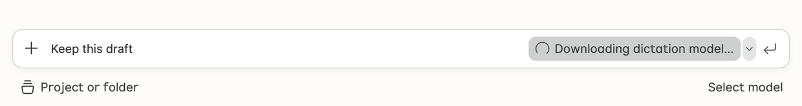
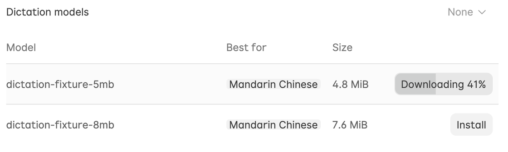

# Agent Window 组件构建

## 先确定页面约定

1. 从真实入口追到组件、所在宿主、现用变体和已有测试。找到 Agent Window 中一个职责相近的生产控件作为参照，核对它的调用参数和最终呈现。组件同名或共用基座时，仍按各自的页面角色判断。
2. 结合用户反馈、视觉参考和 [Agent Window 样式约定](../../../src/ash/sessions/STYLE.md)，写出本次需要验证的结果。新组件先确定区域、槽位及主要状态。修改已有组件时，区分外观、内容布局、锚点关系和交互，列出应保留的行为。页面有专属要求时按该页面判断通用默认值是否适用。
3. 先把意见转成可观察的关系，再选 token。例如「子菜单偏下」要比较首行与触发行的位置。「图标位置不对」要逐种菜单项核对动作图标、标签、快捷键、勾选和展开箭头所在的槽位。

## 选基座与变体

- 查找已有组件、变体和生产调用方。对照其输入、状态、焦点及释放行为，确认哪些可直接复用，哪些由页面组合。修改共享默认值前查所有受影响的宿主，尤其是 IDE 和 Agent Window 使用同一控件时。
- 用组件的实际职责选择实现。例如命令列表检查共享 `Menu`，带查询输入的选择器检查 `ActionWidget`，锚定与浮层生命周期检查 `ContextView`。优先通过现有变体表达页面需求；共享能力确实缺失时，在负责该行为的基座补齐并验证现有调用方。
- 菜单可用两种不同的图标布局。例如需要左侧动作图标与右侧勾选或展开箭头的菜单可用 `leading-with-trailing-check`；命令图标也需要放右侧的菜单可用 `trailing`。从当前页面的行语义选变体。
- 按任务使用 [设计](../design-philosophy/SKILL.md)、[无障碍](../accessibility/SKILL.md)、[布局](../ux-css-layout/SKILL.md) 和 [主题](../ux-theming/SKILL.md) 技能。涉及的业务状态继续由现有模型或服务持有。

## 图标

- 按入口的语义选择已注册的 `Lxicon`。按 [Agent Window 图标规范](../../../src/ash/sessions/STYLE.md#图标与点击区域) 核对控件角色对应的实际字形尺寸、窗口字体和选中态。
- 新增、更换或移除图稿时，按 [SVG 图标字体技能](../svg-icon-font/SKILL.md) 检查调用方并更新字体产物。以填充路径绘制的线框也要核对 Sessions 字体的轮廓分类。

## Learnings

- Agent Window 设置内容区的普通文字操作使用共享 `Button` 的 `secondary` 变体，例如 Install、Cancel 和 Manage accounts。由设置页统一提供默认浅灰底（深色主题使用对应的中性色）、悬停加深和无描边外观，保留键盘焦点环与高对比度描边。主操作、危险操作、纯图标按钮和进度指示使用各自的样式。
- 表单弹窗使用共享 `Dialog` 的 `form` 布局。共享组件拥有标题截断、正文和底部插槽的布局规则，Agent Window 的 `style.css` 提供窗口级尺寸变量和配色，各功能的 CSS 负责自己的弹窗尺寸、字段和内容滚动。
- 浮层外观依赖开关状态时，由持有生命周期的组件输出状态类。例如共享 `Dialog` 在自己的放弃确认打开时标记父弹窗，由 `dialog.css` 根据该状态切换遮罩。验收时同时覆盖确认打开、关闭恢复和无关模态打开的情况。

### 听写模型下载

- **从输入框启动听写。** 下载反馈和取消动作都放在原麦克风按钮上。下载时用转圈和「正在下载听写模型…」替换麦克风图标，模型就绪后才打开麦克风。再次激活按钮或在输入框按 Esc 可取消，取消后恢复麦克风按钮并保留草稿。

  

- **从设置 → 语音安装模型。** 每行的「安装」按钮原位显示实际百分比，准备期间按当前语言的状态文案预留宽度，确保百分比位数和「取消」文案切换时按钮保持同宽；空间不足时，由共享 `Button` 的短标签只显示百分比。填充沿用麦克风按钮的悬停灰色，从左向右推进，高对比度主题用按钮底部的细线显示进度。鼠标移开后再悬停，或用键盘聚焦，按钮显示「取消」，激活后停止下载。安装完成后，同一位置显示「卸载」，普通主题用浅红底和红字表达危险操作，采用无描边样式，高对比度主题用对比描边，键盘聚焦时显示焦点环。激活「卸载」后打开确认弹窗。

  

## 在真实呈现中验收

- 从正常入口打开控件，在本次构建的 Agent Window 中观察反馈所指的状态。用截图核对呈现，用浏览器几何、计算样式或交互断言验证具体要求。核对时直接测量目标元素，例如可见行、图标和焦点所在控件。
- 按改动选择容易出错的状态。图标布局应覆盖普通动作、已选与未选、展开项，以及本次涉及的子菜单。异步浮层应在占位和内容替换后分别测量；要求首行对齐时比较当前首行与触发行的边界，并区分视口避让导致的位移。若修改会影响窄窗口、深色或高对比主题、不同语言或键盘操作，覆盖相关变体。
- 把可稳定复现的回归放在组件所属测试中。几何和焦点关系用浏览器断言；需要组件截图覆盖时用 [组件 fixtures](../component-fixtures/SKILL.md)；需要确认实际窗口中的入口、组合或交互时用 [UI 场景验证](../validate-ui-scenario/SKILL.md)。结论写明实测范围和缺失的验证。
