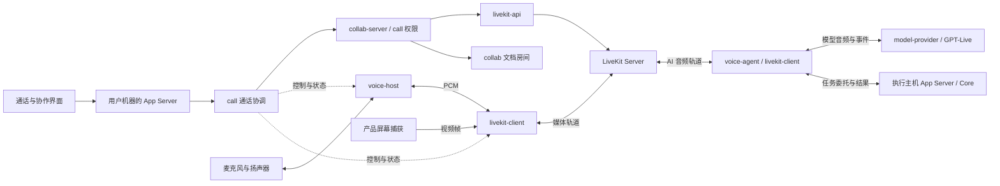

# 协作媒体与 AI 语音方案

Ash 的多人通话、屏幕共享和 GPT Voice 统一使用 LiveKit 房间。GPT Voice 以 AI 协作者身份入房，开发任务交给 Ash 既有 Agent 执行链；`realtime-webrtc` 从目标架构中移除。

- 状态：结构化文档协同编辑、多人通话和通话内文档关联已接入产品；单人 AI 语音已接入 Chat 与任务链。统一协作面板和频道树已接入 Workbench 与 Sessions，频道、成员及角色由协作服务器持久保存。每个频道已绑定共享笔记与可加入的通话，权限继承空间成员。整个代码项目共享、协作者跟随、多人房间 AI 尚未形成完整产品链路。
- 核对日期：2026-10-17；本次增加 macOS 上真实 LiveKit 频道通话、两个独立桌面配置和 EarPods 设备联调。此前 Windows x64 验收未复跑。
- 本文负责：功能命名与实现边界、crate 边界、部署、房间与权限、AI 接入、实施顺序和验收要求。
- 已新增 `call`、`livekit-client`、`livekit-api`、`voice-agent`，并删除无人调用的 `realtime-webrtc`。

### 功能命名与 Zed 对照

- **协作（Collaboration）**：多人共同工作的总称，包含频道、项目共享、协同编辑、语音和屏幕共享。
- **协作面板（Collaboration Panel）**：承载协作入口、频道和成员的界面。
- **频道（Channels）**：持久的团队协作空间，可以有子频道、成员、共享项目、语音和频道笔记。Zed 截图中红框的层级列表应称为“频道树”。
- **实时协同编辑（Real-time collaborative editing）**：多人同时编辑同一内容并同步修改、光标和选区，是协作中的一项能力。

Zed 左侧打开的 `rooms` 文本是频道笔记（Channel Notes）；频道笔记、频道树和共享代码项目分别承担不同职责。命名及能力范围依据 [Zed Channels](https://zed.dev/docs/collaboration/channels) 和[协作概览](https://zed.dev/docs/collaboration/overview)。

| 对照能力                       | Ash 当前实现                         | 边界与代码依据                                                                                                                                                                                                                                                                                                                                                                                                     |
| ------------------------------ | ------------------------------------ | ------------------------------------------------------------------------------------------------------------------------------------------------------------------------------------------------------------------------------------------------------------------------------------------------------------------------------------------------------------------------------------------------------------------ |
| 人类团队的频道树与统一协作面板 | 持久频道与成员权限已接入             | [CollaborationViewPane](../../../src/ash/workbench/contrib/collaboration/browser/collaborationViewPane.ts) 通过领域服务接入 App Server，再访问协作服务器的 [ChannelStore](../../collab/src/channels.rs)。支持多层树、搜索、创建、重命名、删除子树、邀请、角色变更与撤销访问。成员权限在整个空间内继承，SQLite 事务同时校验角色与版本；Calls 独立置于同一侧栏。Workbench 与 Sessions 共享入口，Agent Teams 保持独立 |
| 频道笔记                       | 每个频道固定一份持久笔记             | 双击频道或按 Enter 打开专用笔记编辑器，复用 Document Engine 的同步、重排与选区；owner/editor 可写，viewer 只读。Workbench 与 Sessions 使用同一份远端正文                                                                                                                                                                                                                                                           |
| 频道通话                       | 已绑定稳定通话身份并完成真实服务联调 | 频道入口加入已有通话；owner/editor 可在无通话时发起，viewer 仅加入收听。成员变化由服务端换代媒体房间，桌面自动重连；Browser 尚无媒体权限                                                                                                                                                                                                                                                                           |
| 结构化文档协同编辑             | 已有产品接线                         | [DocumentEditorPane](../../../src/ash/workbench/contrib/documentEditor/browser/documentEditorPane.ts) 接入同步 controller、邀请和成员管理；当前由 Academic 文档配置使用，包含并发变更重排、撤销/重做、远端选区和只读成员                                                                                                                                                                                           |
| 普通代码文件与整个项目共享     | 尚未接通                             | [Code 编辑器入口](../../../src/ash/workbench/contrib/codeEditor/browser/codeEditor.contribution.ts) 未装配文档协作连接；通话只关联独立文档引用，尚无共享项目的文件树、文件打开/保存/搜索与语言服务授权链路                                                                                                                                                                                                         |
| 光标选区与跟随协作者           | 选区同步已有；跟随尚未实现           | [文档协作 controller](../../../src/ash/editor/contrib/collaboration/common/controller.ts) 和富文档 widget 发布、显示远端选区；尚未同步协作者的活动文件和视口，也没有跟随入口                                                                                                                                                                                                                                       |
| 多人语音与通话内文档           | 已有产品接线                         | [Calls 面板](../../../src/ash/workbench/contrib/call/browser/callViewPane.ts) 提供创建、邀请、静音、收听、屏幕共享和文档关联；文档另行授权，打开时使用新的未命名工作副本                                                                                                                                                                                                                                           |
| 屏幕共享                       | 平台实现与验收不齐                   | 采集已有 macOS 和 Windows 后端，其他平台当前走不支持采集的 [fallback](../../screen-capture/src/fallback.rs)；既有产品端到端验收记录限 Windows x64                                                                                                                                                                                                                                                                  |
| AI 语音协作                    | 单人 Chat 已接入；多人房间待补       | [Voice 请求处理](../../app-server/src/server/request_processors/voice.rs) 创建“一名人类 + 一名 AI”的本地房间并绑定活动本地 Thread；[ChatWidget](../../../src/ash/workbench/contrib/chat/browser/widget/chatWidget.ts) 将委托交给原 Chat 的 mode、队列和审批链，尚无向任意多人通话邀请 AI 的产品入口                                                                                                                |

当前可确认的阶段是：持久频道树、成员权限、频道笔记和频道通话已接入；距完整团队协作空间，主要还缺代码项目共享、协作者跟随和在线状态。频道资源以空间成员为权限来源，独立文档和通话仍保留各自的邀请机制，Agent Teams 保持独立。

UI 入口：Workbench 命令面板的 `Open Collaboration`；Sessions Activity Bar 的 `Collaboration`。选择 `Connect Channels`，使用协作服务器地址和部署管理员凭据创建空间，或粘贴成员邀请加入。`Members and Permissions` 提供邀请、查看成员、变更角色及撤销访问；频道增删改写入服务器，重载后恢复。选中频道后可打开笔记或选择 `Join or Start Channel Call`；双击或 Enter 打开笔记，选择频道不会自动入会。通话仍由 `ICallService` 提供，须先离开当前通话才能进入另一频道。生产界面不提供本地样例频道；样例数据只存在于 UI 测试。

### 频道后端与权限

- **状态所有者**：`ash-collab` 的 `ChannelStore` 在协作服务器 SQLite 中保存空间、频道树、成员和角色。`ash-collab-contract::channels` 是共享契约；`ash-collab-server` 提供 `/v1/channels/{create,read,edit,invite,notes,call}`。不需要配置 LiveKit 即可使用频道和笔记。
- **调用链**：面板 → `IChannelService` → `AppServerChannelService` → 每个 Renderer 已有的 protocol client → Main 透明转发 → 共享 App Server → `ChannelAccount` → HTTPS 协作服务器。Main 不增加业务状态或新进程。Browser 使用相同领域 adapter；普通远端目录授权客户端不能读取本机频道凭据。
- **成员角色**：`owner` 在 UI 中称管理员，可管理频道和成员；`editor` 可创建、重命名、删除频道；`viewer` 只读。子频道继承整个空间的成员权限，当前没有子频道私有覆盖规则。不能降级或移除最后一名管理员，也不能自行移除当前身份。
- **凭据**：部署管理员凭据仅用于创建空间，不授予已有空间访问权限。每名成员使用独立的 256 位凭据，服务端只存 SHA-256 摘要；邀请凭据只在创建邀请时返回。本机通过已有 `SecretStore` 保存当前空间身份，启动和窗口重载可恢复。每个本机配置当前连接一个空间；切换会替换已保存身份。“复制我的登录密钥”用于私下备份和恢复同一身份；邀请另一人应发放独立邀请。
- **凭据存储设置**：若宿主无法访问系统钥匙串，在 Settings → Agents → Models 的现有凭据存储区域授权访问，或经确认选择私有文件存储。频道沿用该配置，不自动降级存储方式；无可用存储时连接操作失败并保留错误提示。
- **一致性与同步**：读取返回成员可访问空间的完整快照；修改携带 `spaceId` 和 `revision`，角色、版本及写入在同一 SQLite 写事务中完成。旧版本返回冲突，前端不会自动重发修改。可见面板或打开的频道笔记约每两秒读取一次，失败时退避到五秒并禁用频道修改；撤销访问会清空缓存树。最后一个订阅者释放后停止轮询。服务器对每次笔记读写独立校验权限，不依赖 UI 轮询。
- **边界**：服务器限制每空间 1,000 个频道、256 名成员、16 层树及 80 个 UTF-16 名称字符，拒绝重复同级名称、无效父级、控制字符和斜线。客户端只接受 HTTPS 服务 origin（本机开发可用 HTTP），禁止凭据 URL 和重定向，沿用应用网络访问策略。服务端重启或两个宿主共享 SQLite 时仍由数据库保证权限和并发更新。
- **尚未接入**：共享项目和文件、协作者跟随，以及成员在线状态。成员列表表示已授权身份，不表示在线人数。

### 频道笔记与通话绑定

- **资源身份与凭据**：App Server 的 `channels/notes`、`channels/call` 使用已保存空间身份换取当前成员的单资源凭据。稳定 ID 分别为 `channel-notes-<channelId>`、`channel-call-<channelId>`；凭据不进入编辑器 URI、普通设置或通话快照。SQLite 保存绑定与凭据摘要，客户端断开不删除笔记。删除频道保留不可访问的绑定，避免旧凭据重新创建资源。
- **笔记**：`SqliteDocumentCollaborationRooms` 保存正文、版本和操作记录。首次打开使用服务器空白文档，不接受客户端植入初稿；频道 owner/editor 映射为文档 editor，viewer 映射为只读，不能通过独立文档邀请修改频道权限。每次提交、重放和长轮询都检查当前成员。界面沿用远端文档传输和本地重排引擎；服务器确认的版本更新工作副本保存基线，未确认输入仍为 dirty，不把新输入误标为已保存。连接失败或权限变化时停止编辑并保留本地改动；重新从频道打开可重新取得权限，已有未保存内容不会被覆盖。
- **通话**：`CallStore` 在同一数据库事务中读取频道成员；owner/editor/viewer 分别映射 owner/speaker/listener。并发发起收敛到同一通话；结束后可重新发起并增加媒体代次。通话快照中的成员是已授权媒体状态的派生记录，权限来源始终是频道。成员移除或角色改变触发旧媒体房间清理、换代和重新入房；失败时暂停授权并由服务端恢复。频道通话不开放独立邀请或角色修改，统一从空间成员管理操作。
- **宿主与部署**：Workbench 和 Sessions 注册相同频道笔记编辑器，支持 Desktop 和 Browser。笔记的浏览器请求要求服务端 `ASH_COLLABORATION_ALLOWED_ORIGIN` 包含实际 renderer origin；通话还要求部署 LiveKit。Browser 当前没有本地媒体授权，频道通话按钮会禁用并说明使用桌面应用。现有独立通话文档引用仍需独立文档授权，不会因加入频道通话而扩大访问。

### 当前实现与验收

下表保留此前已记录的真实 LiveKit 和 Windows x64 验收；“已有接线”表示当前代码已连接相应产品路径，不代表本次完成真机或真实模型验收。本次实际执行结果见本节末尾。

| 能力                                      | 当前结果                                                                                                                                                    |
| ----------------------------------------- | ----------------------------------------------------------------------------------------------------------------------------------------------------------- |
| LiveKit 双向音频                          | 真实 Server 1.13.7 与 LiveKit 信令、`webrtc-rs`、Opus 收发测试通过                                                                                          |
| 成员邀请、撤销、角色变更、房间换代        | SQLite 测试与真实服务 HTTP 测试通过                                                                                                                         |
| GPT-Live 会话协议                         | 已有本地 WebSocket 契约测试覆盖；本次未执行真实模型账户验收                                                                                                 |
| AI 混音、重采样与播放清理                 | 单元测试通过；真实 LiveKit + 本地 GPT-Live 模拟服务的三项桥接测试通过                                                                                       |
| 自建服务接入                              | HTTP 宿主接受部署者的 LiveKit 地址和密钥                                                                                                                    |
| 设备发言权                                | 同一成员只向选中设备签发麦克风权限；切换设备更换房间，双 SQLite 宿主竞争测试通过                                                                            |
| 成员通知                                  | HTTP 按修订号等待，App Server 向所属窗口发送 `call/changed`                                                                                                 |
| 文档房间关联                              | 已接入通话快照中的文档引用、所有者关联/移除、独立凭证和新未命名工作副本打开；项目共享仍待实现                                                               |
| App Server 与 UI                          | 通话资源归连接所有；面板提供创建、加入、静音、收听、邀请和离开                                                                                              |
| Core 任务执行                             | 单人语音委托已从 `voice/delegation` 经原 Chat 进入现有任务链，并关联队列、Turn 进度和播报；多人房间委托与真实模型端到端仍待验收                             |
| 本地媒体服务与产品打包                    | 固定版本服务器与助手随包分发；本地通话持有服务进程，最后一个通话释放时回收                                                                                  |
| 屏幕共享                                  | macOS、Windows 已有采集实现；此前 Windows 采集、缩放与停止、真实 LiveKit 视频收发和重复发布测试通过，Windows x64 双窗口产品端到端测试通过；Linux 采集未实现 |
| 真实设备、三平台、公网 NAT、真实 GPT-Live | Windows x64 屏幕共享、macOS ARM64 + USB EarPods 单机双客户端音频已验收；Windows ARM64、跨机器／公网 NAT 与真实 GPT-Live 仍待验收                            |

2026-10-17 真实频道通话联调：

- 环境：macOS 27.0.1（26A434）、Apple ARM64、LiveKit Server 1.13.7；本机回环服务使用 HTTP/WS，媒体通过真实 WebRTC/UDP、Opus 收发。两个 Electron 客户端各有独立用户配置、App Server 和频道成员凭据。
- `livekit-client/tests/channels.rs`：实际启动协作服务和 LiveKit，用两个独立媒体进程验证加入同一频道、双向可辨识音频、静音和恢复，以及 10/20 ms 输入包切换。降为 Viewer 后主动断开旧房间、禁止发布但仍能收听；移除成员后 HTTP 授权拒绝，并验证缓存的发言者、收听者票据不能访问新房间音频。该用例已加入媒体 CI。
- `test/smoke/areas/call/channel-call.spec.ts`：真实双 Desktop 配置从频道树入房，默认静音、双方开麦和状态同步、停止／恢复收听、降级后的自动重连、移除成员和结束通话。测试通过实际系统音频设备，不注入模拟设备服务。
- EarPods 实测：USB 麦克风为系统默认输入（44.1 kHz，由设备进程转换到 48 kHz），收到 59 帧有效麦克风输入，另一客户端解码到 117 帧，502 帧可辨识返回测试音送入实际输出设备。用户确认耳机听到了测试音并已说话；不保存录音。输入 20 ms、网络解码 10 ms，因此收发帧数不同。
- 联调修复：开麦失败后恢复原来的播放会话；旧媒体进程因服务端断开退出后，Close 等待其清理结果，允许客户端正常切换媒体代次；Opus 编码使用固定 10 ms 帧，避免输入包长切换造成声音衰减。
- 复跑命令、物理设备测试开关与明确的无麦克风验收模式见 [LiveKit 客户端说明](../../livekit-client/README.md#频道通话联调)。这次是同机双客户端；跨机器、公网 NAT/TURN、蓝牙切换、长期通话稳定性仍须单独验收。

此前频道笔记与通话绑定增量验证：

- Rust：`ash-collab` 10 项、`ash-call --features runtime` 15 项、`ash-collab-server --lib` 10 项通过。真实 HTTP/SQLite 测试覆盖多人笔记读写、并发冲突、持久恢复、只读与撤权，以及频道通话并发发起、结束后重开、权限换代、准备阶段降权和媒体清理失败后恢复。通话房间管理使用测试媒体服务；本次未复跑真实 LiveKit/WebRTC 或麦克风设备验收，两项相应测试保持忽略。
- 协议与宿主：协议生成及 157 项协议/导出契约测试通过；频道 RPC 定向测试覆盖新增两种资源请求的配置身份与连接授权。Protocol、Renderer、automation 类型检查通过；`ash-collab`、`ash-call` 完整 verify、协作服务器和 App Server warnings 检查，以及依赖审计通过。
- 前端：频道服务、文档 pane、同步 controller、Sessions 布局共 64 项单测通过。覆盖迟到凭据丢弃、服务器确认的保存基线、后续未确认输入保留、未命名文档不访问文件提供者，以及恢复后的已有笔记展开。13 项 Chromium 协作面板测试通过，包含中英文、主题和频道通话入口。中文词条检查为 0 缺失。
- 产品流程：Electron App Server 与 Browser App Server 各 1 项完整测试通过，覆盖频道创建、笔记写入、Workbench/Sessions 读取与修改、协作服务重启和窗口重载后的正文恢复，以及成员撤权。Electron 验证两个实际窗口；Browser 在同一页面切换产品入口并重新连接。
- 验证边界：浏览器集成套件的全量 TypeScript 前置检查仍受现有 `terminal.integration.ts`、`chatInput.integration.ts` 的 9 项类型错误阻塞；13 项交互测试使用同一个 `test/integration/browser/run.ts` 直接构建并执行。不能据此声称整个浏览器测试工程类型检查通过。

此前频道、独立文档与媒体接入记录：

- 频道后端接入：当前 `collaboration.integration.spec.ts` 的 12 项 Chromium 测试通过，覆盖原频道操作、中英文及主题，并新增成员邀请、角色变更、撤权、只读和无频道能力宿主。`appServerChannelService.test.ts` 的 2 项测试通过，覆盖版本冲突不重放、撤权清理、相同版本不重建视图、最后视图隐藏后停止轮询及 dispose 后忽略响应。Protocol、Renderer 和 automation 类型检查通过，中文词条检查为 0 缺失。
- 频道服务：`ash-collab` 10 项测试通过；`ash-collab-server --lib` 8 项通过、1 项忽略（真实 LiveKit）。新增测试使用独立 SQLite 连接及真实 HTTP 客户端验证成员、空间权限、旧版本冲突、并发写入、凭据备份恢复与持久撤权。
- 协议：`just generate-protocol` 和 `just test ash-app-server-protocol --features export` 通过（148 项库测试及 9 项导出、解码和契约测试），依赖审计通过。
- App Server：频道 RPC 定向测试通过，覆盖产品窗口与 Browser 访问、无效服务地址、共享配置的断开操作，以及未授权连接被拒绝。
- 编译检查：`ash-collab` 的完整 `just verify` 通过；`ash-collab-server`、`ash-app-server-protocol`、`ash-app-server` 的 `just rust-warnings`（含所有测试目标）通过。
- 频道产品流程：`collaboration-backend.spec.ts` 在 Electron App Server 和 Browser App Server 各 1 项通过，覆盖创建空间、跨 Workbench / Sessions 窗口读取、只读邀请、服务与应用重开恢复、撤权后 HTTP 403。Browser 使用现有设置 UI 为隔离测试配置显式选择私有文件凭据存储，未改变产品默认值。
- 频道 UI 首版：`collaboration.integration.spec.ts` 的 10 项 Chromium 测试通过，覆盖中英文、浅色/深色/两种高对比度、窄侧栏、搜索与折叠恢复、创建子频道、同名/长度校验、键盘重命名、子树移除及无 Calls host；通话使用测试服务，未调用真实媒体设备。
- 整窗入口：`test/smoke/areas/sessions/collaboration.spec.ts` 在 Browser UI 和 Electron UI 各 1 项通过，验证 Workbench 命令入口、Sessions 协作入口、Agent Teams 独立导航与视图保留。Renderer 与 automation 类型检查、中文词条校验和相关 CSS 检查通过。
- UI 相关定向单测：Calls 与 SessionsLayoutService 共 12 项通过。整仓测试编译遇到无关的 `workbenchSessions.contribution.test.ts` 导入 `getChatInputChanges` 不存在的问题；使用继承 `tsconfig.test.json` 编译选定测试后执行，不能将此结果表述为整仓单测通过。
- 前端：通过 `pnpm test:unit` 的 `--run` 选择编辑重排、同步 controller、文档服务、工具栏、文档 pane 和 Calls，共 9 个文件、79 项通过；随后使用 `pnpm test:unit:no-compile` 运行语音控制与朗读命令，共 2 个文件、17 项通过，合计 **96 项通过**。
- Rust：`just test ash-collab -p ash-collab-server -p ash-call --features ash-call/runtime --lib` 重跑后 **29 项通过、2 项忽略**；忽略项需要显式提供真实 LiveKit 或协作服务程序。
- 此前跨宿主测试出现过响应头缺失的间歇失败；此次频道 HTTP 联调也遇到连接提前关闭。连接处理现已显式清除 macOS/BSD 从监听 socket 继承的非阻塞模式，保证工作线程等待分段请求。新增强制非阻塞 socket 的分段请求回归，以及原跨宿主测试均通过。

## 1. 架构决定

| 决定                            | 结果                                              |
| ------------------------------- | ------------------------------------------------- |
| 所有通话进入 LiveKit 房间       | 单人与 AI 对话、多人讨论使用同一条媒体路径        |
| GPT Voice 是房间参与者          | 可以被邀请、移除、静音，并显示运行状态            |
| 使用 LiveKit 信令和 `webrtc-rs` | Ash 管理房间、轨道和媒体编解码，移除 `webrtc-sys` |
| 保留 `voice-host`               | 专门处理用户机器上的音频设备和音频处理            |
| 移除 `realtime-webrtc`          | 不再维护单独的点对点语音产品路径                  |
| 支持用户自建服务                | Ash 不要求用户依赖 Ash 运营的公共媒体服务器       |
| 单机由产品管理本地服务          | 用户无需先租服务器，也能使用同一套房间架构        |
| 开发任务沿用 Ash 执行链         | 房间成员身份不等于工作区、文件或工具权限          |

LiveKit 的 SFU（选择性转发服务器）负责将参与者发布的音视频轨道转发给订阅者。`livekit-client` 使用 LiveKit 的信令 crate 接入房间，用 `webrtc-rs` 建立媒体连接，并自行处理 Opus 与 VP8 帧。[SFU 架构](https://docs.livekit.io/reference/internals/livekit-sfu/)、[LiveKit 信令](https://github.com/livekit/rust-sdks)、[webrtc-rs](https://github.com/webrtc-rs/webrtc)

### 学习 Zed 的范围

| Zed 的做法                                | Ash 的取舍                                         |
| ----------------------------------------- | -------------------------------------------------- |
| 通话业务、LiveKit 客户端、服务端 API 分开 | 采用这一能力和依赖边界                             |
| 通过协作服务返回房间地址与入房凭据        | 采用；地址由用户自己的部署配置提供                 |
| 音频采集、播放和回声处理仍有应用侧实现    | 保留 Ash 的 `voice-host`，明确音频处理的唯一负责人 |
| `call` 与 GPUI、项目界面结合              | Ash 的共享领域层保持无 UI 依赖                     |

依据是 Zed 的 [call](https://github.com/zed-industries/zed/tree/main/crates/call)、[livekit_client](https://github.com/zed-industries/zed/tree/main/crates/livekit_client)、[livekit_api](https://github.com/zed-industries/zed/tree/main/crates/livekit_api) 和 [collab](https://github.com/zed-industries/zed/tree/main/crates/collab)。这是职责设计参考，不是应用代码移植。独立音频设备进程也不是 Codex 特有机制；是否保留取决于设备故障隔离和生命周期管理。

本方案选择 LiveKit，是因为 Ash 要把多人开发协作和 AI 放进同一房间；这不是对 Zed、Codex、VS Code 或 Warp 的通用性能排名。

## 2. 当前基础与待补能力

| 当前实现                                         | 已有职责                                                                            | 本方案需要补充或调整                                                                         |
| ------------------------------------------------ | ----------------------------------------------------------------------------------- | -------------------------------------------------------------------------------------------- |
| [collab](../../collab/README.md)                 | 结构化文档房间、操作顺序、回放、presence、独立文档授权                              | 普通代码文件的协作接线和项目共享尚待补充                                                     |
| [collab-server](../../collab-server/README.md)   | 文档协作 HTTP、鉴权、SQLite、持久频道树、空间成员与继承权限、通话权限与媒体房间管理 | 频道笔记与通话绑定尚未接入                                                                   |
| [voice-host](../../voice-host/README.md)         | CPAL 设备、PCM 管道、Sonora 音频处理，已接入 LiveKit 通话                           | 完善真实设备、蓝牙与切换验证                                                                 |
| `realtime-webrtc`（已删除）                      | 原单条双向音频连接、Opus、数据通道                                                  | 双向音频改由 `livekit-client` 对真实 LiveKit Server 验证；自维护 RTP 播放与数据通道 API 退场 |
| [model-provider](../../model-provider/README.md) | 模型选择、凭据和语音模型会话装配                                                    | 真实模型账户、计费与语音质量验收                                                             |
| App Server 与 Core                               | 通话装配、语音转写持久化、单人语音委托与 Thread/Turn 进度关联                       | 多人 AI 的任务归属、远程执行目标和完整产品验收                                               |

当前 `collab` 的 room 是文档房间，并不代表一组人的完整协作会话。原 `realtime-webrtc` 不是 LiveKit 客户端；删除前已核对没有其他生产 crate 依赖它。

现有 Realtime 模型会话与 GPT-Live 是不同 API 契约。实现时新增对应协议能力，不能只替换模型名称并沿用旧事件含义。

## 3. Crate 划分

下表列出媒体与文档实现的 **7 个 crate**。文档房间和通话的共享数据类型分别由 [`collab-contract`](../../collab-contract/src/lib.rs) 与 [`call-contract`](../../call-contract/src/lib.rs) 拥有，App Server 协议和业务实现共同消费这些契约。已有 App Server、Core、模型与凭据 crate 继续复用。

| Crate            | 状态 | 唯一职责                                             | 主要依赖边界                         |
| ---------------- | ---- | ---------------------------------------------------- | ------------------------------------ |
| `call`           | 新增 | 协作通话身份、成员权限、房间生命周期、客户端通话协调 | 不引入 UI、WebRTC 或设备驱动         |
| `livekit-client` | 新增 | LiveKit 信令、WebRTC 连接、轨道、媒体帧、连接状态    | 隔离媒体协议与编解码依赖             |
| `livekit-api`    | 新增 | 房间管理、票据签发、参与者权限、服务事件校验         | 复用官方服务端 SDK；不引入媒体客户端 |
| `voice-agent`    | 新增 | AI 参与者、多人输入、模型会话、语音与开发任务衔接    | 依赖媒体客户端和模型能力；不打开设备 |
| `voice-host`     | 保留 | 本机采集、播放、设备切换、回声与降噪                 | 隔离 CPAL、重采样与音频处理依赖      |
| `collab`         | 保留 | 文档操作、版本、回放、presence 与文档权限            | 不承担通话媒体与模型调用             |
| `collab-server`  | 扩展 | 用户自建协作服务入口，装配文档和通话领域             | 不承担客户端设备或开发工具执行       |

### 装配与依赖约束

- `call` 定义业务需要的媒体、设备和服务管理接口；具体实现由宿主注入，避免服务端因复用成员规则而链接 WebRTC 媒体栈。
- `livekit-client` 同时服务人类客户端和 AI 参与者，公开轨道与帧接口，不依赖 `voice-host`、UI 或具体模型。
- `livekit-api` 负责 LiveKit API 适配；成员能否入房由 `call` 判断，密钥由已有凭据存储提供。
- `voice-agent` 产生任务委托提议并接收宿主提供的任务进度说明；App Server 通知原 Chat，由其提交任务，不复制 Core 的工具循环、权限审批或 Thread 存储。
- App Server 只做产品装配、协议转换和资源绑定；通话规则归 `call`，AI 音频协调归 `voice-agent`。
- `src` 与 `app` 消费共享业务协议；不通过 `ash-code` 启动或调用这些能力。

`voice-agent` 单独成 crate，是为了隔离模型与媒体的组合依赖和生命周期。它默认由选定执行主机的 App Server 托管，不要求用户额外部署一个 AI 服务。

## 4. 运行拓扑



- 用户端只向房间发布一份麦克风轨道；AI 输出也作为一条房间轨道供其他成员订阅。
- 单人语音是“一名人类 + 一名 AI”的房间，走同一条链路。
- 音频设备始终归用户机器；选择远程工作区不会把麦克风迁到远程主机。
- AI 运行在邀请时选定的执行主机，模型凭据也在该主机解析。SFU 不持有模型密钥。
- 屏幕捕获及系统权限由产品宿主提供，`livekit-client` 负责发布帧；共享文档仍走文档协议。
- 房间成员、静音状态和任务状态走控制协议；PCM、视频帧不经过 App Server JSON 请求和通知。

### 身份与状态

| 身份                          | 含义与负责人                               |
| ----------------------------- | ------------------------------------------ |
| `callId`                      | 一次可跨文档协作的通话，由 `call` 管理     |
| `documentRoomId`              | 一个文档的同步与授权范围，由 `collab` 管理 |
| `mediaEpoch` / LiveKit room   | 当前媒体房间代次，由通话权限服务分配       |
| `memberId`                    | 已认证的人类或 AI 成员身份                 |
| `participantId`               | 某成员的一次设备连接；映射由服务端建立     |
| `agentId` / `executionHostId` | AI 实例与明确选定的执行主机                |
| `threadId` / `turnId`         | Core 中的开发任务及其运行轮次              |

- 一个通话可以关联多个文档；加入通话不会自动取得这些文档的编辑权限。
- 一个成员可有多个设备连接；默认只允许一个连接发布麦克风，切换时撤销旧连接的发布权。
- 通话服务保存成员、权限、媒体代次与修订号；本机 `call` 运行时保存连接和设备资源，不复制服务端权威状态。
- LiveKit 的在线状态和轨道列表只是媒体事实，不能替代 Ash 的成员权限表。
- UI 使用带修订号的快照与事件更新；重连先取得有效快照，旧代次事件直接失效。

## 5. 自建服务与本地使用

| 方式                  | 运行位置                                | 使用方式                           |
| --------------------- | --------------------------------------- | ---------------------------------- |
| 产品管理本地服务      | 本机协作服务 + 本机 LiveKit Server      | 单人或本机开发，产品负责启动和关闭 |
| 用户自建团队服务      | 用户服务器上的协作服务 + LiveKit Server | 配置团队入口，成员通过邀请加入     |
| 用户已有 LiveKit 服务 | 协作服务连接指定 LiveKit 部署           | 管理员配置媒体地址与服务端凭据     |

### 配置边界

- 普通成员配置协作服务入口；入房时取得该服务授权的媒体地址，不需要掌握 LiveKit 管理密钥。
- 管理员配置 LiveKit 对外信令 URL、服务端 API 入口和凭据引用；可使用自选域名与端口。
- 外网部署还要配置媒体 UDP/TCP、TURN 和公布给客户端的地址；一个 HTTP 转发端口不能代替这些设置。[部署与端口](https://docs.livekit.io/transport/self-hosting/ports-firewall/)
- 配置在保存边界校验地址、凭据可用性和版本兼容性；不自动扫描端口或连接未经选择的服务。
- 秘密值沿用 [secrets](../../secrets/README.md) 及消费领域的凭据规则，界面配置只保存引用。

### 本地服务生命周期

1. 首次进入通话时，由本机 App Server 装配的运行时启动固定版本的协作服务和 LiveKit Server。
2. 为本机实例生成私有凭据，默认只监听回环地址；就绪探测成功后才允许入房。
3. 按安装布局定位程序，记录进程归属；端口占用、版本不符或启动失败返回明确错误。
4. 通话关闭后按资源引用释放媒体；产品退出时关闭自己启动的服务并等待进程结束。
5. 重启时核对遗留实例的归属，禁止结束仅因占用同一端口而被发现的第三方进程。

LiveKit 官方支持本地启动，但跨平台随产品分发、签名、升级与进程回收仍需 Ash 实现并验证。本地产品使用正式私有配置，不使用开发示例中的公共密钥。[本地服务说明](https://docs.livekit.io/transport/self-hosting/local/)

团队服务持续运行，不随某个客户端退出。本地服务的管理不改变现有 App Server 与 daemon 的依赖方向。

## 6. 入房 API 与权限收回

下表是目标能力契约；具体线上类型由所属协议生成器维护。音频通话已提供 `call/start`、`call/read`、`call/control`、`call/leave`、`call/end`、`call/invite`、`call/remove`、`call/role` 和 `call/changed`；屏幕共享增加 `call/screenSources`、`call/screenFrames` 和共享控制，字段与限制见 [App Server 协议](../../app-server-protocol/README.md#通话屏幕共享)。单人语音另有 `voice/options`、`voice/start`、`voice/start/cancel`、`voice/read`、`voice/input`、`voice/interrupt`、`voice/stop` 和 `voice/delegation/reject`，以及 `voice/changed`、`voice/delegation` 通知，见 [Voice 协议](../../app-server-protocol/src/protocol/voice.rs) 与[注册表](../../app-server-protocol/src/protocol/registry.rs)。它们尚未提供向任意多人通话邀请 AI 的能力。

| 能力           | 输入重点                             | 结果与约束                           |
| -------------- | ------------------------------------ | ------------------------------------ |
| 创建通话       | 操作 ID、关联资源、部署选择          | 返回 `callId` 和初始修订号           |
| 加入通话       | `callId`、设备连接 ID、操作 ID       | 验证身份，返回成员能力和媒体连接信息 |
| 读取与订阅状态 | `callId`、已知修订号                 | 快照与续接点一致，不漏事件           |
| 更新成员权限   | 成员 ID、目标权限、预期修订号        | 服务端串行应用，返回操作状态         |
| 邀请 AI        | 模型配置引用、执行主机、任务权限范围 | 创建明确归属的 AI 实例               |
| 退出或结束通话 | 连接或通话 ID、操作 ID               | 区分个人退出与结束整个通话           |
| 停止 AI 播放   | AI ID、输出代次                      | 停止发布旧音频，清空对应播放缓存     |
| 取消开发任务   | `threadId`、`turnId`                 | 使用既有任务取消语义                 |

- 协作服务以版本化 HTTP API 提供远程入房能力；本地产品通过 App Server 的 typed API 调用同一领域规则。
- 入房结果包含 `serverUrl`、短期 `participantToken`、到期时间、`participantId`、`mediaEpoch` 与授予的能力；凭据只交给负责连接的后端媒体客户端。
- 成员身份由已认证连接推导；客户端不能自行声明 owner、AI 身份或任意 room 名称。
- 发布麦克风、发布屏幕、订阅媒体、邀请 AI、管理成员分别授权；默认不允许远程开启用户麦克风。
- 修改使用独立操作 ID 去重；请求超时后查询操作结果，不能盲目重复邀请 AI 或重复创建房间。
- 长期 UI 订阅按 renderer connection 绑定；关闭一个窗口只释放其资源，不中断其他窗口或成员。
- Main 保持透明转发；生成类型与解码器由 [App Server 协议](../../app-server-protocol/src/protocol/collaboration.rs) 的既有机制扩展。

### 自建服务的撤销语义

LiveKit 自建部署不能把“踢出参与者”当作“旧 token 立即失效”；连接中的 token 还可能被自动刷新。只缩短最初票据的有效期不足以证明权限已彻底收回。[票据生命周期](https://docs.livekit.io/frontends/reference/tokens-grants/)

因此，Ash 对移除成员或缩减媒体权限采用统一的媒体代次切换：

1. 通话服务先保存目标权限和正在切换的操作状态，停止为旧代次签发票据。
2. 关闭旧 LiveKit 房间并确认媒体连接被切断；关闭失败时操作保持未完成并报告原因。
3. 分配新的不可预测 room 名称，仅为仍获授权的成员签发新代次票据。
4. 成员重新发布轨道，恢复同一个 `callId`；已退出成员的旧票据不能进入新房间。
5. 服务重启后先完成未结束的权限操作，再开放相关通话。旧代次不得再次成为当前房间。

这一设计会让其他成员经历一次媒体重连，应显示明确状态。旧票据可能重新创建旧的空房间，但授权成员和 AI 不再向那里发布内容；空房间治理与请求限流由部署管理负责。验收需要使用缓存票据和自动刷新的票据重入，不能只测试正常客户端退出。

## 7. GPT Voice 作为协作者

### 模型与执行链

当前生产接线由 Chat 启动：App Server 创建本地通话，验证房间内恰好一名人类和一名 AI，并绑定原活动本地 Thread。模型提出委托后，App Server 通知原 Chat；Chat 使用已有 mode、队列、权限和审批提交任务，App Server 再按同一 command ID 查询任务进度并发送给语音模型。转写写入原 Thread，切换 Chat 会停止该语音会话。多人房间、SSH 或其他远程执行目标仍属于待补能力。

GPT-Live 支持持续双向语音，并将需要推理或工具的工作委托给另一个执行方。Ash 选择由自己接管委托；模型音频通过服务端 WebSocket 接入，房间这一侧仍统一使用 LiveKit。[GPT-Live 接入](https://developers.openai.com/api/docs/guides/live)

```text
人类音轨 → LiveKit → voice-agent → model-provider → GPT-Live
GPT-Live 委托 → voice-agent → App Server 通知 → 原 Chat 任务提交 → Core Thread / Turn
任务进度与结果 → voice-agent → GPT-Live → AI 音轨 → LiveKit → 房间成员
```

- `ash-api` 拥有 GPT-Live 的线上消息；`ash-client` 与既有传输 crate 负责协议会话及连接；`model-provider` 负责配置、凭据与调用装配。
- `voice-agent` 将模型事件与房间、成员和执行上下文关联，创建可追踪的任务委托。
- 工具执行沿用已有权限、审批和沙箱；模型输出、转写文字和房间数据消息都不能直接变成系统命令。
- 每个 AI 实例明确绑定执行主机、项目范围、模型配置和授权者。切换主机必须重新建立执行绑定。
- 模型用量和任务用量沿用现有统计；退出、启动失败或连接终止时明确结束模型会话。

LiveKit 的现成 GPT-Live 插件面向 Python 和 Node.js，不是 Rust SDK 自带的能力。本方案用 Rust 实现 Ash 所需的参与者协调和 API 接入；参考插件的上下文与委托语义，不额外引入一套产品后端。[插件说明](https://docs.livekit.io/agents/models/realtime/plugins/gpt-live/)

### 多人输入与任务归属

LiveKit Agents 的默认会话通常关联一名参与者，不能据此认定整个房间已具备多人 AI 对话。Ash 必须显式订阅和处理允许送给 AI 的人类轨道。[关联参与者](https://docs.livekit.io/agents/logic/sessions/#linked-participant)

- 每条输入轨道保留 `memberId`、`participantId` 和时间戳；只合成当前获授权的人类麦克风音轨。
- 混音器以统一时钟对齐输入、限制增益与缓存，将音频送入一个 GPT-Live 会话；适配层按模型要求转换采样率。
- 排除 AI 自己的输出及其他 AI 输出，避免循环；屏幕共享中的系统音频须单独授权。
- 混合音频不自动携带可靠的说话人身份。显示与任务归属使用轨道来源证据，不根据声音猜身份。
- 对归属明确且持有任务控制权的成员，按其已有权限执行委托；多人重叠或来源不明时产生任务提案，由已认证成员认领后进入执行链。
- 委托事件不能被当作已经解析好的工具参数；结合当前转写与会话上下文生成任务，并按委托 ID 关联进度和最终结果。
- 进入有 AI 的房间时明确显示哪些音频会送往模型服务。文档内容与任务结果只有在获授权的共享范围内才能播报。

### 停止、离开与上下文

- “停止说话”停止发布当前 AI 音频，通知客户端清除该 AI 的旧播放代次；它不承诺远端模型已停止生成。
- “取消任务”通过已有 `turn/interrupt` 等执行接口处理；停止播放不隐式撤销开发任务。
- 移除 AI 会结束房间参与和模型会话；已经接受的任务仍由 Core 管理，并在原任务界面显示结果。
- 最后一名人类离开后结束语音会话；如需保留开发任务，使用已存在的后台任务生命周期。
- 持久化开发任务归 Thread；通话转写不是第二份任务数据库，保存范围与保留时间需要明确配置。

GPT-Live 当前支持文本和音频，不支持图像或视频输入。人类之间可共享屏幕；AI 需要理解画面时，由已授权的任务链调用具备视觉能力的模型，不能宣称“加入房间就自动看懂屏幕”。[模型能力](https://developers.openai.com/api/docs/models/gpt-live-1)

## 8. 音频与视频边界

| 环节                           | 负责人           | 要求                                 |
| ------------------------------ | ---------------- | ------------------------------------ |
| 设备格式与采样率转换           | `voice-host`     | 设备回调只做有界读写                 |
| 回声消除与降噪                 | `voice-host`     | 使用实际播放样本作回声参考           |
| 编解码、丢包处理与网络抖动缓冲 | LiveKit SDK      | 不再保留第二套自制网络音频管线       |
| 远端轨道选择、音量与混音       | `livekit-client` | 保留来源，按统一播放时钟输出         |
| 模型输入混音与输出发布         | `voice-agent`    | 与物理设备无关，不重复做设备回声处理 |
| 屏幕捕获与显示                 | 产品宿主         | 系统授权、帧生命周期和停止共享可验证 |

- 通话设备链使用 48 kHz；`voice-host` 当前 20 ms PCM 帧在适配处转换为 Opus 输入，不把帧大小当作网络协议。
- 回声、降噪和增益处理只由 `voice-host` 执行，媒体连接不重复处理。
- 每条轨道与跨进程队列有容量、时间戳和代次；音频过期按明确策略丢弃并计数，控制指令不能静默丢失。
- 切换设备、静音、停止共享和重连都会使相关旧帧失效；音视频资源关闭后不得继续向 UI 或设备发送事件。
- 记录端到端延迟、队列时长、丢帧、欠载、重连原因和音频处理耗时；诊断日志不记录 token 或原始音频。
- 视频走媒体帧通道与 WebRTC，JSON 只传资源句柄和控制状态；不要把视频帧编码成业务通知。

## 9. 实施顺序与退场范围

以下顺序用于交付同一个最终架构，不形成两套长期运行路径。

1. **确定媒体与构建依赖。** 固定 LiveKit 信令、`webrtc-rs` 和服务端版本，验证三平台构建、媒体帧 API 及打包依赖。
2. **实现通话与服务端能力。** 新建 `call`、`livekit-api`，扩展 `collab-server` 的成员、入房与媒体代次管理。
3. **实现媒体客户端。** 新建 `livekit-client`，接通 `voice-host`、多人轨道、屏幕共享和真实服务测试。
4. **实现 AI 参与者。** 新建 `voice-agent`，补 GPT-Live 协议与模型能力，接入明确归属的开发任务链。
5. **接入产品。** 完成生成协议、通话 UI、本地服务管理、自建服务器配置与安装包资源。
6. **完成旧实现退场。** 删除 `realtime-webrtc` 及其专属依赖、构建与测试入口，更新相关文档。

### `realtime-webrtc` 删除清单

- 删除 crate 目录、根 workspace member 和只由它使用的依赖，重新生成所属 lockfile。
- 检查 Cargo、Bazel、依赖检查、打包脚本与 CI，不留下失效目标。
- 更新 `voice-host` README 中旧媒体调用方与网络职责的描述。
- 将双向真实音频、有界缓存、连接关闭和异常中断的必要覆盖落到新链路；不能只删除旧测试。
- 不因名称中包含 Realtime 就删除模型 API：模型协议适配与待移除的 WebRTC crate 是不同职责。
- 以完整引用检索和依赖检查确认退场；保留其他 crate 仍使用的第三方库。

## 10. 验收标准

| 范围       | 必须验证的真实行为                                                     |
| ---------- | ---------------------------------------------------------------------- |
| 多人媒体   | 真实 LiveKit Server 上至少三名人类双向收发、独立静音、入退房与屏幕共享 |
| AI 协作者  | 人类与 AI 双向音频；加入、移除、多人重叠、来源不明和防音频循环         |
| 开发任务   | 语音委托进入真实 Thread / Turn；权限拒绝、审批归属、进度回传和取消     |
| 授权撤销   | 缓存与刷新 token 重入、媒体代次切换、旧房间关闭失败、服务重启恢复      |
| 异常网络   | 公网 NAT、UDP 受阻、TCP/TURN、断线重连；证明无重复 AI 或任务           |
| 真机音频   | macOS、Windows、Linux 的权限、设备切换、蓝牙、回声和连续双向说话       |
| 本地服务   | 首次启动、端口冲突、启动超时、崩溃、升级、应用退出及遗留进程回收       |
| 多窗口     | 各自连接和订阅隔离；关闭一个窗口不会结束其他成员或窗口的通话           |
| 前端       | 用 Playwright 驱动真实 Web/Electron 流程，验证状态、控制和资源释放     |
| 构建与打包 | 三平台依赖、实际产品构建、安装包资源及 SDK 所需运行库                  |
| 旧实现退场 | 无生产引用、无失效构建目标，新链路保留所需行为覆盖                     |

### Windows ARM64 实机验收流程

GitHub Actions 的 `windows-11-arm` 任务只证明 ARM64 目标可以构建并完成无桌面依赖的自动化测试。要把 ARM64 标记为已支持，必须在一台 Windows 11 ARM64 实机的已解锁桌面上完成下面的流程，并保留测试日志和产品版本。

先确认运行环境确实是 ARM64，而不是 x64 模拟进程：

```powershell
node -p "process.arch"
rustc -vV
```

前一个命令必须输出 `arm64`，后一个命令的 `host` 必须是 `aarch64-pc-windows-msvc`。在仓库根目录执行：

```powershell
just test ash-screen-capture --lib window_frames_resize_stop_and_close_release_capture -- --ignored
just test ash-voice-host --features host
pnpm run pretest:smoke:desktop
pnpm exec playwright test --project=electron-app-server test/smoke/areas/call/call.spec.ts
```

屏幕共享的双窗口验收必须使用两个独立产品窗口和一个真实 LiveKit 房间，逐项确认：

1. 创建通话并让第二个窗口通过邀请加入。
2. 选择显示器和窗口来源，开始共享；接收端出现画面且图像尺寸有效。
3. 调整被共享窗口大小，确认画面继续更新；关闭该窗口，确认共享停止并显示错误或结束状态。
4. 主动停止共享，确认接收端画面立即清除；再次选择来源并开始共享，确认新轨道正常工作。
5. 接收端离开、发起端结束通话，确认两个窗口都显示结束状态，后台服务和音频助手退出。

真实设备验收还要用两台设备完成连续双向说话、静音、麦克风权限、扬声器输出和设备切换；若涉及团队外网部署，再分别验证 UDP、TCP/TURN、断线重连和公网 NAT。每一项都记录系统版本、CPU 架构、产品构建版本、LiveKit 服务版本、结果和失败日志。任何一项未执行都只能标记为“未验收”，不能用 x64 结果替代 ARM64 结果。

- 音频测试必须检查可辨识的真实解码输出、双向持续传输和停止后的静默；仅收到连接成功事件不算通过。
- 协议测试覆盖生成类型、错误分类、修订号、幂等操作、资源释放与旧代次隔离。
- 实际模型测试与无需凭据的本地测试分开记录；模拟事件不能证明模型兼容或真实语音质量。
- 发布前确定并测量延迟、连续通话资源占用和重连恢复预算；目前没有实测数字，不预先宣称优于其他方案。

**当前验收状态：此前已记录真实 LiveKit 多路音频、成员权限、模型模拟桥接和 Windows x64 屏幕共享双窗口产品端到端验收；本次增加 macOS ARM64 + EarPods 的频道音频、两个独立桌面配置和动态撤权验收。单人语音已接入生产 Chat/任务链，且有使用真实房间与本地模型模拟服务的 App Server 用例；这些用例默认忽略，本次未执行。Windows ARM64 实机、macOS 产品屏幕共享、两台物理设备通话、蓝牙切换、三平台签名、公网 NAT、真实模型账户的语音任务端到端和多人 AI 仍待验收；Linux 屏幕采集尚未实现。**
