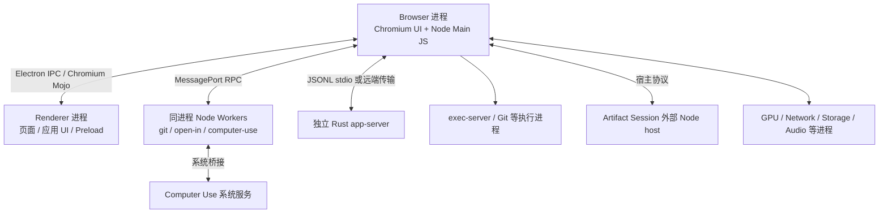
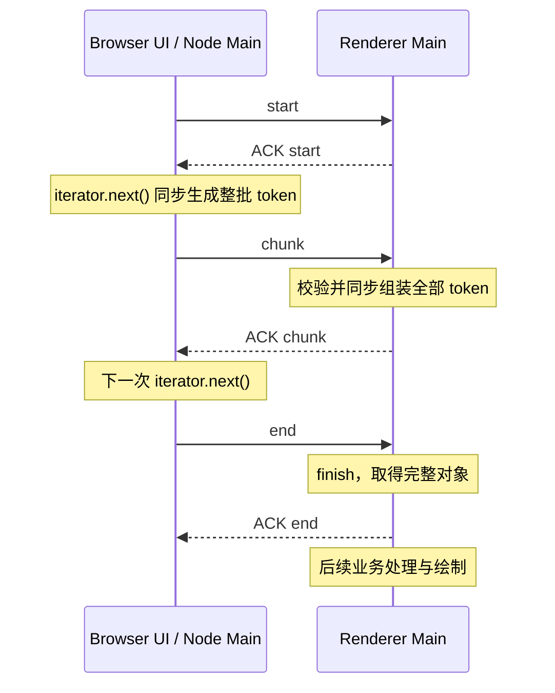

# Codex Owl 运行时调查与 Ash 性能优化参考

本文保存 2026-10-17 对本机 Codex/Owl 安装包、运行进程、事件循环、任务分配及大响应传输的调查结果，供 Ash 后续性能设计、测量和代码审查使用。核心发现是：Owl 把 Electron 风格的 Node 主环境放在 Chromium Browser 的 UI 线程上；大 JSON 解析、对象遍历、图像处理及同步系统调用仍可能阻塞这条线程。IPC 分片和消息队列预算只能覆盖各自所在的阶段。

本文是特定版本的外部实现研究，不定义 Ash 的产品契约，也不表示 Ash 已有相同问题。Ash 的职责边界仍以 [Desktop 架构](desktop-architecture.md)、[前端与 App Server 连接边界](frontend-app-server-boundary.md)和 [App Server API](app-server-api.md)为准。

## 1. 调查范围、版本与证据强度

| 项目              | 调查对象                                                                                |
| ----------------- | --------------------------------------------------------------------------------------- |
| 日期              | 2026-10-17，America/Los_Angeles                                                         |
| 平台              | macOS 27.0.1（26A434），ARM64                                                           |
| 安装目录          | `/Applications/ChatGPT.app`                                                             |
| Bundle identifier | `com.openai.codex`                                                                      |
| 应用版本／构建    | `26.1013.40934`／`20770`                                                                |
| Framework         | `Codex Framework.framework/Versions/155.0.8059.80/Codex Framework`                      |
| 运行时名称        | `owl`，见 `Contents/Resources/owl-electron-app.json`                                    |
| 用户数据目录标识  | `Codex`，见 `Contents/Resources/owl-app.ini`                                            |
| 原始调查缓存      | `/tmp/ash-owl-inspection`，正文不依赖该目录继续存在                                     |
| Ash 对照基线      | `8b26605f93b9afcdaaa1e53870aa6929fa56c141` 及调查时的工作区；未提交内容可能影响实际实现 |

证据分四类，后文按这个边界解释：

- **运行时观察**：进程树、线程采样及调用地址匹配，证明采样时确实存在的进程或执行路径。
- **安装包实现**：打包 JS、嵌入的 Electron JS、二进制字符串和反汇编，证明该版本包含某实现及调用分支；不自动证明功能已启用或用户操作已触发。
- **隔离小测**：独立 Node 进程中的合成输入实验，说明同步成本的可能量级；不是 Codex 现场 profile，也不是 Ash 的性能基线。
- **优化候选**：由证据推导的 Ash 检查方向；没有测量的项目不能写成已确认瓶颈。

采样过程中没有故意阻塞运行中的 Codex，没有修改安装包。原始文件哈希、提取文件哈希和证据清单见 [manifest.json](research/codex-owl-2026-10-17/manifest.json)。打包文件名中的 hash、混淆符号、PID、地址和格式化行号均只适用于本次快照。

## 2. Owl 是什么，与 Electron 有什么关系

本机名为 `ChatGPT.app` 的包，identifier、打包来源和用户数据配置均指向 Codex 桌面产品；不能仅根据文件名判断成 ChatGPT 网页。`owl-electron-app.json` 的 `packagedFrom` 包含 `codex/codex-apps/electron/out/ChatGPT-darwin-arm64/ChatGPT.app`，`runtimeName` 为 `owl`。

Owl 是该应用使用的 Chromium/Node 桌面运行时。它保留 Electron 的 JS 模块、API 风格和 bootstrap，同时包含大量 `owl/browser`、`owl/common`、`owl/renderer`、`owl/host` C++ 实现路径和新增能力。应用启动代码明确检查 Owl 扩展，并抛出：

```text
Codex requires the Owl app shell; stock Electron is no longer supported.
```

因此可以把它描述为具有 Electron 兼容接口、OpenAI 定制的 Chromium 桌面宿主。安装包足以证明它在使用定制运行时；没有源码仓库和提交历史，不能进一步断言它是从哪一版 Electron fork、哪些目录被完整替换，或所有能力都由 OpenAI 从零实现。

本次公共 API 对照使用本地 Electron `44.4.5` 的 `electron.d.ts`。这里的“标准 Electron 中未找到”仅指该类型文件中未找到对应公共 API；不等于逐行审计过所有 Electron 内部实现。

证据：[运行时与 API 对照](research/codex-owl-2026-10-17/runtime-api-evidence.txt)、[Owl 源路径](research/codex-owl-2026-10-17/owl-source-paths.txt)。

### 2.1 安装包中可确认的扩展能力

下表列出应用调用点或样式使用点；这些调用不代表相应开关在所有账户、平台、窗口和启动条件下都启用。

| 能力               | 安装包中的接口或标记                                                                                      | 调查所得                                                        |
| ------------------ | --------------------------------------------------------------------------------------------------------- | --------------------------------------------------------------- |
| 浏览器配置导入     | `browserProfileImporter.getSignals()`、`importBrowserProfile`                                             | 应用有导入信号、策略检查与导入路径                              |
| 地址栏补全         | `autocomplete.start/stop/accept/recordNavigation/deleteMatch`                                             | 浏览器补全服务接入应用宿主                                      |
| 站点图标与常用站点 | `faviconService`、`topSites`、`getFaviconImage`、`owl-favicon-image-updated`                              | 不只依赖当前页面 DOM 获取图标                                   |
| 浏览历史           | `searchHistory`                                                                                           | 接入浏览器历史服务；二进制还包含 `agent` 来源的功能门禁提示     |
| 下载历史           | `getDownloadHistory`、`searchDownloadHistory`                                                             | 历史下载与当前下载合并呈现                                      |
| 网站权限与页面信息 | `setPermissionPromptHandler`、`showPageInfoDialog`                                                        | 宿主提供浏览器式网站权限交互                                    |
| 导航与激活         | `setOpenURLHandler`、`setWebContentsActivationHandler`                                                    | Session 层接管打开 URL 和页面激活                               |
| 扩展工具栏         | `session.extensions.getExtensionToolbarState`、`setExtensionPinned`、`webContents.triggerExtensionAction` | 扩展工具栏状态、固定和 action 触发                              |
| 页面跨窗口移动     | `createWebViewTransfer`、transfer token、`finished`                                                       | 应用会等待移动完成，支持取消与失败处理                          |
| Agent 页面状态     | `setAgentActive`                                                                                          | 页面恢复或替换后同步浏览器使用状态                              |
| 页面捕获保活       | `setPageCapturePaintLeaseEnabled`                                                                         | 捕获期间申请并释放绘制 lease；不等于所有后台页面永久绘制        |
| 视口与页面布局     | `waitForViewportSize`、`setContentInsets`                                                                 | 截图或注释流程可等待视口，向页面同步顶部 inset                  |
| 系统字体           | `systemPreferences.getFontFamilies`                                                                       | 应用直接取得系统字体目录                                        |
| 性能测量与任务管理 | `configureMeasurementCollection`、`collectMeasurements`、`showTaskManager`                                | 对运行时测量和浏览器任务管理有额外入口                          |
| 运行时功能配置     | `setRuntimeFeatures`、`isRuntimeFeatureEnabled`                                                           | 应用传入运行时功能开关                                          |
| 网站上报控制       | `setWebsiteReportingEnabled`                                                                              | Session 创建和启动时配置，存在策略分支                          |
| 系统材质与玻璃效果 | `-owl-native-material`、`-owl-native-glass-container`、`-owl-native-glass-spacing` 等                     | 应用 CSS 和 Framework 路径同时包含材质接入；不只是普通 CSS blur |

`importProfile`、`adoptWebContents` 在初次候选名称搜索中没有对应应用调用，不能当成已确认使用的 API。`setAccessibilitySupportFeatures` 在对照 Electron 类型中已经存在，也不能算 Owl 独有扩展。

接口兼容并不完整：二进制包含 `BaseWindow.getNativeWindowHandle`、`BaseWindow.setProgressBar`、`session.fromPath()` 在 Owl 不支持，以及 `getBackgroundColor()` 未实现的提示。不能把“能 require electron”理解为可直接替换任意 Electron 应用。

## 3. 进程架构与通信边界

采样时 Browser 主进程 PID 为 `91912`。主程序直接进入 `ChromeMain`，同一进程装载 Node、Electron 风格的应用主模块和 Chromium 浏览器宿主。没有观察到另一个独立进程专门承担应用的 Electron Main JS。



图中的执行进程连线是职责示意；并不表示所有命令都由 Browser 直接启动，具体仍取决于执行宿主和本地／远端分支。

### 3.1 Electron API 与 Chromium 宿主怎样连接

安装包包含以下接口及源码路径字符串：

- `electron/js2c/browser_init`、`process.appCodeLoaded()`，以及“同一进程已有 Node main module”的错误提示。
- `electron_browser_web_contents`、`electron_renderer_ipc` 等 `_linkedBinding`。
- `owl.mojom.ElectronIPC`、`owl.mojom.ElectronRenderer`、`owl.mojom.ElectronWebContentsUtility`。
- `owl/browser/electron_app_main_process_host.cc`、`electron_web_contents_host.cc`、`node_app_runner.cc` 和 Renderer IPC 实现路径。

可建立的调用层次是：Renderer 的 `ipcRenderer` 进入 C++ binding，跨 Chromium IPC/Mojo 边界到 Browser，再由 Browser 中的 Electron 风格 JS 分发到 `ipcMain`、Frame 或 WebContents listener。`invoke` 的返回通过 reply channel 送回 Renderer。具体 Mojo 消息定义和全部 C++ 调用链没有源码可核对，不能仅凭字符串补出未观察的实现细节。

应用自己的 Preload 使用 `contextBridge.exposeInMainWorld` 暴露桥接对象；`sendMessageFromView` 调用 `ipcRenderer.invoke`，主进程向窗口发送消息后，Preload 再分发 `MessageEvent`。Worker 消息和大消息 ACK 有各自的 channel。

Preload 同时存在启动配置、主题、初始快照和拖拽等 `sendSync` 调用。Renderer 遇到这些同步调用时需要等待 Browser 响应，Browser UI 线程的阻塞可以进一步传导到 Renderer。普通异步 IPC 的存在不能消除这类同步依赖。

证据：[进程与宿主](research/codex-owl-2026-10-17/process-architecture-evidence.txt)、[嵌入 IPC JS](research/codex-owl-2026-10-17/ipc-js-evidence.txt)、[Preload 摘录](research/codex-owl-2026-10-17/preload-evidence.txt)。

## 4. Node 事件循环与 Chromium UI 循环

### 4.1 已观察到的集成方式

3 秒、1ms 间隔的采样，在 `com.apple.main-thread` 上观察到：

```text
ChromeMain
  → NSApplication / CFRunLoop
  → Owl 回调
  → uv_run
  → uv__run_check
  → node::Environment::CheckImmediate
  → node::InternalMakeCallback
  → v8::Function::Call
```

这不只是“Node 和 Browser 在同一 PID”的推测，而是 Node 回调确实出现在 Browser 的 UI 主线程调用栈中。

反汇编进一步给出对应关系：

| 项目                                  | 本次快照值                                   |
| ------------------------------------- | -------------------------------------------- |
| Framework 运行时加载基址              | `0x119ce4000`                                |
| 采样中的调用返回地址                  | `0x11e43e894`                                |
| 减基址后的返回地址                    | `0x475a894`                                  |
| `BL uv_run` 的静态地址                | `0x475a890`                                  |
| 调用前第二参数                        | `w1 = 2`，即 `UV_RUN_NOWAIT`                 |
| 进入／退出 Node V8 Context 的回调入口 | `0x475a7f0`                                  |
| 辅助等待线程函数                      | `0x475c910`，通过 `uv_thread_create_ex` 创建 |

辅助线程取得 `uv_backend_timeout`、等待 backend FD，然后向保存的 TaskRunner 投递上述回调。相关 Source Location 包含 `WakeupMainThread` 和 `owl/common/node_bindings.cc:602`。它负责等待和唤醒，Node Main JS 最终仍在 UI 线程执行。

二进制符号被裁剪后，反汇编工具会用附近的已导出符号加大偏移命名匿名函数，例如 `_ares_llist_replace_destructor+...`。这不证明代码属于 c-ares。这里的判定依赖指令、字符串交叉引用和运行时地址吻合，不能照抄工具给出的近邻符号作为真实函数名。

上游 Electron `v42.3.0` 的 `shell/common/node_bindings.cc` 在调查中只用于模式对照，不代表 Owl 的确切基线或相同源码。该对照地址也保存在证据中。

### 4.2 阻塞的影响范围

`UV_RUN_NOWAIT` 表示这一轮不阻塞等待 I/O，不表示里面执行的 JS 会被定时抢占。完整 `JSON.parse`、同步文件调用、编码或大型循环一旦开始，会占住当前 UI 线程直至返回。Promise 和 `async` 也不会自动把其中同步工作移到其他线程。

此时 Browser 的窗口管理、输入分发、应用 IPC handler 和后续 Node 回调可能延迟。独立 Renderer、GPU 和网络进程仍可能继续部分工作，所以不能把它写成“所有页面、网络和 GPU 必然同时停止”。Renderer 自己的 JS 长任务则首先影响该 Renderer 的内容交互；同步 IPC、宿主响应和资源依赖会扩大影响。

证据：[事件循环采样、地址匹配与反汇编](research/codex-owl-2026-10-17/node-ui-loop-evidence.txt)。本次没有向真实 UI 注入忙循环，因此没有记录“阻塞 N 秒后各窗口的实际表现”。

## 5. Worker、app-server 与 Main 的实际分工

### 5.1 已有的隔离

| 承载位置                        | 安装包中确认的工作                                                       | 仍需注意的边界                                                                |
| ------------------------------- | ------------------------------------------------------------------------ | ----------------------------------------------------------------------------- |
| `git` Node Worker               | Git status、diff、分支／worktree 操作的调度、结果解析、缓存和 watcher 等 | 执行宿主调用可回到 Main；不能据 Worker 名称断言全部 I/O 在 Worker             |
| `open-in` Node Worker           | 可打开应用的发现、信息和图标等请求处理                                   | Windows `read-shortcut-link` 会 RPC 回 Main 调用同步 `shell.readShortcutLink` |
| `computer-use` Node Worker      | 权限请求、捕获轮询、控制等系统服务桥接；Apple Event 调用                 | 系统服务是独立进程，Main 仍负责服务 PID 与生命周期协调                        |
| Rust app-server                 | thread／turn、配置、插件等后端协议能力和状态                             | 浏览器／桌面动态工具仍可回调前端宿主执行                                      |
| 独立执行进程／远端执行服务      | 命令执行、部分文件操作                                                   | 本地与云端执行宿主路径不同                                                    |
| Artifact Session 外部 Node host | 独立 artifact runtime host                                               | Main 保留进程与连接管理                                                       |
| Chromium utility／GPU 等进程    | 网络、存储、音频、GPU 等服务                                             | 不能代替应用 JS 的 CPU 隔离                                                   |

Worker manager 使用 `new Worker(worker.js, { name: workerId, workerData, transferList })`，通过 `MessageChannel` 建立 Main RPC 和遥测连接。它是同进程的独立 Node Worker 环境，不是另一个 Browser 进程。

### 5.2 本地 Git 的重要修正

“Git Worker 的所有命令都交给 Rust app-server”不符合本次安装包实现。可追到的路径是：

```text
Git Worker 的执行宿主代理
  → Main RPC
  → executionHostRegistry
  → 本地执行宿主 qQ
  → 异步 spawn / stream / fs.promises
```

本地宿主在 Main 注册，进程执行本身交给子进程，文件操作使用异步流和 promises。Main 会参与调度、流转和回调，但没有因此同步等待 Git 完成。云端宿主则存在 `command/exec` 等 app-server 协议路径。分析性能时要分别标出“CPU 解析在哪”“谁启动子进程”“谁等待 I/O”“结果经过哪些复制”。

### 5.3 不应错误归属的打包代码

主 bundle 包含 JS `AppServerManager` 实现，但主进程内启用条件是：

```js
!app.isPackaged && process.env.CODEX_APP_SERVER_MANAGER_IN_MAIN === "1"
```

本次调查的是已打包应用，不能因为类定义出现在 bundle 中，就把该类所有状态维护和重活归到已安装版本的 Main 热路径。

### 5.4 仍在 Main 的同步工作

| 触发场景                               | 同步工作                                                          | 风险与适用范围                                                         |
| -------------------------------------- | ----------------------------------------------------------------- | ---------------------------------------------------------------------- |
| 启动迁移旧数据                         | `better-sqlite3` 的事务、全量 `.all()`、逐行查询／插入／更新      | 数据量和磁盘决定停顿；这是迁移路径，不是普通聊天查询都在 Main          |
| 浏览器注释截图达到至少 10 条等压缩条件 | 多图解码、crop、resize、`toDataURL`                               | 批量图像处理连续占用调用线程                                           |
| 异步截图／缩略图完成之后               | `toPNG()`、Base64 等同步后处理                                    | 异步捕获只覆盖前一段，不能忽略编码阶段                                 |
| macOS 输入监控权限请求                 | `spawnSync(helper, ["--request-permission"], { timeout: 10000 })` | 等待期间可以阻塞；10 秒是超时配置，不是已测耗时                        |
| 项目 provisioning 状态持久化           | `readFileSync`、write、rename、文件与目录 `fsyncSync`             | 内容即使很小，磁盘持久化仍有长尾延迟                                   |
| realtime handoff 读取 rollout          | 异步 `readFile` 后，对整个文本 `split/filter/JSON.parse`          | 文件读取异步，整文件处理仍同步；重试可再次处理                         |
| dictation 历史                         | 同步读取、逐行解析、同步写临时文件并 rename                       | 正常写入保留 20 条，但读取会先遍历文件，不能把 20 当成所有输入的硬上限 |
| app-server 接收及 IPC                  | 下文的解析、遍历、路由和发送                                      | 这是大响应路径的主要关注范围                                           |

表中列的是实现风险，未做各用户功能的现场耗时排序。证据：[完整任务分配摘录](research/codex-owl-2026-10-17/workload-placement-evidence.txt)。

## 6. 大 app-server 响应如何解析

### 6.1 普通 stdio 路径：完整 JSON 解析在队列之前

```text
app-server stdout Buffer
  → JSONL 行收集器 bs
  → Buffer.concat（有多段时）
  → buffer.toString("utf8")
  → JSON.parse
  → In：已解析对象 + lineBytes + timing
  → StdioConnection 消息队列
  → setImmediate 派发
  → IncomingLineProcessor 队列
  → routeIncomingMessage / routeResponse
  → 窗口 IPC 发送器
```

`parseBufferedLine` 的核心代码是：

```js
const buffer = chunks.length === 1
  ? chunks[0]
  : Buffer.concat(chunks, contentBytes);
setCompletedMessage(line, JSON.parse(buffer.toString("utf8")));
```

没有 Worker，也没有穿过合并、解码、解析的 yield。行收集器还可能在同一个输入 Buffer 中连续处理多行。后面的预算不能覆盖已经发生的工作。

stdio 把解析结果包装成 `In` 后交给下游，下游识别该类型并直接派发，没有再做一次 `JSON.parse`。另一条原始字符串输入路径仍会在 `handleIncomingLine` 中解析，不能把这两个分支叠加成“stdio 固定解析两遍”。

### 6.2 流式 JSON 分支及内部数组分块

默认切换阈值是：

```js
Math.min(268435456, Math.floor(Buffer.constants.MAX_STRING_LENGTH / 2))
```

也就是约 256MiB 的单行缓存，而非 IPC 使用的 4MiB。本地 `StdioConnection` 构造 parser 时没有传入更低的阈值覆盖。几十 MiB 的单条响应仍走完整解析。

超过阈值后，已收集 Buffer 被重放到流式 tokenizer／assembler，后续继续写入。这里使用 `packValues: true, streamValues: false`，数组 builder 默认按估算约 4MiB 组织内部 chunk。多块数组使用带 `chunks` 和 `length` 的自定义表示；这是主进程内的数据结构，和 IPC token 分片是两层机制。

这一分支可以避开普通路径对整行进行一次 `Buffer.concat + toString + JSON.parse` 的要求，但仍在 Main 线程工作：

- `write()` 到 backpressure 为止的解析、token 回调和对象构建是同步执行的，没有显式毫秒预算。
- 跨阈值时，可能先连续处理已经缓存的大量输入。
- 单个字符串仍由 parser 组装为完整值；数组分块不等于字符串也按业务流消费。
- 每个数组元素加入时的大小估算也需要同步遍历；4MiB 是分块目标，不是每个元素的强制大小上限。
- 仍要等完整 JSON-RPC 对象就绪后才交给路由，不是边收到 thread item 边显示。

### 6.3 分块数组何时又被还原

`Ss` 检查消息的 WeakSet 标记，必要时调用 `ns`：递归复制对象、普通数组，并把分块数组重新展开成普通数组。没有 yield。

路由对带分块数组的非 response 消息会先还原；部分 Main 内部 host 响应也会在 resolve 前还原。正常转发给窗口的 response 可以保留分块表示交给 token 遍历器，因此不能写成“所有大响应必定在 IPC 前再次完整 flatten”。

### 6.4 派发预算的真实保护范围

stdio 派发层与下游 incoming-line 层使用队列／`setImmediate`。默认预算为每片最多 200 条、约 8ms。核心顺序是：

```js
onItem(item); // 整条消息的处理先执行完
count++;
if (!flushAll && (count >= maxItems || Date.now() - startedAt >= maxMs)) {
  break;
}
```

因此，8ms 只能决定“还要不要处理下一条”。一条 handler 花 100ms，预算也要 100ms 后才能检查；多个阶段和 Node 回调共享 UI 线程，这也不是整个 Browser 的全局 8ms 上限。

下游 incoming-line 队列默认 overflow 深度为 20,000，达到后连接失败。数量保护不等于字节保护：20,000 条的内存成本取决于各条大小。stdio 的深度／大小阈值日志也不能当成进程内存硬限制。

stdout 正常结束和退出收尾还会调用 `flushPendingStdoutLines → drain(flushAll: true)`，绕过平时的预算。IPC 发送器自身的 inline 队列也有不同的排空规则，见下一节。

证据：[JSON 与 IPC 摘录](research/codex-owl-2026-10-17/json-ipc-evidence.txt)。

## 7. IPC 分片、背压与接收端

### 7.1 四个大小概念

| 参数                   | 本版默认值    | 约束对象                         |
| ---------------------- | ------------- | -------------------------------- |
| `maxBufferedLineBytes` | 约 256MiB     | JSONL 普通缓存切到流式解析的阈值 |
| 内部 `arrayChunkBytes` | 4MiB 估算目标 | 流式解析后的数组内部存储块       |
| `inlineThresholdBytes` | 4MiB          | 自动 IPC 分片判断                |
| `batchTargetBytes`     | 2MiB 估算目标 | 一片 IPC token 的成本            |

解析器用 WeakMap 记录完整消息及其 `result`／`params` 的原 JSONL 字节数。发送器优先读这些 hint，避免为判断大小再次遍历整个对象。无 hint 时，退回同步的有预算大小估算；预算按估算字节停止，但其中的 `Object.entries()` 仍会先完整枚举该对象。

2MiB 是自定义估算模型：字符串按 `length * 2`，外加 token／primitive 固定开销等计算，不是 Chromium 实际 wire 字节数或峰值分配硬上限。

### 7.2 发送的是结构 token，不是 JSON 文本切片

`DG` 使用 `OG` 遍历对象，生成 `object-start`、`array-start`、`container-end`、`key`、`value` 等 token。大字符串会产生 `string-start`、多个 `string-chunk` 和 `string-end`。默认每个字符串小段最多 524,288 个 UTF-16 code unit，不能把这个数解释为 UTF-8 字节数。

外层协议使用 `codex-host-chunked-message-v1` 标记，带 `transferId` 和递增 `sequence`：

```text
start(seq=0)
  → chunk(seq=1, tokens=[...])
  → chunk(seq=2, tokens=[...])
  → ...
  → end(seq=N)
```

生成器的 `yield` 发生在一整批 token 生成之后。`yield` 本身不把工作移出主线程；真正的阶段间让出来自发送后等待异步 ACK。

### 7.3 实际响应路由：正常响应会判断大小，sendInline 不会

正常 app-server 对窗口的响应路径是：

```text
routeResponse
  → sendClientResponse
  → Cq.send 或 Cq.sendCritical
  → ChunkedMessageSender
  → PG.send 或 PG.sendCritical
  → shouldChunk
```

普通优先级也会分片。critical 路径有独立队列和调度优先级，不意味着普通响应强制整包发送。

`sendInline` 则完全跳过 `shouldChunk`。它在无 target 状态时立即整包发送，有状态时排队为 `chunked: false`。部分本地合成响应、错误分支或通用窗口消息使用它；不能只看到类名 `ChunkedMessageSender` 就推断每个入口都具有大消息保护。

VS Code fetch 桥还有独立前置成本：先执行完整 `JSON.stringify(result)` 生成 `bodyJsonString`，再调用支持分片的发送方法。后面的字符串分片不能消除已经完成的整包序列化。

### 7.4 ACK 控制传输推进

每个 target 的当前大传输保存 iterator、当前 part、transfer ID、sequence 和 delivered 状态。Main 发出一片后，等待匹配 ACK 才生成下一片；收到 end 的 ACK 后清理传输、推进后续队列。

Renderer 的组装器对 start 创建状态，对 chunk 同步消费全部 token，对 end 检查结构完整并返回最终对象。组装完成后，经 `electronBridge.acknowledgeChunkedMessage → ipcRenderer.send` 发回 ACK。Main 校验受信 IPC 来源以及 ID／sequence 后推进。



ACK 不等待业务模型更新、React 工作或页面绘制。它提供分片接收／组装背压，不能当成“这批数据已完整显示”的信号。小的 critical 消息还可按调度规则插入，不能把单个大传输的一片推进模型理解为所有消息全局严格串行。

### 7.5 分片仍然留下的长任务

- **生成器片内工作**：`iterator.next()` 是同步调用，循环按字节凑满，没有时间检查。
- **宽对象枚举**：`Object.entries(object)` 在 token 迭代前一次分配所有 entries；即使当前片很小，也可能提前付出整对象成本。
- **发送端复制／序列化**：`webContents.send` 在 UI 线程被调用，片内对象构建和 IPC 序列化／复制仍有成本；本次未单独测量 Owl 的内部成本。
- **无预算的 inline 排空**：`drain`、`drainCritical` 可连续发送多条 inline 消息，没有 200 条／8ms 保护。结束大传输后的积压释放也可能形成突发。
- **接收端片内组装**：Preload 和 Renderer 有 token 校验，组装循环也同步运行，影响 Renderer 主线程。
- **大字符串终点**：`stringChunks.join("")` 最后仍一次生成完整字符串；跨片传输没有消除最后的字符串合并和可能的分配／GC 压力。
- **完整消息的后续处理**：收到 end 才交给应用的完整对象，业务归一化、模型更新和渲染仍可能形成另一个长任务；本次未对这些后续工作作 profile 排名。

Renderer ACK 迟到会让 Main 等待下一片，并不意味着 Main 在等待期间忙等。要区分“CPU 阻塞”和“传输尚未继续”。

## 8. 隔离小测与日志陷阱

### 8.1 已执行的小测

使用 ARM64 Node `v24.21.0` 独立进程，模拟嵌套会话对象。解析项各测 5 次，显式 GC 在计时区间之前，取中位数；输入构造、JSON.stringify 和基准自身的 GC 不计入解析项。分片生成器 `DG/OG/kG/AG/jG` 直接取自本版打包实现；普通 JSON 输入不包含自定义数组类型，因此类型判断适配为恒 false。

| 合成响应实际大小 | 单独 JSON.parse 中位数 | Buffer 合并＋UTF-8 解码＋JSON.parse 中位数 |
| ---------------- | ---------------------- | ------------------------------------------ |
| 3.94MiB          | 1.35ms                 | 1.52ms                                     |
| 15.75MiB         | 5.68ms                 | 6.28ms                                     |
| 63MiB            | 27.44ms                | 31.13ms                                    |

另一个 200,000 字段的普通对象，token 迭代器第二次 `next()` 包含完整 `Object.entries`，单次观察约 **36.52ms**。它证明一个结构枚举步骤本身可能超过派发预算；这是单次观察，不是分布统计。

上述字符串主要由 ASCII `x` 构造，数据形状比较简单，不能外推真实会话的字段数、转义、多语言、峰值内存或 GC。基准也没有计入真实 IPC、Renderer 或业务 handler；基准 Node/V8 并非运行中 Owl 的完整运行时。因此只用它验证同步路径的量级与风险，不能宣传成 Codex 或 Ash 的响应时间。

可从仓库根复跑：

```sh
node --expose-gc docs/research/codex-owl-2026-10-17/json-ipc-bench.cjs
```

脚本还输出各合成输入的分片数、各次 `next()` 最大耗时与累计耗时，便于比较数据形状。它连续执行 generator，不模拟 ACK 和 UI 调度，累计值不能当成端到端传输时间。新增的验证输出保存在 [benchmark-validation.jsonl](research/codex-owl-2026-10-17/benchmark-validation.jsonl)，与上表首次记录可以不同。

### 8.2 parseDurationMs=0 不代表没花时间解析

stdio 在 parser 中已经完成解析，随后以下游“已解析消息”形式进入队列。`IncomingLineProcessor` 派发该类消息时传入的 parse duration 是常量 **0**。因此 `incoming_line_processed.parseDurationMs = 0` 不能用来排除前置的 `JSON.parse` 长任务。

`receiveStartedAtMs → receivedAtMs` 包含接收及解析阶段的综合时间，不能直接当成纯 parser CPU。排查需要分别记录收齐字节、合并、解码、解析、排队、路由、生成 token、发送、ACK、业务应用和绘制时间。

## 9. 对照 Ash：已知差异与优化候选

后续完整链路核对、复制量实验及优化优先级见 [Ash app-server 到 Renderer 的大响应链路审计](ash-app-server-data-path-audit.md)。该审计区分当前实际问题与尚待真实 Desktop 测量的性能影响。

### 9.1 Ash 已经使用不同的数据路径

调查时的 Ash Desktop 不是在 Main 中照搬 Owl 的“完整 JSON 对象 → token IPC”路径。对当前文件的直接核对显示：

```text
Rust app-server / daemon 连接程序
  → ChildProcessJsonlTransport(stdoutMode: 'bytes')
  → Main 的 AppServerConnectionRelay
  → MessagePort 字节块
  → Renderer MessagePortSocket
  → Renderer 的 framing / UTF-8 解码 / AppServerProtocolClient
  → 前端领域 adapter / Service / UI
```

| Ash 当前实现                                                                                            | 可确认的差异／待检查点                                                            |
| ------------------------------------------------------------------------------------------------------- | --------------------------------------------------------------------------------- |
| [Main relay](../src/ash/platform/agentHost/electron-main/appServerConnectionRelay.ts)                   | Desktop 选择 `stdoutMode: 'bytes'`，Main 透明转发，不在此解释 JSON-RPC 业务消息   |
| [子进程传输](../src/ash/platform/agentHost/node/childProcessJsonlTransport.ts)                          | 同时支持 JSONL 和 bytes 模式；不能把非 Desktop 的 framing 分支成本套到 Desktop    |
| [Renderer MessagePort](../src/ash/platform/agentHost/electron-browser/appServerMessagePortTransport.ts) | 收到字节后触发下游 listener，再 ACK；接收处存在 `new Uint8Array(value.data)` 复制 |
| [Renderer socket transport](../src/ash/platform/agentHost/browser/appServerSocketTransport.ts)          | 在 Renderer 接收协议帧并 UTF-8 解码                                               |
| [Renderer 协议客户端](../src/ash/platform/agentHost/browser/appServerProtocolClient.ts)                 | `JSON.parse(frame)` 在 Renderer 的协议处理路径；完整 JSON 的同步成本仍需测量      |

Main relay 发送 `new Uint8Array(chunk)`，收到 ACK 后恢复 stdout；未确认使用 ArrayBuffer transfer-list 传递每个数据块，因此不能把 MessagePort 的存在直接写成零复制。当前代码在积压至少 4 块时暂停 stdout，降至 4 块以下恢复，并有 128 条和约 320MiB 的传输容量保护。容量、复制和解析位置各解决不同问题，容量不是低延迟保证。

这部分只是为研究提供准确入口，没有对 Ash 的完整 pipeline、所有消费者或最新工作区做性能审计。特别是将解析放入 Renderer，只隔离了 Browser UI 线程，仍可能卡住聊天／编辑器所在的 Renderer。

### 9.2 建议优先测量的方向

下表是后续候选，不是已经批准或完成的实现计划，也不要求复制 Owl 的 API、阈值或自定义数组协议。

| 顺序 | 候选检查                                                             | 验证成功的证据                                                                            |
| ---- | -------------------------------------------------------------------- | ----------------------------------------------------------------------------------------- |
| 1    | 给完整接收链路分阶段计时，避免已解析消息的 0ms 掩盖真实成本          | 可区分 receive、decode、parse、queue、route、copy、apply、paint，能对应同一次请求         |
| 2    | 用真实大 thread／turn 数据测 Renderer 的完整 JSON 解码、解析与归一化 | 记录单次长任务、输入字节、字段／item 数、CPU 和峰值内存；比较大字符串、宽对象和小对象数组 |
| 3    | 核对 bytes → Main → MessagePort → Renderer 的复制和内存存活          | 每个大 buffer 的 owner、复制次数和释放点可说明；优化前后有 CPU／内存对比                  |
| 4    | 评估协议层分页、按需展开、增量订阅，减少一次完整返回的对象           | 首屏需要的数据下降，协议取消／顺序／一致性保持；避免只把大包换个线程                      |
| 5    | 如解析确为瓶颈，再评估 Worker 解析和结果传递形态                     | 把入 Worker、出 Worker 的复制与重建成本一并计入，UI 事件延迟实际改善                      |
| 6    | 给队列同时考虑字节、条数、耗时和控制消息容量                         | 数据洪峰下仍可取消／关闭，RSS 和长任务有上限证据；EOF／关闭不无限排空                     |
| 7    | 检查截图和缩略图完成后的编码、Base64、批量压缩                       | 异步捕获之后的 CPU 被独立测量，批量图像不连续阻塞 UI                                      |
| 8    | 审计启动迁移、权限 helper、状态 fsync、rollout 整文件处理            | 按触发频率、数据规模、长尾及所属线程排序；异步签名不作为不阻塞的证明                      |

协议分页和增量消费应由数据拥有者提供契约；Main 不能为了性能再维护一套 thread／turn 业务状态。Worker 和执行进程也不能复制权限或持久化规则。Ash 的 Desktop 不应因为 Codex 包内出现 `codex app-server` 就改为依赖 `cli/` 产品命令；Ash 后端启动继续遵循现有 daemon／app-server 的所有权。

### 9.3 后续性能场景建议

这些是未来需要执行的场景，本次没有运行 Ash 场景测量：

1. 首次打开含大量 turns／items 的 thread，同时输入、切换会话和操作浏览器页面。
2. 一个超长字符串、一个宽对象和大量小对象数组，控制总字节接近，比较形状差异。
3. 多窗口接收大数据、Renderer 忙碌导致 ACK 延迟，以及取消请求和关闭窗口。
4. app-server stdout 结束／异常退出时仍有大量积压，验证收尾与故障恢复。
5. 大量截图批量压缩、缩略图编码，以及大 rollout 的 handoff。
6. 大数据首次迁移、慢磁盘持久化与首次权限请求，分别测启动与交互路径。

至少同时观察 Browser UI 的事件循环延迟、目标 Renderer 的 long task／输入延迟、首个可见内容时间、完整应用时间、峰值 RSS／heap、队列字节和 ACK 等待。单独降低吞吐耗时或分片大小不足以证明交互改善。

## 10. 证据索引与复核方法

正文对应的证据均保存在 [research/codex-owl-2026-10-17](research/codex-owl-2026-10-17/manifest.json)，不需要 `/tmp` 缓存：

| 文件                                                                                                 | 内容                                                          |
| ---------------------------------------------------------------------------------------------------- | ------------------------------------------------------------- |
| [manifest.json](research/codex-owl-2026-10-17/manifest.json)                                         | 安装包元数据、源文件／证据 SHA-256、格式化信息与限制          |
| [runtime-api-evidence.txt](research/codex-owl-2026-10-17/runtime-api-evidence.txt)                   | Owl 身份、源码路径、API 对照和应用调用／CSS 摘录              |
| [owl-source-paths.txt](research/codex-owl-2026-10-17/owl-source-paths.txt)                           | Framework 中 Owl 源路径快照                                   |
| [process-architecture-evidence.txt](research/codex-owl-2026-10-17/process-architecture-evidence.txt) | 进程树、Browser／Worker 采样、模块和 IPC 字符串               |
| [ipc-js-evidence.txt](research/codex-owl-2026-10-17/ipc-js-evidence.txt)                             | Framework 中 Electron bootstrap、bindings 和 IPC 分发 JS 摘录 |
| [node-ui-loop-evidence.txt](research/codex-owl-2026-10-17/node-ui-loop-evidence.txt)                 | 1ms 采样、运行时地址匹配和关键反汇编                          |
| [preload-evidence.txt](research/codex-owl-2026-10-17/preload-evidence.txt)                           | 应用桥接、同步 IPC、消息接收和 ACK 摘录                       |
| [workload-placement-evidence.txt](research/codex-owl-2026-10-17/workload-placement-evidence.txt)     | Worker 注册、执行宿主、app-server 边界和 Main 同步工作        |
| [json-ipc-evidence.txt](research/codex-owl-2026-10-17/json-ipc-evidence.txt)                         | JSONL parser、队列预算、分片生成器、路由和接收端组装摘录      |
| [ash-comparison-evidence.txt](research/codex-owl-2026-10-17/ash-comparison-evidence.txt)             | 本次核对的 Ash 字节转发和 Renderer 解析路径，记录对应文件哈希 |
| [json-ipc-bench.cjs](research/codex-owl-2026-10-17/json-ipc-bench.cjs)                               | 隔离小测，包含实际提取的 token 生成器                         |
| [benchmark-validation.jsonl](research/codex-owl-2026-10-17/benchmark-validation.jsonl)               | 文档落盘后复跑脚本的输出                                      |

证据中的 `Source: *.pretty.js lines ...` 和数字前缀指向当时格式化后的 bundle 行号，不是 OpenAI 原始 TypeScript 行号。原始 bundle 标识为 `.vite/build/main-CLu1A25j.js`、`src-DsLVGakC.js`、`application-network-startup-DB1VeU3v.js`、`worker.js` 等；Renderer 片段来自 `webview/assets/app-shared-52443cbe9ac4.js`，以 manifest 中记录的真实 archive path 为准。

复核新版本时：

1. 先读取 `Info.plist`、`owl-electron-app.json` 和 `owl-app.ini`，记录平台、版本、runtime archive SHA；保存 `app.asar` 和 Framework 的 SHA-256。
2. 只读提取 ASAR 中的 JS，记录真实 archive path 和文件 hash。使用相同 Prettier 版本可辅助对齐行号，符号／文本定位比行号更可靠。
3. 通过进程命令行区分 Browser、Renderer、utility、app-server 和执行服务。PID 只是快照，不能跨运行沿用。
4. 分别采样 UI 主线程和 Worker；反汇编地址必须先减对应模块加载基址，再核对实际指令，不能依据近邻符号猜函数名。
5. 对每个异步操作继续追到回调后的解析、编码、复制和业务处理；对分片核对所有 send 入口及 ACK 时点。
6. 重跑隔离小测时记录 Node/V8、硬件、输入形状和统计方式。要认定产品瓶颈，另做真实场景 profile 与改动前后对照。

本次仍未建立：Owl 的完整源码／fork 历史、各功能账户开关状态、真实用户大响应的延迟分布、Owl IPC 内部逐段复制次数，以及 Ash 的性能回归基线。后续结论应追加对应测量并修正正文，不能把这些未知项当作已证实事实。
