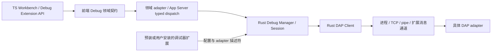
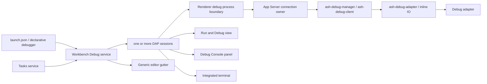

# 调试系统

> 状态：已确认的 Rust Debug 领域迁移和 Workbench 职责拆分已接入生产。Rust 拥有 DAP client、初始化／执行状态、断点绑定、检查编排、工作区定义与 SQLite 持久化、实时异常选择、父子会话和结构化输出。TS 保留配置／编辑器／Tasks／Terminal 接入、v1/v2 Memento 单向迁移和窗口 UI。SSH 资源绑定执行 Environment；Academic 不组装 Tasks、Testing 或 Debug。真实环境验收按实际记录区分，不以源码接通代替。具体实现见 [client](../crates/debug-client/README.md)、[manager](../crates/debug-manager/README.md)、[transport](../crates/debug-adapter/README.md) 和 [Workbench](../src/ash/workbench/contrib/debug/README.md)。

## 编辑器检查与交互

暂停源码的悬浮检查和行内值共用现有 editor hover/decorations；异常详情使用同一编辑器坐标与独立无障碍帮助。Loaded Scripts 独立视图和命令查询适配器的源码目录，也能打开 sourceReference 虚拟脚本。Variables 的“查看内存”及同名命令通过 FileService 以十六进制显示原始字节，保存会写入适配器；继续执行或检查代次变化后必须重新打开，旧视图不能继续读写。

适配器进度接入共享通知；可选 `accessibility.debugWatchVariableAnnouncements` 播报当前 Watch 值变化，`debug.confirmOnExit` 控制退出确认。Chat 的添加上下文提供暂停帧和变量快照，不自动发送。变量可视化提供有界变量树及 Ash 扩展命令输出；扩展声明见 [SDK 说明](../sdk/typescript/README.md)。状态栏颜色使用可释放的主题样式；F9/gutter 共用断点语言及 when 策略，`debug.allowBreakpointsEverywhere` 保留现有默认行为。

具体路径的职责、能力缺口与架构差异由 [Workbench 路径复核](../src/ash/workbench/contrib/debug/README.md#53-path-responsibility-review)维护，不以没有调用方排除未实现功能。

## 快速理解

Code 可以从 `.vscode/launch.json` 启动或附加到一个调试目标，并同时运行多个 DAP 会话。用户可以设置持久化行断点、选择线程和栈帧、递归展开和修改变量、维护 Watch、在调试控制台求值、启用异常断点、读取适配器提供的虚拟源码，以及启动 compound 配置。Rust 后端负责 DAP 请求配对、初始化、能力、执行状态、传输与资源；Workbench 按原 owner 接入配置提供者、编辑器、Tasks、Terminal 和窗口交互。

| 使用场景                    | 当前结果                                                                                                                                                                                | 关键边界                                                                             |
| --------------------------- | --------------------------------------------------------------------------------------------------------------------------------------------------------------------------------------- | ------------------------------------------------------------------------------------ |
| 启动或附加                  | ✅ `launch`、`attach`、重启、停止和 `runInTerminal`                                                                                                                                     | Workbench 解释配置；后端启动适配器                                                   |
| 断点                        | 行断点、函数断点、变量数据断点、指令地址断点、条件和命中次数、日志消息、单独或批量启用/禁用、适配器确认状态、异常断点                                                                   | 条件和日志能力取决于适配器；不支持时显示未验证原因，不下发普通断点                   |
| 停住后检查                  | 线程选择、调用栈、作用域、递归变量树和 `sourceReference`；侧栏检查暂停状态时，首个栈帧有可用行列号时定位源码，正在查看反汇编时保留反汇编编辑器；支持 `setVariable` 的适配器允许修改变量 | DAP Session 拥有请求语义；只读或尚未展开的延迟变量不能修改                           |
| 反汇编                      | 中央编辑器展示地址、机器码、指令与符号；地址跳转、分页、当前指令、F9 指令断点、源代码导航与指令单步                                                                                     | 需要适配器声明反汇编能力；指令单步另需粒度能力；恢复执行后清空旧指令                 |
| Watch 与控制台              | ✅ 持久 Watch；Rust 结构化输出；独立 Panel 提供过滤、工作区历史、补全及所选帧求值                                                                                                       | Watch 与输入历史持久；输出按连接有界保留，不进通用 Output                            |
| 多目标调试                  | ✅ 多会话、会话切换、compound 和 `stopAll`                                                                                                                                              | 后端会话仍按连接隔离                                                                 |
| SSH Remote 调试             | adapter 由远端 App Server 启动；`${workspaceFolder}`、断点、调用栈源码和 `runInTerminal` 使用远端路径/Terminal                                                                          | stdio 不需要额外 Tunnel；TCP/pipe 传输已实现，其 Remote 产品验收另计                 |
| 调试任务                    | ✅ `preLaunchTask`、`postDebugTask`                                                                                                                                                     | Tasks 负责执行和退出状态                                                             |
| 适配器发现                  | 声明式 `contributes.debuggers`、动态配置 provider 与 descriptor factory，仍可显式写 `debugAdapter`                                                                                      | 发现类型不调用工厂或启动适配器；Rust 与 JS 扩展按各自宿主执行                        |
| 完整 VS Code Debug 扩展 API | 已退出扩展生态目标                                                                                                                                                                      | 现有 API 子集、tracker 和传输保留为迁移基础；Ash 作者接口按真实消费者接入 `@ash/sdk` |

## 当前执行链

`DebugSession` 通过上游同职责的 `browser/rawDebugSession.ts` 访问 Rust 请求 client，已退出 TS 请求编号、pending response table 和请求超时实现。`ash-debug-manager` 组合 `ash-debug-client` 与既有 `ash-debug-adapter`，App Server 只增加连接与目录绑定。每个会话只有一个请求配对 owner；stdio、TCP、pipe 和 inline 使用同一 client。tracker 从有界、双向、有序的观察日志取消息，其回调可重入请求而不阻塞协议配对；关闭前先收取观察记录，再按原生命周期释放 tracker 与 transport。

初始化已由 Rust 状态机决定：initialize 响应触发 launch/attach，initialized 事件开放配置阶段；Workbench 提交当前断点后调用 completeConfiguration，Rust 选择受支持的异常过滤器（省略选择使用适配器默认值，显式空数组保持清空，noDebug 下发送空数组，未知过滤器拒绝提交）、发送 setExceptionBreakpoints，并按协商能力发送 configurationDone。launch 回复可以等到配置结束；提前到达的 stopped 事件不会被迟到的 launch 或单步回复覆盖。初始化超时与失败也在 Rust 决定。capabilities 增量事件由后端合并归一化，read 返回带 revision 的只读会话快照。

Rust 同时使在途 stackTrace/scopes/variables/setVariable 在恢复执行、再次停住或 invalidated 后失效；不会重放这些请求。会话执行状态属于 Rust，选中线程/栈帧仍由 Workbench 维护。此切片沿 DebugService → DebugSession → RawDebugSession → platform capability → App Server → DebugManager 的生产链迁移，两个 Workbench 文件保留 VS Code 的对应文件路径与职责入口，协议执行落在 Rust。

会话断点运行意图和绑定已迁入 `breakpoints.rs`：前端只提交带编辑版本的 source/function/data/instruction 意图；Rust 决定能力过滤、源文件分组、整组替换顺序和旧源清空，只有仍匹配当前意图的回复才能建立绑定。适配器主动的 new/changed/removed 也更新同一份绑定。前端的 protocolBreakpoints、syncedBreakpointSources 和 breakpointSync 队列已退出生产链。未支持的条件不会被降级为无条件断点，跨会话的变量/指令地址不会发送或覆盖验证状态。

`inspection.rs` 已拥有 threads → stack、scopes → variables、子变量和批量 Watch 求值。每次查询携带显式线程/帧及 inspectionRevision，Rust 在发送前拒绝旧暂停代次，并使迟到的中间步骤和终态失效。Watch 单个表达式、scope 单个变量请求失败不会抹掉其他结果；任务数量、期限与结果内存都有界，终态只消费一次。Variables、Watch 和 Call Stack 独立注册并分别请求领域结果；DebugService 选择默认暂停帧并打开源码，Call Stack 提交显式线程／帧选择，不再依赖视图创建。前端不再编排这些 DAP 请求链。共享 [debug-contract](../crates/debug-contract/README.md) 定义领域值，RPC/生成 decoder 仍归 App Server protocol。

工作区定义/持久化、实时异常过滤器、父子关系和结构化输出现均由 Rust 拥有。Workbench 的 REPL 模型只保留会话选择、标签和带修订的只读快照；过滤和输入历史归 UI，补全经领域会话调用 Rust 的请求 owner。`rawDebugSession.ts` 保留领域调用、inline IO 桥接和释放确认。协议端口见 [App Server DAP 会话](app-server-api.md#dap-会话与请求调度)。

实时异常选择按版本串行应用。迟到确认不覆盖新编辑，适配器拒绝实时修改保留已确认选择且不会结束整个会话，动态能力会收敛不再支持的选择。初始省略选择才使用默认值，显式空数组保持清空；noDebug 抑制发送的过滤器而保留偏好，避免持久化时丢失正常调试设置。通用 DAP 入口禁止绕过此 owner。

`DebugSessions` 是连接隔离、跨目录共享的注册表。配置回调前先接纳稳定身份，descriptor 回调前提交已解析的 noDebug；Rust 决定继承、控制台合并和父级托管的停止/重启目标。父会话结束即撤销准备中及运行中子树，并关闭其进程/网络资源；Workbench 按返回身份取消回调和 Tasks，释放 inline/tracker/editor 对象。编辑器保存、配置提供者、变量交互、Tasks 和 Terminal 仍由原 owner 执行。

Rust 输出日志按控制台统一排序，最多 512 条和 128,000 字节，另保留最多 20 个已结束控制台。条目保留类别、分组/折叠、对象引用、JSON data、源码和位置；分组栈按输出会话隔离。截断修复悬空父引用，清空由后端执行。对象条目携带产生时的检查代次，旧暂停对象在发送 DAP 前被拒绝。输出和会话图不持久化。

## 目标分层

参考 LSP 的协议客户端、运行管理与具体工具提供者分层，把通用调试后端迁入 Rust；Workbench 的公开契约与交互继续对齐 VS Code。Zed 的 DAP client、会话协调和 adapter 注册可作职责参考，其 GPUI 对象不进入 Ash 后端。下面描述完整目标；当前执行链与状态归属见上一节。



| 层                           | 目标职责                                                                                                                                                                                                                               |
| ---------------------------- | -------------------------------------------------------------------------------------------------------------------------------------------------------------------------------------------------------------------------------------- |
| Rust DAP Client              | 单连接的 DAP 初始化、请求配对、能力协商、事件、反向请求、取消和关闭；复用现有进程及 framing 机制，不选择调试器、不拥有 UI。                                                                                                            |
| Rust Debug Manager / Session | 调试会话与父子关系、执行状态、断点意图及各会话绑定、Watch 求值、线程/栈/变量/源码/反汇编查询、结构化输出和对象引用生命周期；按 Environment、目录授权和发起连接界定资源，拒绝过期会话与暂停代次的结果。                                 |
| 具体调试器扩展               | 工具链发现与运行包准备、调试器配置方言、配置 provider 和 adapter 描述符；沿现有扩展 SDK、注册与授权体系接入，具体实现不链接进核心。Rust 编写的调试器也优先通过 DAP 接入，暂不建立绕过 DAP 的第二套执行契约。                           |
| App Server                   | 产品协议、typed dispatch、连接归属、授权与领域路由；不在 request processor 中实现调试状态机。生成 DTO 只进入前端领域 adapter。                                                                                                         |
| TS Workbench                 | 编辑器与工作副本、保存和变量交互、Tasks/Terminal 的客户端入口、扩展 API 对象与注册、断点位置随编辑变化的通知，以及控制台/调用栈/变量/Watch/反汇编的展示。聚焦会话、选中线程/栈帧、过滤、输入草稿、输入历史和滚动属于各客户端视图状态。 |

Workbench 发送明确的会话与栈帧身份执行求值，不把某窗口的当前选择变成共享后端的全局选择。TS 可以持有稳定身份的展示模型和只读快照，但不能另做 DAP 配对、维护第二套执行状态机或自动重放请求。断点意图及 Watch 定义的工作区持久化随所属行为切片一次转移，保留原有数据迁移入口；编辑器模型、dirty buffer 和撤销仍由 TS 唯一拥有。

保存、交互变量、配置回调、前置/后置任务及 `runInTerminal` 仍经过各自领域 owner；后端需要客户端行为时，使用绑定原调用方的显式请求、取消和关闭契约。现有 inline adapter 和 tracker 也必须接入同一个 Rust DAP 会话，保留消息顺序、原扩展实例身份、重入与释放语义，不能以迁移为由删除兼容行为或保留另一条 TS DAP 会话执行路径。

借鉴 LSP 的分层不等于照搬恢复策略。调试器退出、连接失效或权限撤销后先终止对应会话；不自动重放 `launch`、`evaluate`、`setVariable` 或其他可能有副作用的请求。继续执行后，旧栈帧、变量引用和在途检查结果失效；多窗口共享与跨进程恢复需另有明确租约契约，当前不承诺调试会话脱离发起连接存活。

### VS Code 前端对齐与迁移顺序

对齐的是公开 API、文件职责、生产调用与可观察行为，Rust 后端不照搬 VS Code 的 TS 实现。`common/debug.ts` 和 `browser/debugService.ts` 保留 Workbench 领域入口，`browser/debugSession.ts` 的 DAP 执行职责逐段迁走；不能为维持同名而保留第二套协议客户端。配置解析继续使用现有 ConfigurationResolver、Editor、Tasks 和扩展注册 owner。

本批行为链：编辑工作区断点/Watch → `DebugService` → `common/debugStorage.ts` → 既有 `platform/debug` adapter → Rust `DebugWorkspaceStore` → 带修订快照。对应验证覆盖首次快照前编辑、双窗口冲突、持久化重开、迁移中断与关闭等待；编辑器 DOM 和布局没有变化。

本轮已修改的对应文件如下。这里对齐职责和生产入口，协议执行使用 Ash 的 Rust owner，不复制上游内部实现：

| Ash 文件                                              | VS Code 对应关系                     | 当前职责                                                                                                 |
| ----------------------------------------------------- | ------------------------------------ | -------------------------------------------------------------------------------------------------------- |
| `browser/debugService.ts`                             | 双方同路径                           | Workbench 启动/配置/Tasks 与会话集合；身份保留到 adapter、inline 与子会话完成释放                        |
| `browser/debugSession.ts`                             | 双方同路径                           | 会话模型、线程/栈帧选择、扩展对象与宿主回调；消费 Rust 快照，新的暂停代次即使枚举仍为 stopped 也刷新检查 |
| `browser/rawDebugSession.ts`                          | 双方同路径                           | 原始会话调用入口；Ash 委托 Rust 初始化和请求 owner，保留 inline IO 与关闭确认                            |
| `browser/repl.ts`                                     | VS Code 同职责路径                   | 控制台面板、输入、选择、焦点、滚动及源码/对象交互                                                        |
| `browser/replViewer.ts` / `browser/media/repl.css`    | VS Code 同职责路径                   | 结构化条目的 DOM/无障碍及样式；沿用 Ash 的 list renderer 契约                                            |
| `common/replModel.ts`                                 | 双方同路径                           | 会话/栈帧求值入口及只读修订缓存；不拥有输出归一化、拼接、截断或分组关系                                  |
| `common/debugStorage.ts`                              | VS Code 有对应文件，本批在同路径创建 | Workbench 存储接入、v1/v2 Memento 解码/清理、修订快照和未确认编辑；持久化与编辑应用唯一归 Rust           |
| `common/debugViewModel.ts`                            | VS Code 有对应文件，本批在同路径创建 | 窗口内会话／线程／帧的唯一焦点 owner，通过 `getViewModel()` 供视图、REPL、反汇编和扩展事件读取           |
| `browser/variablesView.ts`、`watchExpressionsView.ts` | VS Code 有对应文件，本批在同路径创建 | 变量展开／赋值与 Watch 编辑，各自拥有查询和控件生命周期                                                  |
| `browser/callStackView.ts`、`breakpointsView.ts`      | VS Code 有对应文件，本批在同路径创建 | 线程／帧选择、源码导航及断点编辑；从聚合窗格退出这些职责                                                 |
| `platform/debug` 领域 capability                      | Ash 专属，已确认的 Rust 接入边界     | DI 契约与 App Server adapter；不拥有 Workbench 状态或第二套协议语义                                      |

控制台入口已迁为 `browser/debug.contribution.ts` → `browser/repl.ts` → `common/replModel.ts`，行渲染和可访问性文本归 `browser/replViewer.ts`，样式归 `browser/media/repl.css`。2026-10-18 用户确认迁移并删除 `browser/debugConsoleViewPane.ts`，生产注册和三个测试 import 同步迁移。已接通选中栈帧求值、分组、嵌套对象、JSON 和源码位置，提供中文、键盘、无障碍帮助及纯文本视图。

过滤调用链为 `Repl` → 同路径 `browser/replFilter.ts`，共享输入和徽章由 `workbench/browser/parts/views/viewFilter.ts` 的 `FilterWidget` 拥有。查询支持大小写无关的有序匹配、逗号替代和 `!` 排除；匹配后代保留父组上下文，表达式和求值结果保留，清空查询恢复原折叠状态。过滤不编辑 Rust 日志；`getVisibleContent()` 从当前显示内容读取文本，遵守过滤、折叠及已展开对象。`getFilterStats()`、`focusFilter()`、`focusTree()`、`acceptReplInput()`、`sendReplInput()` 和历史导航由真实调用方使用对应公开入口。

表达式历史由 REPL 的 `HistoryNavigator` 管理，过滤历史复用 `FilterWidget` 的 `HistoryInputBox`，分别保存到工作区 UI 状态键 `debug.repl.history`、`debug.repl.filterHistory`，目标为 MACHINE，各最多 100 条；它们不进入调试器配置或工作区断点定义。Enter 提交表达式，首／末显示行的方向键回顾历史并恢复草稿及选区，清除输出不删除历史。存储边界校验完整字符串数组，无旧历史来源需要迁移。Ctrl+Space 和适配器触发字符发起补全；候选先消费上下键、Enter/Tab 和 Escape，接受候选不求值。`IDebugSession.completions(frameId, threadId, text, Position, CancellationToken)` 校验 UTF-16 范围并使用所选会话和帧；Rust 规范化能力、分配请求身份并在检查代次变化后作废结果。输入、光标、焦点、帧和会话变化会取消候选，支持取消的适配器收到 DAP cancel。

`Repl` 继承 `browser/parts/views/viewPane.ts` 的 `FilterViewPane`。同一 `FilterWidget` 在标题和正文之间移动，保留过滤、历史、光标与焦点；宿主将可用正文尺寸交给 REPL。输入由真实 `CodeEditorWidget` 和其拥有者管理的 `TextModel` 承载，`getReplInput()` 返回该编辑器实例，支持 Shift+Enter 多行、选择、撤销／重做、自动高度和首／末显示行历史导航；DAP 补全使用实际模型行列与 UTF-16 编辑范围。

输出使用已有 `AsyncDataTree` 管理展开、焦点、行身份和懒加载子变量。`replViewer.ts` 的 `ReplDataSource` 读取 Rust 快照并用原 inspectionRevision 请求子变量；同组无换行的输出片段仅在显示层派生成同一行，不改后端日志。无障碍纯文本读取可见树元素，覆盖过滤／折叠及已加载对象，不依赖 DOM 是否呈现。

`DebugViewPaneContainer`（`debugViewlet.ts`）只拥有标题动作、可见性条件和内联 chrome 的高度；布局、隐藏偏好和独立视图创建归通用容器，会话控制归 `DebugToolBar`。`variablesView.ts` 拥有作用域／变量展开与赋值，`watchExpressionsView.ts` 拥有 Watch 编辑与逐帧刷新，`callStackView.ts` 拥有线程／栈选择和源码导航，`breakpointsView.ts` 拥有断点编辑。它们是由 DI 创建的真实 `ViewPane`，各自释放控件和过期查询。`common/debugViewModel.ts` 是窗口内会话／线程／帧焦点的唯一 owner，`IDebugService.getViewModel()` 将同一快照提供给检查视图、REPL、反汇编和扩展事件；`DebugService` 不再保存第二份焦点。

实施从 Rust DAP client 与可验证的单会话契约开始，再逐段迁移 manager 状态、App Server 产品端口及消费者；每个切片只保留一个有效执行 owner。已存在的 Testing 调试入口、`MainThreadDebugService`、配置 provider、descriptor、tracker、inline/parent session 与 Remote 路径都属于迁移回归范围。前端可独立闭合的交互不必等待整条后端重写，但结构化输出、变量引用和会话身份必须使用已就绪的领域契约。单元与契约测试之外，还需真实 adapter、Desktop/连接后端的 Browser、远端及扩展生命周期验证；纯 TUI 不因复用 Rust crate 自动加载调试扩展。

## 当前一次调试如何执行



1. `DebugService` 读取并验证 `.vscode/launch.json`。配置可显式声明适配器命令，也可按 `type` 从声明式扩展注册表解析；compound 只在 Workbench 中展开。
2. 如果存在 `preLaunchTask`，Tasks 必须先返回成功；缺失、歧义、失败或取消都会阻止调试启动。
3. App Server 校验当前 Environment 的目录 Grant、可执行配置与进程执行能力，启动 stdio 适配器，并把会话归属绑定到发起连接。Remote Workbench 的 App Server 位于 SSH host，因此 adapter executable 与 debuggee 都在远端启动，不回落到本机进程。
4. DAP Session 完成 `initialize`、`launch`/`attach`、行断点、异常断点和 `configurationDone`。反向 `runInTerminal` 请求委托给现有 Terminal service；Remote Workspace 下该 service 创建 Remote PTY。DAP 返回的绝对源码路径由 Session 投影为当前编辑器 Workspace 的 URI，View 不自行猜测本机 `file://`。
5. `stopped` 事件驱动线程、栈帧、作用域、变量、Watch 和源码请求。多个会话独立保存运行状态，Run and Debug 侧栏只负责检查；独立 Debug Console Panel 在不可见时也持续捕获 DAP output，并按会话提供 REPL。
6. 适配器退出、用户停止、编辑器 Workspace 切换、目录 Grant 撤销或连接关闭都会回收进程。Workbench 随后运行对应的 `postDebugTask`。

## 当前所有权边界

| 能力                                                                                                    | 当前 owner                                                            |
| ------------------------------------------------------------------------------------------------------- | --------------------------------------------------------------------- |
| 通用 gutter 槽位与编辑器模型                                                                            | Editor；Workbench 通过现有 contribution 展示断点与源码                |
| launch/compound、断点/Watch 的 UI facade、线程/栈帧选择                                                 | TS Workbench Debug；保存、配置回调、Tasks/Terminal 仍由原领域服务拥有 |
| 工作区断点/Watch 定义、异常过滤器选择的存储、修订冲突和迁移回执                                         | Rust `DebugWorkspaceStore`；profile 数据库按 Workspace ID 隔离        |
| 初始化/配置门禁、动态能力、执行状态、会话断点意图/绑定/主动事件、初始异常过滤器、Watch 和检查编排及失效 | `ash-debug-manager`；Workbench 仅持有带 revision 的只读运行快照       |
| DAP 请求编号、响应配对、请求超时和反向请求应答编号                                                      | `ash-debug-client`                                                    |
| 单会话 client/transport 生命周期、有界双向观察与输出分页                                                | `ash-debug-manager`                                                   |
| `runInTerminal`、Tasks、保存与交互变量                                                                  | 原有 Workbench 领域 owner                                             |
| Environment、目录 Grant、App Server 连接归属与 typed dispatch                                           | 原有授权和连接 owner                                                  |
| 子进程、连接、framing、传输缓冲与回收                                                                   | `ash-debug-adapter`；inline 实现 IO 保留在其扩展宿主                  |

Editor 不得 import Debug service；它只提供无领域语义的 gutter decoration contract。`ash-debug-adapter` 仅承担进程与传输层，断点运行意图和绑定由 `ash-debug-manager` 拥有；各窗口选择仍归 Workbench。扩展的来源、宿主、注册与授权边界见 [`editor-extensions.md`](editor-extensions.md)。

## 持久性与失败语义

工作区存储保留行断点、函数断点，以及适配器明确允许持久化的数据断点；同时保存启用状态、条件、行断点日志消息、Watch 表达式和按适配器类型划分的异常过滤器。旧 Memento 的 v1/v2 均在打开工作区时单向导入 Rust，成功后才清理；修订冲突保留两边，迁移回执允许中断后安全重试。不能持久化的数据标识和指令地址只属于创建它们的会话，会话结束即移除。适配器确认状态、调用栈、变量、控制台输出和活跃会话不会持久化。控制台在当前连接内保留最多 20 个已结束控制台及受配额约束的活跃控制台、每会话 512 条 / 128,000 字节；会话结束后仍可查看，但不能继续求值。切换工作区时先保存旧状态，再恢复新工作区状态并停止旧会话。

在断点行按 F2 或点击编辑按钮，可修改表达式条件、命中次数条件和日志消息；Enter 保存，Escape 取消。表达式语法由适配器决定，日志消息中的空白和插值内容原样发送。不支持某项能力的适配器不会收到对应断点，侧栏和 gutter 提示未验证原因。单行复选框和分组工具栏分别控制单个或全部断点；每个会话按顺序下发完整的文件断点集合，已经编辑或删除的断点不会被迟到的确认结果覆盖。

断点工具栏可添加函数断点。暂停时，变量行的数据访问按钮通过 `dataBreakpointInfo` 查询可用位置，再选择读取、写入或读写中断；无可用位置时显示适配器说明。调用堆栈工具栏可添加指令断点，带入选中栈帧的 `instructionPointerReference`，允许输入地址和正负字节偏移。三类断点分别使用 `setFunctionBreakpoints`、`setDataBreakpoints` 和 `setInstructionBreakpoints`，不支持的类型或条件会显示原因；所有替换请求按会话排序。

暂停时，在变量行按 F2 或双击可输入新值，Enter 提交，Escape 取消。适配器拒绝修改时保留输入并显示原因；成功后显示适配器返回的值、刷新 Watch，并把焦点还给变量行。继续执行、切换会话或栈帧会结束编辑，旧检查请求和修改请求的迟到结果不能更新当前侧栏。已经发出的修改仍由适配器执行，关闭输入框不会撤销它。

compound 启动中任一配置失败时，已经启动的会话会回滚。自然退出和主动停止都只执行一次 `postDebugTask`。声明式适配器被卸载后，Workbench 会先清空旧 launch 候选再重新解析，避免继续执行已经失效的命令。

## 当前实现与后续演进

具体调试器可以由可选 Rust 扩展提供。内置包 [`debug-lldb`](../extensions/debug-lldb/README.md) 为 CodeLLDB 注册 `lldb`，首次调试时下载固定版本及 SHA-256 的完整平台运行包，校验、解压后原子发布到执行环境的缓存；初始配置发现不触发下载。状态栏显示下载和解压进度，可点击取消或在失败时重试，命令面板也提供安装/重试及取消入口。多个窗口用磁盘锁协调同一缓存，各自拥有调用和取消；完整缓存支持离线复用，开发和离线部署可用扩展程序的 `--prepare-runtime` 提前准备。`debug.lldb.codeLldbPath` 可选择已有 CodeLLDB，`debug.lldb.runtimeDirectory` 可选择预填充目录。原有 `lldb-dap` 类型及 `debug.lldb.adapterPath`、`debug.lldb.adapterArgs` 保留为已安装 LLVM 工具链的接入方式。停用会撤销注册并回收准备任务，缺少扩展时不回落到内置 LLDB 实现。运行会话、断点绑定与检查编排由 Rust manager 拥有；Workbench 保留定义的 UI facade、选择与 REPL，Adapter 进程由共享 Rust DAP runtime 启动和回收。

Rust Testing 的 `prepareDebug` 只构建并返回测试可执行文件、精确用例参数与工作目录。Workbench 通过 `type: "lldb"` 请求同一 provider，使用 Rust formatter 和 Debug Console 输出；Testing 不运行 `xcrun`、选择适配器路径或维护另一套安装逻辑。缺少或停用 provider 时，沿 Debug 的现有失败路径返回不可用，不启动系统适配器作为备用实现。

### JavaScript 调试、自动附加与服务就绪

Ash 预装两个独立 Rust provider。`debug-javascript` 复用 MIT 许可的官方 `vscode-js-debug` standalone DAP server；适配器自身仍是 JavaScript，自动附加的选择、鉴权、终端环境、broker 和生命周期由 Rust 实现。`debug-server-ready` 通过公开 tracker／DebugEvents、Debug 启动和 Opener 契约工作，可用于其他调试类型。共享 Rust Debug manager 继续拥有唯一的 DAP client、会话图和执行状态。

适配器固定为 `v1.140.0`，大小和 SHA-256 由 [runtime.json](../extensions/debug-javascript/runtime.json) 单独管理；构建通过现有下载校验器获取 standalone tar 包，拒绝越界／链接／重复成员并保留 LICENSE。随 Desktop 资源分发，运行时复用 Ash 管理的 Node 或开发时 Electron 的 Node 模式；最终用户不需要安装 Rust、Cargo 或 VS Code 扩展宿主。调试 Node 程序可指定 `runtimeExecutable`；Chrome／Edge 仍需对应浏览器。

Node 启动配置使用 `type: "node"`、`request: "launch"` 和 `program`，附加使用 `request: "attach"`。provider 同时接纳 `pwa-node`、`chrome`／`pwa-chrome`、`msedge`／`pwa-msedge`。TS 仍需编译后的 JS 与 source map；配置 `outFiles` 指向输出目录。入口脚本的 source map 绑定会先暂停，避免短脚本越过已有 TS 断点。

自动附加默认关闭。运行“调试: 切换自动附加”（`ash.debug-javascript.toggleAutoAttach`）选择 `always`、`smart` 或 `onlyWithFlag`，然后新建集成终端；也可直接修改 `debug.javascript.autoAttachFilter`。选择器默认使用已有工作区覆盖所在层，否则使用用户设置，并可显式切换写入范围。启用后状态栏显示当前模式；点击可切换模式、临时禁用或恢复。临时禁用只暂停新程序的附加，保留设置、已有会话和终端环境，因此恢复后同一终端以及暂停期间新建的终端均可继续自动附加。更改自动附加设置或重新激活扩展会清除临时禁用状态；选择 Disabled 会关闭能力并隐藏状态栏项。

`smart` 使用 `debug.javascript.autoAttachSmartPattern` 指定排除 glob，默认排除 `node_modules`；`onlyWithFlag` 只附加已启用 Inspector 的程序。Rust 只接纳当前窗口发布给终端的临时凭据、工作区内 cwd 和 loopback Inspector，不扫描系统进程。小型 Node preload 只打开 Inspector、调用 Rust helper 和等待握手；provider 关闭或拒绝请求时，helper 会释放等待。非持久环境集合随停用／撤权撤销，旧终端中的凭据会失效。停止附加会话只分离调试器，终端程序由用户通过 Ctrl+C 结束。

在父配置中添加下面的工作流，可在所属会话或其专属集成终端输出匹配时启动命名子配置。匹配按一次启动／重启代次触发一次，支持分块输出和 ANSI 控制序列。`killOnServerStop: true` 将子配置绑定到已有父子会话 owner；默认 false 时子配置独立运行。

```json
"serverReadyAction": {
  "action": "startDebugging",
  "pattern": "listening on (\\d+)",
  "name": "Debug client",
  "killOnServerStop": true
}
```

`startDebugging` 的 `name` 与内联 `config` 二选一。`openExternally` 使用 `uriFormat`（恰好一个 `%s`）；省略时端口转换为 `http://localhost:<port>`，捕获的完整 HTTP(S) 地址直接使用。`debugWithChrome`／`debugWithEdge` 通过同一 JS provider 启动浏览器调试。正则采用 Rust `regex` 语法，不支持反向引用和 lookaround；不支持的配置会显示本地化错误。工作流只处理会话相关输出，后台任务和保留文本均有界，外部网址仍交给 Workbench Opener。

会话停止、provider 停用／撤权与断连释放 tracker、broker、后台请求、adapter 子进程和环境集合。DAP `terminated` 之后由 Rust owner 发送一次 `disconnect` 确认，再允许 Workbench 释放连接，避免 multiplex adapter 等待子会话导致父会话退出卡住。实现与验收入口见 [JavaScript provider](../extensions/debug-javascript/README.md)、[server-ready provider](../extensions/debug-server-ready/README.md) 和 [Desktop 工作流测试](../test/smoke/areas/debug/debug-workflows.spec.ts)。

当前已实现：已授权 stdio adapter、连接级归属、有界 framing/分页、显式和声明式适配器解析、初始化与请求配对、持久行断点和函数断点、变量数据断点、指令断点、异常断点、线程/栈/递归变量、Watch/`evaluate`、调试控制台、虚拟源码、多会话、compound、restart、Tasks 生命周期、`runInTerminal`、Code-only 组装和断点 gutter。Remote Workbench 复用相同协议让 App Server 在远端启动 adapter，并保持 Workspace 变量、断点、调用栈源码和集成终端都映射到同一个远端 Environment。

当前还已接入 TCP server、OS named pipe 与 inline adapter，以及公开会话 API 子集、tracker、父子会话、`noDebug` 和父子控制台合并；这些行为通过当前 Workbench Session 接入 Rust 请求 client；运行语义由 Rust manager 拥有；这不证明任意 VS Code 调试扩展完整兼容。Select and Start 支持 Dynamic provider 选择；类型重定向会先激活目标扩展，再执行目标配置回调与 descriptor。完整 namespace、部分会话选项和跨进程恢复仍有缺口，兼容细节由 Workbench README 维护。

Debug Console 已实现过滤、结构化分组/对象/源码、工作区输入和过滤历史、选中栈帧求值及 DAP 补全。过滤视图宿主、真实编辑器多行输入和检查视图职责已接通；最近的真实 Desktop 验收见 [Debug 验证记录](../src/ash/workbench/contrib/debug/README.md#desktop-acceptance-closure-2026-10-21)。

### Rust 工作流验收（2026-10-21）

macOS arm64 的真实 Ash Electron + App Server 整批 11 项通过：新增 JS／TS 源码断点、source map、变量和单步，控制台与集成终端的 server-ready 单次触发及子进程回收，Node 自动附加、停止后的终端程序存活、停用后的旧终端凭据失效，provider 停用、窗口重载、原生 Opener，以及中文错误通知／无障碍帮助和焦点恢复；同时回归已有扩展父子控制台、DAP 反向子会话和真实 Rust Test Debug。预装 provider 的授权由现有 Disable 策略管理。

Debug 前端定向 171 项通过；两个 Rust provider、SDK、manager 与 App Server 的 check／test／warnings 通过（共 1,098 项 Rust 测试，另有 12 项现有忽略）；构建 Python 264 项完成（1 项跳过）。`just dependencies` 通过，workspace 为 233 members，未升级已有依赖版本。正常 Desktop 构建、自动化类型检查和中英文 manifest 解析通过。两个新 provider 的 Windows x64、Linux x64 测试目标均通过交叉编译检查；这些平台未执行 Desktop 运行验收。Chrome／Edge 实际浏览器启动和 SSH 自动附加也不属于本次已执行场景。

原始报告、命令日志和源码摘要见 [.build/debug-rust-workflows](../.build/debug-rust-workflows/validation.json)，整批 Desktop 报告见 [desktop-report](../.build/debug-rust-workflows/desktop-report/index.html)。

2026-10-21 自动附加操作入口补验：macOS arm64 的真实 Desktop 已通过命令／状态栏键盘操作、用户与工作区模式持久化、暂停时保留已有会话、同终端及暂停期间新建终端恢复附加、重载清除暂停、停用撤销旧凭据、中英文显示和无障碍帮助。Rust 策略／helper 8 项及产品部署授权 1 项定向测试通过；Desktop 3 项回归和 5 步录屏场景通过。证据、构建来源与校验值见 [自动附加验收](../.build/ash-playwright-mcp/evidence/debug-auto-attach-controls-2026-10-21T23-31-52-960Z/validation.json)，[录屏报告](../.build/ash-playwright-mcp/evidence/debug-auto-attach-controls-2026-10-21T23-31-52-960Z/report.html) 保留实际 UI 断言与视频。本次未执行 Windows、Linux 或 SSH 的运行验收。

## 验证范围与限制

已有 macOS 验证覆盖 Debug manager／protocol／领域契约、浏览器控制台与布局，以及 Desktop/Web 的正常构建。真实 Desktop/Web 场景覆盖检查、Watch、单步、observer、inline 清理、父子终止、实时异常、结构化输出、配置取消、空 descriptor、停用／卸载回收、控制台过滤与历史恢复、多行 UTF-16 补全和所选帧求值；浏览器另覆盖焦点、中文和高对比主题。具体入口与证据由 [Workbench 验证记录](../src/ash/workbench/contrib/debug/README.md#desktop-acceptance-closure-2026-10-21)维护，不在本文重复测试数量与构建批次。

同机隔离 OpenSSH 场景确认了远端 profile／进程、栈帧检查、多行控制台与进程回收；这不是跨机器网络验收。Web 首次启动曾遇到后端 socket deadline，单独重试正常；重载步骤也曾误点已选活动栏而关闭侧栏。首次失败及修正结果保留在原构建诊断中，不计作产品故障已归因的证据。

2026-10-21 的 CodeLLDB Desktop 验收通过真实 Rust 测试的断点、继续执行和会话清理，未更改系统 Developer Mode。系统 Apple LLDB 在本机 macOS 27.0.1 上加载 `/bin/echo` 和 Rust 测试时仍会在符号解析中崩溃，该独立工具链问题未修复；Rust Testing 已退出强制选择系统 `lldb-dap` 的路径。完整扩展 namespace 和跨进程活动会话恢复仍按 Workbench README 的兼容边界处理。
