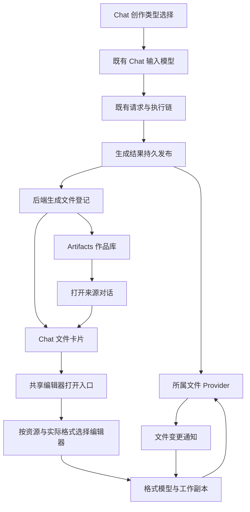

# Chat 创作入口与生成文件

> 状态：设计已采纳，首阶段已接入 Docs/Markdown。下文保留完整目标；当前实现和验证范围见第 12 节，其他格式及旧数据迁移仍按阶段推进。

## 1. 产品对象决定边界

用户从 Artifacts 选择创作方向并进入新的 Chat。生成后的作品出现在 Artifacts 首页，点击作品回到来源对话。在对话中可以继续讨论或打开文件编辑。

由此采用三个互相独立的概念：

| 概念         | 表达什么                                               | 身份与生命周期                                              |
| ------------ | ------------------------------------------------------ | ----------------------------------------------------------- |
| 创作意图     | 希望 Chat 制作文档、演示、设计、表格、白板、分析或动效 | 属于既有 Chat 输入状态；发送时随请求冻结                    |
| 生成文件引用 | 哪个持久文件由哪些生成结果产生，如何再次找到它         | 由后端持久登记；文件关闭、页面切换和任务结束后仍存在        |
| 文档工作副本 | 某个资源当前正在编辑的内容、历史及保存状态             | 由该格式的模型持有方管理，通过 Workbench 的工作副本契约协调 |

请求和执行复用现有消息、Thread、Turn 及取消生命周期。这里不再引入与它们一一对应的 Request、Run 或 Task 实体。

创作意图不决定最终文件格式。一轮请求可以生成多个不同格式的文件，也可以更新已有文件。用户选择 Data 后，可以得到数据文件、分析文档或其他已支持的资源；不据此定义一个 DataDocument。

截图中的 Sheet 也不能直接推导出某种表格模型：电子表格、文档中的表格、CSV 数据集具有不同的编辑语义，需由实际文件格式和能力决定。

## 2. 采用已有底层能力的依据

这些事实只用于核对集成条件，不从现有 Artifacts 页面反推目标架构：

| 已核对的能力                                                                                                                                        | 可以承担的职责                                   | 不应外推的能力                                     |
| --------------------------------------------------------------------------------------------------------------------------------------------------- | ------------------------------------------------ | -------------------------------------------------- |
| [IResourceEditorInput](../../src/ash/workbench/common/editor.ts)、[IEditorService](../../src/ash/workbench/services/editor/common/editorService.ts) | 按资源打开、选择编辑器及管理宿主操作             | 输入对象不等于 ChatInput，也不拥有完整文档内容     |
| [EditorPaneRegistry](../../src/ash/workbench/browser/editor.ts)                                                                                     | 根据资源、内容类型及显式偏好选择 Pane            | 不需要另建一个 Artifacts 私有编辑器注册系统        |
| [DocumentEditorTextModelService](../../src/ash/workbench/services/documentEditor/browser/documentEditorTextModelService.ts)                         | 为受支持的富文档格式共享模型引用与工作副本       | 不表示画布、电子表格或任意二进制格式都已接入       |
| [IWorkingCopyService](../../src/ash/workbench/services/workingCopy/common/workingCopyService.ts)                                                    | 索引活动工作副本，协调保存、恢复与关闭           | 注册表不自动保证同资源只有一个模型，也不是文件目录 |
| [IFileService](../../src/ash/platform/files/common/files.ts)                                                                                        | 资源 Provider 路由、读写、条件保存及变更通知     | URI 可访问不等于格式可编辑                         |
| [ToolOutputArtifact](../../crates/protocol/src/tool_output_artifact.rs)                                                                             | 保留工具输出的文本、字节或 JSON 快照及其来源描述 | 不是统一的生成文件身份、版本或持久目录协议         |
| [AgentHostResourceSnapshot](../../src/ash/platform/agentHost/common/agentHostResourceService.ts)                                                    | 请求与连接期间的临时内容传输                     | 临时 handle 不能充当可重开的文件身份               |

Artifacts 首页把已发布结果作为回到来源 Chat 的入口。VS Code 的 `IChatArtifactsService` 管理单个 Chat 的产物引用；Chat 内按 URI 打开文件可复用 `IOpenerService`。Ash 保留少量发布和来源元数据，让首页在不读取完整对话历史的情况下显示这些入口。

VS Code 的参照是职责关系：Editor 连接工作台，EditorInput 描述可打开对象，模型解析服务管理引用，Widget 提供编辑界面。不是所有格式都要建立四个新类，也不是一个文件只能包含一个类。

## 3. 推荐依赖与数据流



作品库通过生成记录的来源打开对话。Chat 文件卡片通过资源引用打开文件。具体编辑器依赖资源与格式。布局由已有 EditorPart、SessionsPart、AuxiliaryBarPart 和入口组合机制承担。

作品库是一个浏览页面。具体文件以自己的资源输入进入真实编辑器生命周期，不作为首页内部的某个长期隐藏 workspace 保存。返回作品库是导航操作，不是销毁文档。

## 4. 状态所有权

| 状态                               | 唯一持有方                           | 其他组件如何使用                   |
| ---------------------------------- | ------------------------------------ | ---------------------------------- |
| 未发送文本、附件、创作类型         | 既有 Chat 输入模型                   | 创建入口和输入标签读写该模型       |
| 请求参数、执行进度、失败和取消     | 既有 Thread/Turn 执行链              | UI 观察既有执行状态                |
| 文件内容、存储修订及读写能力       | 文件所属 Provider                    | 通过文件契约读取、提交和观察       |
| 生成文件成员关系及来源关联         | 后端生成文件目录                     | Chat 和作品库通过同一领域查询读取  |
| 当前编辑内容、撤销历史和未保存修改 | 格式模型及其工作副本                 | Editor、预览和属性组件借用模型引用 |
| 生成修改的审核与决策               | 既有编辑审核能力，受格式支持范围约束 | UI 投影审核状态，不复制正文        |
| 搜索、排序、筛选、滚动和卡片选择   | 作品库视图                           | 仅保存需要恢复的展示偏好           |
| 选区、缩放、播放状态及属性面板焦点 | 相应编辑器视图                       | 与共享文档内容分开                 |

同一 Renderer 中，同资源、兼容编辑域的不同视图共享同一内容模型。模型持有方负责引用与释放，工作副本注册表只参与协调。打开不兼容编辑器时，需由资源与编辑器契约决定切换、只读或拒绝并发编辑，不能靠两个独立模型最后覆盖写入。

跨窗口不承诺共享同一个内存模型；通过同一文件 Provider 的条件写入及变更通知处理并发。实时共同编辑属于另外的协作协议，不能由此推定已实现。

## 5. 生成文件的身份与目录

### 5.1 两种有实际用途的身份

- Workbench 继续使用规范化资源 URI 表达当前读写位置和模型共享身份。路径比较遵循 Provider 的 authority、大小写及路径身份契约。
- 生成文件目录提供一个在拥有者作用域内稳定的文件记录 ID，用于 Chat 引用、作品库成员关系和重命名后的定位。这个 ID 不替换 URI，也不再派生一个通用 documentId。

稳定记录 ID 是新增的目标契约，不是假定已有 ArtifactId。其必要调用方是 Chat 的历史文件卡片和作品库：它们需要在路径变化后继续找到同一文件。更新原文件复用记录；另存为或导出独立副本产生新资源，不沿用原文件身份。

同一文件可以有多个来源关联，分别引用既有 Session、Thread、Turn、Item 或提供方结果身份。多次提及不意味着复制文件记录。来源坐标必须保留连接、后端及账号作用域，不能仅用裸路径或消息中的名称匹配。

### 5.2 目录只拥有成员关系与必要元数据

目录需要表达稳定记录 ID、所属作用域、资源定位、创建时间和来源关联。文件名、当前大小、当前修订和可写状态从文件持有方读取或通过可失效缓存投影；格式声明由实际格式 Provider 或 codec 拥有。

目录不保存第二份可写正文，不保存编辑器模型，不承担逐键输入的保存，也不为 Docs、Sheet 等入口各维护一套集合。

目录的后端查询与变更契约至少要满足：按产品实际范围列举、按记录 ID 解析、按发布身份幂等登记、更新资源位置和观察成员变化。具体 RPC 字段在所属协议实现时维护，UI 消费归一化领域契约，不导入生成的 transport DTO。

Chat 文件卡片与作品库使用同一生成记录，分别读取资源地址与来源对话。关闭所有编辑器后查询仍然有效。目录成员关系不能只保存在 Renderer profile 或依靠完整重放所有 Chat 消息恢复。

### 5.3 范围与失效

默认目录范围以已有账号、后端和项目/执行环境为依据。切换账号或连接不能把同名文件解析到另一个拥有者。断连表示当前不可访问，不自动视为删除，也不退回当前机器的同路径。

产品显示的“我的”“共享”需要实际所有权或授权事实；在无相应能力时不展示空壳筛选。索引只表达本产品登记的生成文件，不把执行目录中所有文件都认定为生成作品。

## 6. 生成结果如何成为可编辑文件

### 6.1 发布条件

用户选择类型只修改 Chat 输入状态，不创建文件。发送后，类型随既有请求冻结并实际传递到生成入口；仅改变输入框文案不足以完成这条能力。

只有同时满足以下条件，结果才可作为已生成文件发布：

1. 内容已保存到明确拥有者的持久资源；需要多个文件的格式已完成其根资源及必要依赖的有效提交。
2. 文件位置可通过受支持的资源 Provider 重新解析。
3. 来源与文件记录已在所属后端登记，重复处理同一发布不会重复造文件。
4. UI 展示的预览、可编辑和导出能力由真实 Provider/编辑器能力确定。

内容提交和目录登记不要求新建跨系统分布式事务。由现有执行提交链承接发布顺序与重试：内容提交成功后幂等登记；登记失败保留可重试结果，不先宣布文件已可重开；恢复时补齐登记而非重新生成。实施时必须验证此故障窗口，不能只依靠 Renderer 收到一次通知。

生成过程中的进度或尚未完成的预览属于执行展示，不伪装成已经保存的文档。

### 6.2 持久位置

优先使用本次执行所属的已授权项目或会话资源位置，通过同一文件 Provider 管理。本地与远端由 authority 和原始连接定位；浏览器通过已连接 Provider 使用同一资源契约，不默认另建 IndexedDB 作品正文存储。

若没有可写的持久位置，则需要先建立已授权保存位置，或只提供明确的预览/下载能力，不能用临时传输 handle 宣称已实现持续编辑。

外部只读附件保持原来源。需要编辑时，显式导入或转换为持久的可编辑副本，记录来源关系；原附件和副本的内容身份分开。重复点击既有副本引用应重开该副本，不能每次重新导入覆盖用户编辑。

### 6.3 原生格式与导出格式

可持续编辑需要明确的源文件格式、schema/codec 及保存方式。格式支持情况不能由七个入口名称决定。

- 支持直接编辑和无损保存的格式，按其原资源打开。
- 需要转换的格式，通过显式导入建立原生源文件，导出另行生成目标格式。
- 仅能预览的文件使用只读打开能力，不把预览控件标成编辑器。
- 文件包的一致性由该格式的保存边界负责，不让作品库自行写多个资源。

本设计不先创造新的表格文件扩展名，也不把 Office、CSV、画布或富文档格式支持写成既成事实。

## 7. 编辑和更新

打开流程统一为：解析生成文件引用 → 得到资源与打开能力 → 共享 Editor 服务 → 已注册 Pane → 获取共享格式模型/工作副本。

有必要的编辑模型由格式持有方定义；可复用控件属于编辑器内部。正文变化通过模型事务进入历史，持久化经工作副本与文件 Provider 完成。作品库、卡片和预览不得自行序列化另一份正文。

用户和 AI 后续修改存在两条真实路径：

| 路径                                      | 推荐处理                                                                         |
| ----------------------------------------- | -------------------------------------------------------------------------------- |
| 支持模型编辑协议的修改                    | 绑定读取时的模型版本/文件基线，经既有编辑事务及审核链应用；应用点再次检查版本    |
| Shell、外部应用或不支持模型协议的文件修改 | 作为外部变更处理；干净模型按已支持规则重载，有未保存修改时保留本地内容并报告冲突 |

不能承诺所有工具写文件都会自动进入前端模型。文本审核已有 [IChatEditingService](../../src/ash/workbench/contrib/chat/common/editing/chatEditingService.ts)，结构化文档、场景和二进制格式需逐项证明适配能力。未支持的格式保留候选结果供比较或显式替换，不用无条件覆盖冒充统一编辑。

文件提交继续检查 expected revision，保护其他窗口和外部程序的修改。模型版本与磁盘修订保护不同的并发面，两者不能互相替代。

历史 Chat 保留当次生成事实和已有内容快照；文件卡片默认定位当前文件，不把用户后续编辑写回历史工具输出。原始生成版本的查看只在真正有历史存储能力时提供。

## 8. 保存、关闭和恢复

- 页面隐藏、导航和 Chat 任务结束不构成文件关闭；编辑组与模型引用按已有生命周期保留状态。
- 实际关闭及窗口退出走统一 dirty、保存、放弃或备份机制。自动保存是文档保存策略，不属于作品库行为。
- 崩溃恢复由工作副本备份恢复未保存修改；持久文件与生成目录负责恢复已提交作品。不能靠长期保留 DOM 充当恢复方案。
- 重命名、移动和 Save As 通过共享文件/编辑器命令执行；有意的移动在后端更新文件记录定位，并可在失败后修复。外部移动未能可靠追踪时标记位置失效，允许重定位，不能按同名文件猜测。
- 删除对话或关闭卡片不隐式删除文件。删除文件、从库中移除和清理来源关联是不同操作，各自通过拥有者执行。
- 文件缺失、只读、连接离线和格式编辑器不可用分别表达，不能统一当作空作品或自动创建新内容。

## 9. 命名与模块组织

### 9.1 命名依据

| 名称                       | 适用职责                             |
| -------------------------- | ------------------------------------ |
| `chatCreation…`            | Chat 创作方向、创建入口和请求语义    |
| `generatedFile…`           | 生成文件的持久引用、来源及目录查询   |
| `artifacts…`               | 用户可见的作品库页面及其列表呈现     |
| `<capability>Editor`       | 与 Workbench 集成的具体编辑器 Pane   |
| `<capability>EditorWidget` | 编辑器内部可组合的实际编辑界面       |
| `<format>…Model` / codec   | 实际格式需要的数据、事务和序列化能力 |

`EditorInput` 仅在资源需要自定义身份、能力或解析行为时引入；普通资源直接使用共享输入契约。`Service` 仅用于有明确跨组件能力和状态所有权的对象。`Workspace` 保留给真正的项目/工作区上下文，`Draft` 保留给尚未发送的输入或明确的未命名文档语义，不用于泛指生成文件。

上方创建入口、聊天输入框和作品示例共用 Artifact 分类的本地化标签、图标和主题配色。下方已登记的文件以资源名称和真实格式区分。

### 9.2 建议的最小目录形态

```text
sessions/common/
  chatCreation.ts                       核心输入模型与服务使用的最小创作意图契约

sessions/contrib/chat/
  browser/chat.contribution.ts          创建 Chat 并设置创作选择
  browser/chatInputArtifactPill.ts      输入框中已选创作类型

sessions/contrib/artifact/
  browser/newArtifactWidget.ts          上方创建入口的 UI
  browser/artifactKindPresentation.ts   Artifact 分类的标签、图标及配色入口
  browser/artifact.contribution.ts      作品库入口与来源对话命令
  browser/artifactEditor.ts             作品库 EditorPane 与页面组合

sessions/contrib/docs/
  browser/docsArtifactCatalog.ts        将已发布文档与保留的 Docs 工作副本投影到作品库

sessions/services/generatedFiles/
  common/generatedFilesService.ts       文件目录的领域查询/解析契约
  browser/generatedFilesService.ts      后端适配与窗口观察状态
```

这是建议的职责落点，不是要求立即创建的空文件清单。相邻职责尚小时可同文件实现；只有真实调用和所有权成立后才拆分。

创作意图的最小值类型被既有 Sessions 核心输入模型及服务契约消费，因此归 `sessions/common`；入口顺序由 Chat 创作意图的分类顺序决定，展示由 Artifacts contribution 提供。核心与服务层不得反向导入 contribution。

生成文件服务由 DI 在窗口/连接作用域注册，连接其后端持久目录；页面借用服务，不自行创建另一个目录实例。协议 DTO 的验证和转换留在运行适配边界，服务对外提供领域值。共享 Core 或 Workbench 不依赖 Sessions 的此服务；它们只接收资源打开请求。

Chat 创建 Widget 通过公开浏览器 API 供作品库组合。文件卡片使用生成文件公共契约与编辑器打开入口，不反向导入作品库 UI，从而避免 Chat 与 Artifacts 的实现循环依赖。

具体编辑能力独立于作品库宿主注册。已有共享富文档编辑器、文本编辑器及真正可复用的画布机制继续归其能力持有方；产品专属编辑策略留在对应 Sessions contribution。这里不预建七个编辑器目录，也不把所有创作能力机械移动到 Workbench。

### 9.3 七种创建方向如何接入

| 创建方向   | 架构处理                                                                                       |
| ---------- | ---------------------------------------------------------------------------------------------- |
| Docs       | 请求文档创作；按实际生成的文本或富文档格式打开                                                 |
| Slides     | 请求演示内容；由真实演示文档格式及编辑能力决定路由                                             |
| Design     | 请求设计内容；场景/矢量等编辑能力按真实模型接入                                                |
| Sheet      | 请求电子表格成果；公式、引用、格式及保存能力需按实际格式实现，普通表格控件不能代表完整电子表格 |
| Whiteboard | 请求白板成果；可以在语义兼容时共享画布内核，文档身份独立                                       |
| Data       | 请求数据处理或分析；结果按 CSV、JSON、报告等实际输出路由，不预设专属 DataEditor                |
| Motion     | 请求动效成果；可以共享场景与时间线能力，不按入口名称预设新文件实体                             |

可编辑能力由完整的“格式 → 模型 → 编辑事务 → 保存/重开”链路证明。入口选择只改变请求语义，不假定这些能力已经齐备。

## 10. 实施顺序与退出条件

### 先建立一个真实文件的完整链路

选择已有格式与编辑能力支持的文档文件作为首个贯通对象，例如 Markdown。完成创作选择传递、实际生成、持久发布、目录登记、Chat 与作品库定位、共享编辑、保存和重开。

退出条件：关闭所有编辑器并重启后仍能列举和打开同一文件；修改后再次打开保留内容；没有依靠静态示例或页面私有集合得到结果。具体路径中已有能力可直接复用，不为完成目录形态重复实现。

### 再让生成更新接入同一文档生命周期

补齐原文件更新、模型版本和文件修订检查、适用格式的审核、外部变更和失败恢复。验证断连、重试和发布中途退出，不要求等待七种编辑器全部完成才验证基础正确性。

退出条件：用户编辑和生成更新不会静默互相覆盖，取消与重试不会重放成重复文件，正常关闭和崩溃恢复均保留应保留的内容。

### 随实际格式接入其他编辑能力

逐个确认格式、codec、模型和编辑器能力，并复用真正兼容的实现。只在具体需求成立后新增类型专属模型或服务。作品库的查询和打开逻辑不随编辑器数量增长而增加类型分支。

退出条件：作品库打开来源对话。从 Chat 和常规文件入口打开同一资源时，使用相同模型和保存路径。导入、保存源文件、导出副本的行为明确。

### 最后清理旧结构与兼容数据

依据上面的真实入口和契约迁移调用，再移除旧 workspace 宿主及私有状态，不给旧抽象做等价重命名。

迁移前区分真实用户文件、可恢复的旧本地保存数据和纯示例。保留真实内容并建立可验证的新引用；未能识别的数据保留原件并报告，不能因旧抽象不合理就删除。命令、布局恢复值和旧 URI 仅在确有保存消费者时提供有限迁移。

静态示例只在明确的示例/模板入口或测试 fixture 中使用。正式编辑器契约接收资源/模型，不依赖示例对象。所有权确定并实现后，同步现有领域规范并归并本评审稿，避免长期并列维护两套架构要求。

## 11. 验证与尚未承诺的范围

实施验证通过 Ash 自身执行，至少覆盖：

- 创建类型与生成文件格式独立，一次请求可登记多个实际文件。
- 文件和目录登记之间失败后可恢复，重复通知或重试不重复创建。
- 关闭所有编辑器、页面切换和应用重启后，作品仍可发现和继续编辑。
- 同资源在两个兼容视图打开时共享内容；不同文件使用同类编辑器时互不串状态。
- 用户未保存编辑、AI 更新、外部变更和跨窗口条件写入冲突。
- 保存失败、连接失效、文件缺失、重命名及编辑器不可用。
- 外部只读附件与可编辑副本各自的身份和持久位置。
- Electron 和浏览器使用同一领域契约；至少一个远端资源不会被错误路由到本机。
- UI 变更使用 NLS，验证默认语言和至少一种非默认语言；变更导入方向时执行 layer 检查。

上述列表是整个目标架构的验收范围，不代表首阶段全部完成。实时协作、通用离线作品存储、七种格式的完整编辑与任意 Office 格式无损往返不在首阶段实现范围内。

## 12. 首阶段实现与边界

### 已接入的职责

| 能力          | 当前实现                                                                                                                                                             |
| ------------- | -------------------------------------------------------------------------------------------------------------------------------------------------------------------- |
| Chat 创作方向 | `ChatCreationKind` 归既有输入和请求状态；七个入口、输入标签、原生 Chat 和 ChatGPT 请求均消费它。旧草稿字段只在恢复边界归一化。                                       |
| 完成结果发布  | 原生 Docs 回合在写入完成事件的同一个 SQLite 事务中暂存最终回复。App Server 在事务之外写文件；ChatGPT 提供方负责已确认的完整 writing 区块。                           |
| 持久文件      | 首批输出为 Profile 内的 Markdown 文件。来源坐标决定文件身份，原生发布使用共享的原子创建工具，保留已有修改。                                                          |
| 生成文件目录  | SQLite 持有记录和来源，并在一次查询内按账号筛选 Desktop 可见的导入记录。已认证的 Web 连接可查询原生作品，通过共享文件服务读写已登记的单个文件。                      |
| 发布恢复      | 原生登记与移除暂存记录在同一个事务内完成。一份文件失败时保留其暂存记录，其余成功登记的文件仍触发刷新。ChatGPT 导入回执在登记成功后清理。                             |
| 编辑与打开    | Artifacts 卡片打开来源对话。Chat 文件卡片和已发布 writing 的 Edit 把文件 URI 交给 `IOpenerService`；Docs 使用现有 Markdown 编辑器和工作副本。                        |
| 默认保存      | Code 与 Sessions 共用服务注册和自动保存策略；生成目录中的工作副本在编辑后延迟 300 ms 自动保存，退出时等待保存。外部冲突或写入失败保留 dirty 内容并报告，不循环重试。 |

作品库负责列表和导航。Chat 用 `ChatInputArtifactPill` 表达当前草稿的创作方向，并复用其键盘移除和焦点返回行为。已接入发布的 writing 区块在文件登记后启用编辑入口。正文由 Markdown 工作副本管理，目录只保留引用。

### 已验证与未覆盖的边界

定向测试覆盖请求意图、回合完成、回执恢复、账号切换、键盘操作和工作副本。产品场景从作品库的 Docs 按钮发送请求，通过隔离的本地模型服务返回 Markdown，再验证关窗完成、自动保存和重开。

首阶段尚未接入目录记录的重命名、移动、删除和 AI 原文件更新，也未将其他六个创作方向接成原生格式的完整编辑链路。旧画布和表格内容仍通过原入口保留，未因本次职责拆分删除或伪装成新的生成文件。跨窗口冲突及远端文件的完整产品流程仍需各自格式接入时验证。
