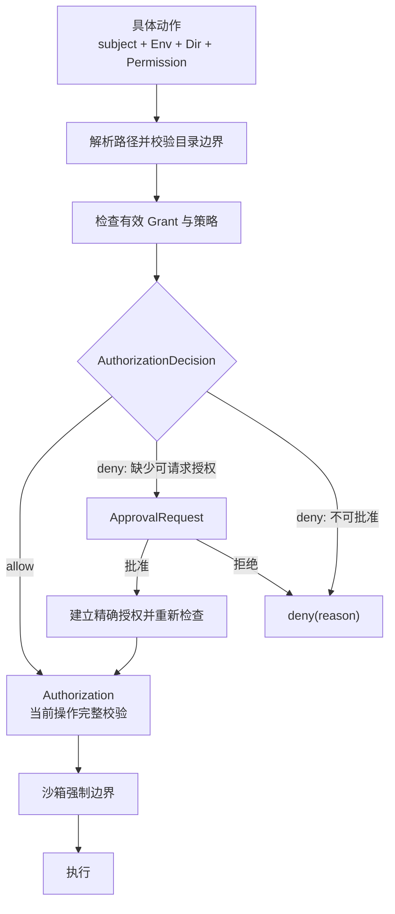

# 环境与目录访问

> 本文拥有 Environment、`cwd`、目录范围和目录授权的跨组件语义。对话与产品组织边界见
> [`domain-model.md`](domain-model.md)，动作审批与执行策略见 [`permissions.md`](permissions.md)。

## 快速理解

| 问题                   | 使用的概念                                    | 不使用                 |
| ---------------------- | --------------------------------------------- | ---------------------- |
| 在哪里执行？           | `Environment` / `Env`                         | Workspace、Project     |
| 相对路径从哪里解析？   | `cwd`                                         | 主工作区               |
| 目录属于哪个运行位置？ | `Dir = EnvId + canonical path + 目录对象身份` | 裸路径身份             |
| 主体可以对目录做什么？ | `Permission + Grant`                          | Trusted / Untrusted    |
| 当前动作是否允许？     | `AuthorizationDecision`                       | 持久 Permit            |
| 缺少授权时怎么办？     | `ApprovalRequest`                             | 自动把目录设为 trusted |

Workspace 可以继续表示编辑器窗口、多根 folder 集合或 workspace 配置作用域，但不是 Agent 执行、
Session 身份或目录安全边界。

计划中的 Project 可以长期关联多个 Environment 和 Dir，但这些引用不是 Grant。Session 从 Project 选择明确目录子集后，仍要逐目录取得权限并冻结实际使用的范围；Project 目录变化不会自动扩大活动 Session。Project 语义见 [`domain-model.md`](domain-model.md#11-project多根与共同工作)。

## 1. 执行结构

```text
Thread defaults
└── execution context
    ├── EnvironmentRef
    ├── cwd
    ├── dirs
    └── grants

Turn overrides?
└── environment / cwd / dirs / grants
```

运行时从 Thread 默认值与 Turn 覆盖计算有效上下文。这组值可以跨接口包装成 `ExecutionContext`，但
不建立独立生命周期、数据库表或全局 manager。

`Environment` 拥有执行和文件系统连接所需的事实：环境 ID、平台、Shell、文件系统入口、临时
目录、连接状态与生命周期。它不拥有 Project、Session tree 或某个用户的全部目录授权。

## 2. 路径、目录与 cwd

裸路径不能跨环境定位资源。`Dir` 至少冻结：

```rust
struct Dir {
    env: EnvId,
    requested_path: AbsolutePathBuf,
    canonical_path: PathBuf,
    object_id: [u64; 2], // 环境文件驱动提供，并保留对应目录句柄。
}
```

路径相同但环境不同，必须是不同目录。同一环境内的路径重新绑定到另一个文件系统对象时，旧 Grant
不得自动沿用。

`cwd` 只决定相对路径如何解析。改变 `cwd` 不会：

- 改变 Project 或 Session tree 身份；
- 把该目录变成“主目录”；
- 增加 Permission；
- 允许加载配置、指令或自动化。

目录集合没有“主目录”和“附加目录”的安全差异。UI 可以突出 `cwd`，但每个目录都必须独立获得
所需 Grant。

## 3. Permission、Grant 与单次决定

```text
Permission
  = 动作种类

Grant
  = subject + scope + permissions + source + revocation lifetime

AuthorizationDecision
  = allow(Authorization) | deny(PermissionDenied)
```

当前 Rust 表达为：

```rust
type AuthorizationDecision = Result<Authorization, PermissionDenied>;
```

`GrantSubject` 明确区分：

- `Environment(EnvId)`：环境级主机授权；
- `SessionTree(SessionId)`：共享一个 `session_id` 的执行范围；
- `Thread(ThreadId)`：只属于具体分支的授权。

`SessionTree` 只是主体作用域，不代表存在 Session store 或 Session event log。

允许分支携带的 `Authorization` 只在当前操作入口与执行之间传递。它绑定主体、目录、Permission、
来源和撤销租约。它可复制、可重复使用，每次操作必须重新校验完整绑定，不是一次性凭证。
文件执行入口持有租约直到 I/O 完成；撤销等待已获准操作结束，返回后旧 Authorization 不能开始新操作。
它不持久化，也不升级成新的领域对象。

`ApprovalRequest` 是缺少 Grant 时的交互。批准可以只覆盖当前动作，也可以由明确的配置入口创建
长期规则；不能把一次批准历史模糊匹配成长期授权。

## 4. 授权流程



批准、Grant、AuthorizationDecision 和沙箱互相独立：

- 批准交互取得用户决定；
- Grant 保存主体在范围内获得的 Permission；
- AuthorizationDecision 判断当前动作；
- 沙箱在操作系统层强制边界。

任何一层都不能替代另外三层。

## 5. 来源权限取代目录 Trust

目录能否贡献行为，由明确 Permission 决定：

| 行为         | Permission         | 含义                             |
| ------------ | ------------------ | -------------------------------- |
| 读取项目指令 | `LoadInstructions` | 允许读取并加入当前 Turn 上下文   |
| 读取配置     | `LoadConfig`       | 允许读取该目录的配置贡献         |
| 发现 Hook    | `DiscoverHooks`    | 只允许发现；运行还需执行授权     |
| 发现 Skill   | `DiscoverSkills`   | 允许发现并按 Skill 生命周期加载  |
| 发现 MCP     | `DiscoverMcp`      | 只允许发现声明，不自动连接       |
| 发现 Plugin  | `DiscoverPlugins`  | 只允许发现声明，不自动安装或激活 |

一个 `Trusted / Untrusted` 布尔值无法表达只读、可写但不可执行、允许指令但禁止 Hook 等组合，
因此不进入目录模型。签名、证书与发布者验证仍可使用各自的 trust 语义。

## 6. 命令与命名

用户命令使用环境、目录和动作组成的短词：

```text
env list
env use <env-id>
env dir list <env-id>
env dir add <env-id> <path> --allow read,search
env dir allow <env-id> <dir-id> write
env dir deny <env-id> <dir-id> exec
env dir remove <env-id> <dir-id>
```

在目录领域内使用 `dirs`、`add_dir`、`remove_dir`；不要写
`additional_directories` 或 `add_additional_directory`。跨模块公开类型使用完整且无歧义的
`AuthorizationDecision`、`DirectoryGrantsConfig`；局部变量使用 `dir`、`grant`、`permission`、
`authorization`。

## 7. 所有权与不变量

| 所有者            | 负责什么                                           |
| ----------------- | -------------------------------------------------- |
| `ash-environment` | 环境身份、物理目录绑定、安全路径解析和目录句柄     |
| `ash-file-access` | `Dir`、`Permission`、`Grant`、撤销、快照与授权决定 |
| `ash-file-system` | 按完整授权执行文件操作，目录句柄约束实际 I/O       |
| 权限策略          | 判断动作应允许、询问还是拒绝                       |
| 批准交互          | 收集用户决定                                       |
| 沙箱              | 强制文件、网络和进程边界                           |
| Git               | `Repo / Worktree` 身份与 Git 操作                  |

长期不变量：

- 路径、`cwd`、Workspace、Project 和 Repo 都不会自动授予 Permission；
- 每个 Grant 都有明确主体、目录范围、Permission、来源和撤销生命周期；
- `AuthorizationDecision` 是一次检查结果，不保存为 Grant；
- 来源配置不能给自身扩权；
- Project、Project 根目录表和同 Project 关系不能产生 Grant；
- Workspace 只表示编辑器窗口、多根 folder 集合、配置作用域、Cargo 或外部标准中的同名概念；
- 后端执行位置使用 Environment，执行范围使用 `cwd`、`dirs` 和 `grants`，不能再借用 Workspace 表达。

## 8. 文件执行契约

- 读文件需要 `ReadFiles`；元数据、列举需要 `BrowseFiles`；写入、条件写入、创建、重命名、删除需要 `WriteFiles`。
- `Access` 绑定唯一主体，所有查询与撤销使用包含环境和物理对象身份的目录键。
- 本地驱动在实际承载环境的进程中运行；不能把任意远端环境 ID 当成本机路径的归属。
- 目录规范化只确定名称；实际 I/O 使用保留的目录句柄。重新绑定后旧 Grant 不获得新对象的权限。
- 条件写入在同一物理目录的进程内写锁下检查和提交；不承诺与其他进程的文件修改进行事务隔离。
- 配置来源可以影响签发政策；配置目录引用不能签发 Grant，已明确签发的贡献权限不再被来源过滤。
- 旧的仅路径目录 ID 不匹配新的物理对象绑定，必须重新建立绑定并取得授权。

## 9. 执行层实现核对（Codex 对照）

2026-10-17 核对本地 Codex `822e58cc3d666166c7446c5b1ea2e52f5d09594c`：
`codex-rs/core/src/config/mod.rs` 分开保存 `cwd`、`workspace_roots` 与权限；
`core/src/session/session.rs` 分别应用执行目录和运行根更新；
`app-server-protocol/src/protocol/v2/{thread,turn}.rs` 分别表达 `cwd` 与 `runtime_workspace_roots`。
后一个字段在该版本仍为实验协议，本次只采用职责约束，不在 Ash 接入它。

| Ash 对象                | 唯一职责与 owner                                                                                                                                  | 权限边界                                                                                            |
| ----------------------- | ------------------------------------------------------------------------------------------------------------------------------------------------- | --------------------------------------------------------------------------------------------------- |
| 窗口 Workspace folders  | TypeScript Workspace services 管理显示顺序、编辑器归属和配置文件；Rust `EnvRuntime.dirs` 路由目录服务                                             | `env/dirs/set` 的根和授权分别解析；目录 ID、顺序、当前 Session 均不代替能力检查                     |
| Session / Thread `cwd`  | `DirContributions.session_environments` 保存显式 Session move 的来源；`ThreadDirs` 拥有受管理 worktree 绑定，绑定存在时决定 Thread 的相对路径基准 | 位置元数据读取不授予 I/O；根重排不会改变已有 Thread 或进程的 cwd                                    |
| 模型 `dirs`             | `DirContributions` 从当前 Session 目录条目和本次 cwd 构造；`ash-agent-environment::Dirs` 只排序、去重和渲染                                       | 不按 Git 检查权限筛掉普通文件目录，不代表可读或可写，也不导入其他窗口的目录                         |
| 目录能力与临时批准      | `ash-file-access::Grant/Authorization` 与 App Server `DirGrants` 按 Environment、Session tree、Thread、Turn 持有和撤销                            | 请求分别取得 `ReadFiles`、`WriteFiles`、`ExecuteCommands` 等证明，不能由 cwd 或根列表推导           |
| Profile、动作批准与沙箱 | config / action-policy 决定约束和批准；App Server 组装 `SandboxScope`，exec-server 与 sandbox backend 执行                                        | 执行目录只有执行权限时默认只读；额外目录的文件证明分别进入范围，每个根保留 profile 和受保护路径规则 |

`DirGrants::bind_thread_dir` 是受管理 worktree owner 使用的宿主授权入口，包含其工作副本的
文件、命令与仓库能力。它不是普通目录导航操作；`session/dir/move` 显式接收权限，窗口根列表不调用它。
这些 worktree 授权仍受生效 profile、路径约束及动作审批限制。

本次修正包括：文件工具与 `apply_patch` 在 cwd 无写权限时不再把相对路径落到第一个额外可写根；
命令沙箱由独立文件能力构造可写范围，不把 `ExecuteCommands` 当作 `WriteFiles`，并包含当前
Session / Thread / Turn 的有效额外文件授权；模型将旧 `filesystem/accessible_dirs` 改为独立
`dirs`，位置元数据与权限分开表达。准备后的 shell 调用保存范围所用的全部文件租约，
审批等待期间撤销任一租约会阻止执行；选择启动方式时也保留只读范围与 profile 的宿主可读限制。
初始环境采集和 Thread 目录切换分别检查 `InspectRepository`，缺少该能力时不执行 Git 采集；
允许加载目录指令不会附带仓库检查权限。
配置提交和后台配置监听也检查非选中根的用户授权变化；失效的根先撤销旧租约、移除服务路由并
清理终端、调试与语言资源。保留根不受影响，新权限由现有 `env/dirs/set` 显式重新绑定，
不能因该根不是当前 cwd 就继续使用旧授权。

窗口的第二根不会自动扩大 Agent 的 Session 权限。Agent 额外目录继续通过已有的 Session 目录授权
或明确批准的 Turn / Session 临时授权进入执行范围；选择命令 cwd 也不改变这些根的权限。
沙箱现有契约要求目录 grant 不重叠，无法无损表示的重叠授权明确失败，不合并成更宽的可写父目录。
本次未改变线上 RPC，也未新增 Main 状态或进程；模型环境块的结构变化属于请求上下文，不改写历史消息。

验证覆盖 `local_tools` 33 项、`environment_runtime` 49 项、`dir_contributions` 20 项、
`agent_runtime` 11 项和 `ash-agent-environment` 8 项。macOS 真实沙箱进程分别用普通沙箱授权和
动作批准验证 cwd 保持、只读根拒绝写入、额外可写根成功写入及受保护文件拒绝读取。
两个受影响包的 check、rust-warnings 和改动文件格式检查通过；本次未运行 Windows / Linux 的真实沙箱。
