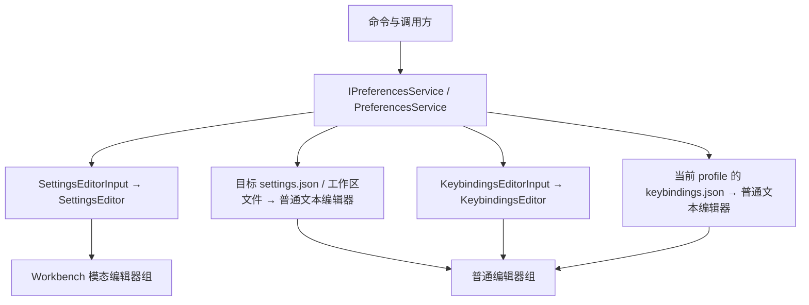
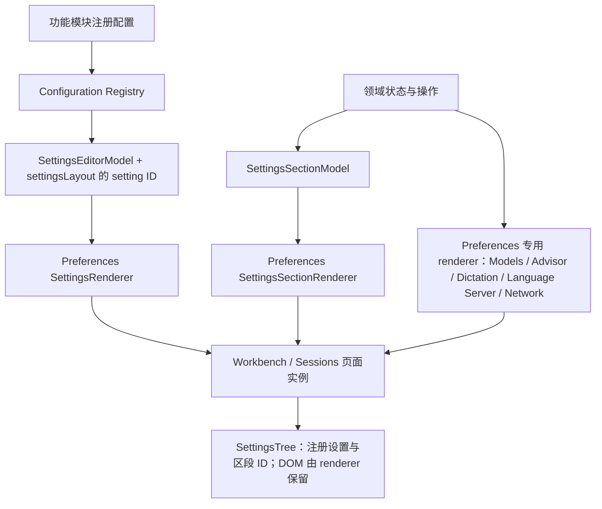
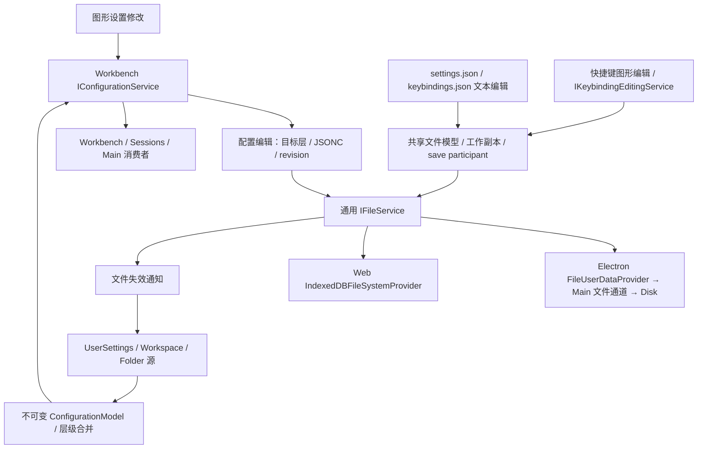

# Preferences、Settings 与 Configuration

> 适用范围：Ash TypeScript Workbench 与 Sessions 的偏好入口和编辑页面。配置存储背景见 [Browser foundation](browser-foundation.md#configuration-architecture)，设置接入规则见 [Preferences README](../src/ash/workbench/contrib/preferences/README.md)。

Preferences 负责打开偏好资源，Settings 是其中一种内容。配置读写、用户设置 JSONC 和快捷键独立资源的主链已接通；用户、Workspace / Folder 目标、语言覆盖、编辑器组选项和 Policy 已完成所选行为的代码验收。真实系统与外部账号的覆盖边界见[已有验证与限制](#已有验证与限制)。本文描述当前架构，不作为全部 VS Code 契约已对齐的声明。

## 打开路径

[PreferencesService](../src/ash/workbench/services/preferences/browser/preferencesService.ts) 选择资源并交给 EditorService，不绘制控件或保存配置值；[preferencesActions.ts](../src/ash/workbench/contrib/preferences/browser/preferencesActions.ts) 注册打开命令。Sessions 的设置对话框提供自己的宿主，并复用打开选项校验、设置模型和 renderer；设置控件由 Preferences 创建。

| 调用                                         | 内容选择                                          |
| -------------------------------------------- | ------------------------------------------------- |
| `openSettings()` / `openUserSettings()`      | 按 `workbench.settings.editor` 选择图形页或 JSONC |
| `openSettings({ jsonEditor: false })`        | 本次明确打开图形页                                |
| `openUserSettings({ jsonEditor: true })`     | 本次明确打开用户设置 JSONC                        |
| `openGlobalKeybindingSettings(false / true)` | 分别打开快捷键图形编辑器 / JSONC                  |

`IOpenSettingsOptions` 支持 `query`、Ash 分类或区段 `section`、`jsonEditor`、`revealSetting`、`focusSearch`、`openToSide`、数字 `groupId` 和 `USER` / `USER_LOCAL` / `WORKSPACE` / `WORKSPACE_FOLDER` 目标；Folder 使用当前工作区根的 `folderUri`。单目录窗口将 Folder 请求归到 Workspace 层。[validateSettingsEditorOptions](../src/ash/workbench/services/preferences/common/preferences.ts) 在改变页面前拒绝错误类型、未知选项与未支持目标。`jsonEditor` 只覆盖本次打开，不修改默认编辑器。

`workbench.action.openSettings` 接受查询字符串或选项对象，例如 `"editor.fontFamily"`、`{ "query": "@modified" }`、`{ "section": "models" }`。图形页查询更新并默认聚焦当前搜索框；`focusSearch: false` 保留现有焦点，`true` 明确聚焦搜索框。显式空查询清除筛选，未传查询保留原搜索，区段定位清除筛选。Workbench 服务持有只读的固定 Settings 输入；编辑器 host 将打开选项交给目标 pane 的 `setOptions`。各 pane 独立拥有搜索、配置目标与控件生命周期，搜索值随页面释放，不写入配置。

## 设置内容与渲染

普通配置与服务区段共用设置树，复杂页面也由 Preferences 的专用 renderer 创建控件。领域模块只提供配置、数据与操作。

Preferences 负责搜索、分类、导航、控件、布局、主题、键盘与无障碍交互；功能模块拥有配置语义和领域业务状态。新接入只提供注册配置或数据与操作，不传 DOM、widget 或渲染回调。完整约束与迁移边界仅在 [Preferences README](../src/ash/workbench/contrib/preferences/README.md) 维护。

普通配置经配置服务读写；账号、密钥、模型发现、Hook 执行与权限继续归各自领域服务。GitHub、Trace、Sandbox、Search 使用数据模型和共享 section renderer，Hooks 使用同一 renderer 提供 Agent Customizations 管理入口。Advisor、Dictation、Language Server 和 Network 的控件及 CSS 归 Preferences。Models 设置使用 Chat 的共享目录 Widget 和 ViewModel；供应商配置表单及其临时探测状态归 Preferences，发现、测试和持久化继续调用 Chat 领域服务。

`SettingsTreeModel` 的区段和交互标题只保存 `SettingsSectionReference`，由当前打开实例的 `SettingsRenderer` 找到保留的控件；不再在可搜索元数据中传递 DOM。Sessions 的普通设置只声明 ID 和顺序，由 `DefaultSettings` 解析注册表中的类型、文案与选项。宿主专属条目使用 `setting.included: false` 退出自动目录，仍可按 ID 显式解析，不改变配置的存储、作用域或默认值。

### 搜索与设置操作

| 行为            | 当前契约                                                                                                                                                                                                                                                               |
| --------------- | ---------------------------------------------------------------------------------------------------------------------------------------------------------------------------------------------------------------------------------------------------------------------- |
| 搜索            | 普通文本匹配 ID、标题、说明、关键词和标签；支持 `@id:`、`@modified`、多项 `@tag:` 和排除 experimental / preview 的 `@stable`，可组合使用。`@lang:<语言 ID>` 选择已注册语言，只显示 registry 声明为 `LANGUAGE_OVERRIDABLE` 的设置；逗号分隔时使用首项，未知语言没有结果 |
| 已修改与已配置  | 按配置服务已接受的所选目标与语言覆盖判断，显式默认值、false、0、空字符串均算覆盖；未选择语言时，语言覆盖块不标记基础设置，服务状态不进入已修改结果。成功保存、外部更新和重置同步刷新内容与目录，失败保留实际状态                                                       |
| 重置            | 删除对应覆盖并保留其他 JSONC；自有 binding 可提供 `isDefault()`                                                                                                                                                                                                        |
| 复制设置为 JSON | 注册表驱动且无自有 binding 的行复制 `"键": 值`，不带外层花括号；执行时读所选目标与语言的值，无覆盖时读窗口默认值。标准 JSON 序列化、两空格缩进，本操作不保存配置                                                                                                       |
| 在 JSON 中编辑  | 同类设置行的菜单及复杂值按钮打开所选目标的 JSONC；Workspace 文件在 `settings` 对象内定位或插入。复用脏模型，缺失键以默认值插入未保存模型，保留注释和其他键，支持撤销并选中值；语言行定位已有语言块，不插入基础用户覆盖                                                 |
| UI / JSON 切换  | 精确注册 ID 查询可定位 JSON 已有键，不创建覆盖；显式 `revealSetting.edit` 才插入缺失键。查询不成为配置内容，切换不丢弃未保存 JSON 草稿                                                                                                                                 |
| 显示语言        | 常规页与配置显示语言命令共用语言服务，写入 `workbench.locale`；内置语言、已安装语言包及后续列表变化进入下拉框，重置清除偏好。搜索支持 language、locale 和“语言”                                                                                                        |

Sessions 菜单使用对话框内的 ContextView，关闭时释放菜单与服务，执行或取消后焦点回到对应的更多操作按钮。已配置标记不进入 Tab 顺序，通过单一无障碍说明提供状态；悬停复用 Hover、当前 ContextView 和 `workbench.hover.delay`，移除覆盖或销毁页面时关闭。操作与失败反馈使用 NLS，剪贴板失败沿设置状态反馈。

产品和扩展 schema 由 `DefaultSettings` 收集；动态 registry 更新目录与已打开页面，扩展名来自本地化 manifest，撤回扩展不删除已保存值。样式归创建控件的代码：[settingsEditor.css](../src/ash/workbench/contrib/preferences/browser/media/settingsEditor.css) 负责页面，[settingsTree.css](../src/ash/workbench/contrib/preferences/browser/media/settingsTree.css) 负责分类树，[settingsWidgets.css](../src/ash/workbench/contrib/preferences/browser/media/settingsWidgets.css) 负责搜索与设置控件。

### 工具、沙箱与 GitHub

[ILanguageModelToolsService](../src/ash/workbench/contrib/chat/common/tools/languageModelToolsService.ts) 在 `chat.shared.contribution.ts` 注册，由 Workbench 与 Sessions 共享入口加载。browser 实现将 App Server DTO 转为整体替换的只读目录快照；消费者先 `refresh()`，再读取 `getAllToolsIncludingDisabled()`、可观察 `toolSets` 和引用查询。它不提供工具注册、启用或执行入口。

`EnvToolPorts.replace` 成功安装且目录内容变化后，沿 UpdateBroker 向同一 Environment 的连接发送空参数 `agent/tools/changed`。前端合并并发刷新及读取期间的变更通知，失效旧读取，替换快照后触发 `onDidChangeTools`；断线清空列表，重连后重读。已打开的引用与配置选择器订阅事件，保留搜索、仍存在的选项及未提交的禁用选择，关闭时释放订阅。

Skill 补全和引用通过 `getFullReferenceNames()`、`getFullReferenceName()`、`getToolByFullReferenceName()` 与 `IToolSet.getTools()` 消费同一快照。来源组名由来源类别与编码 ID 组成，空 ID 使用保留段 `@`，MCP 工具集使用 `/*`，外部引用带来源组前缀；后端 ID 保留为解析别名，选择和执行仍传后端 ID。Skill 的 `allowed-tools` 仅是目录提示，不授予权限。来源、权限和暴露方式是 Ash 元数据；当前接口无模型参数或目录版本，不提供模型筛选或完整 VS Code `ToolDataSource`。

设置与 MCP 详情消费同一工具契约；沙箱准备诊断由 [IAgentCapabilitiesService](../src/ash/platform/agentCapabilities/common/agentCapabilitiesService.ts) 提供，目录授权仍归 `IWorkspaceTrustApi`。GitHub 设置显示 Codex 登录与 Ash GitHub 账号、检查仓库访问并链接官方 Connector / 自动审查管理页；Ash 访问成功不代表官方 Connector 获授权。PR 页使用 GitHub 账号提交 `@codex review` 并分页读取评论与审查讨论；结果不确定时须先确认远端结果，不能重复提交。

## 快捷键资源与生命周期

快捷键使用独立的有序 `keybindings.json`，不经过 Settings 键值 API，也不增加 App Server 接口。图形编辑与 JSON 编辑共享当前 profile 的文件模型，经 `IKeybindingEditingService` 保存或移除绑定，保留注释、参数与其他绑定。

`KeybindingsEditorInput` 持有唯一 `KeybindingsEditorModel`，管理行和服务监听；各 pane 分别持有搜索与录制草稿。打开请求和 pane 分别取得输入引用，最后一个引用释放时销毁模型；重复打开、失败、取消和恢复输入均沿同一生命周期。Editor Part 释放 pane 而不自动释放传入输入，因此该引用规则留在 Preferences。

录制最多四段组合键，首个输入替换原值，第五段开始新序列并显示和朗读提示。裸 Enter 保存；裸 Escape 清空，再按一次取消；Tab / Shift+Tab 移动焦点。这些裸键绑定通过 JSON 编辑，带修饰键的 Enter / Escape 可录制；重复 keydown、IME 组合输入与纯修饰键不计入。

保存期间禁用草稿、行操作和取消按钮，失败保留草稿并允许重试。取消后返回原行按钮，行已被替换则返回搜索框；保存后仅在焦点仍属于当前页时聚焦搜索。清空输入或销毁后，异步结果不得更新退休草稿；隐藏页面或焦点转移后不恢复焦点。页面可以在保存未完成时关闭。

## Models 设置

模型目录由 `ChatModelsWidget` 呈现，Preferences 的 `ModelSettingsRenderer` 将它接入设置树，`ModelProviderSettingsRenderer` 呈现供应商配置。`workbench.action.chat.manage` 和聊天选择器的 Add Models 直接打开“设置 → Models”，带入可选查询并聚焦模型搜索。即使默认设置编辑器为 JSON，此入口也打开图形设置。模型目录、开关、发现和凭据仍通过所属服务操作。

Workbench 和 Sessions 共用 `ModelSettingsRenderer`。模型目录按供应商排列，同一供应商内按发布时间从新到旧排列；默认收起为每家供应商的首个模型，`viewall models` 在概览与完整列表间切换。完整列表显示按连接 ID 划分的供应商分组、组开关、折叠操作和搜索筛选建议；同名连接保持独立，只有一个连接时也提供组操作。概览中的可见模型按置顶、已开启和未开启排序，完整列表在各供应商内使用相同排序，各组内部保持目录原序；关闭未置顶的模型后回到未开启组中的原有位置，与开启先后无关。列表顶部的模型搜索框按名称和 `provider/model` ID 搜索整个目录，搜索结果使用同一排序规则，清空搜索后恢复展开状态；API key 区域不参与这个局部搜索。供应商开关作用于该连接的全部模型，包括搜索结果之外的模型；失败保留服务中的实际状态并显示错误。键盘切换开关后，保存完成时焦点留在同一个控件上。从折叠分组返回概览时恢复概览模型。

`ModelCatalogConfiguration` 拥有模型开关的界面默认值：只开启 GPT-6.1 Sol、GPT-6 Astra、GPT-6 Luna、Claude Opus 5.5、Claude Sonnet 5.5 和 Grok 4.7。其他内置、后续新增及自定义模型默认关闭。手动修改由配置服务写入同一份用户设置，模型选择器通过 `ILanguageModelsService` 使用这些开关。

`models.hidden` 保存偏离默认值的选择。已有 `{ provider, model }` 条目继续表示关闭，新增 `{ provider, model, visible: true }` 条目表示开启默认关闭的模型；`visible` 仅接受布尔值。恢复某个模型的默认值时移除对应条目，不保存另一份模型目录。

Models 管理命令的搜索参数通过 `IOpenSettingsOptions.sectionQuery` 交给 Models 自身的搜索框，保留 `@provider:` 和 `@capability:` 语法。`sectionQuery` 需要图形设置分类及实际提供搜索能力的 renderer；不会经过全局设置查询的规范化。Workbench 和 Sessions 均复用这一能力。

完整模型列表支持勾选模型、Shift 范围选择、选择全部可见结果，以及对所选模型批量显示、隐藏、置顶或取消置顶。多选仅存在于当前 Widget；置顶使用本地用户设置 `models.pinned`，和显隐设置 `models.hidden` 独立。Chat 选择器在各供应商内优先排列置顶的可见模型。搜索支持词首、驼峰首字母、高亮及 `@` 补全；供应商过滤按实际 ID 或完整名称精确匹配。

模型行内的 Ctrl/Cmd+A 选择所有可见模型，Shift+方向键扩展范围；搜索框仍使用原生文本选择。右键、行操作按钮或 Shift+F10 打开当前选择的菜单。未勾选模型时收起批量动作，清空选择后焦点回到全选按钮。单模型菜单只呈现当前连接实际支持的长上下文和加速选项，通过原 `setModelPreferences` 保存，不切换当前聊天的模型或推理深度。

供应商菜单可以刷新目录及定位现有配置；自定义模型菜单可直接打开对应手工声明的编辑器，订阅连接复用账户管理。设置宿主接收页面的 reveal 请求，清除全局设置搜索后定位现有控件。两个窗口的模型菜单及子菜单归各自设置容器拥有，关闭设置时释放。

供应商级目录状态来自 `model/list.catalog_statuses`，保留实际 provider、connection、新鲜度和稳定问题分类，不传递原始错误或凭据。发现失败保留此前目录，空目录仍保留供应商标题及配置入口；刷新进度由发起请求的 Widget 临时呈现。状态随模型服务的目录快照更新，和 API key 是否保存、模型测试或实际调用权限分开。

完整列表以模型选择、显隐、置顶和批量操作为主，模型行仅附带已确认的工具调用、图像输入和 Agent 模式能力摘要，不重复铺陈未知状态、来源与价格细节。悬停模型开关，或聚焦后执行“显示或聚焦悬停提示”，可查看能力三态、模型厂商、实际连接、元数据来源及完整参考价格；无障碍视图保留同样的事实和价格依据。`@capability:tools` / `toolCalling`、`@capability:agent` / `agentMode` 只匹配明确支持的条目。磁盘恢复的目录标记为已保存的供应商数据。

能力摘要按钮可以切换对应筛选条件，保留供应商和普通文本查询；按钮独立于模型显隐开关，选中反馈同时使用主题样式和 ARIA 状态。

参考价格复用后端已有价目表，保留币种、每百万 token 单位、服务等级、区域、输入区间、版本及核对日期；不是订阅账单或 Copilot credits。订阅、自定义网关和显式端点覆盖不会继承厂商公开价。缺少价格表示未知，零金额保留为零。模型来源、能力、价格单独变化也刷新界面。

自定义供应商的“删除供应商”经确认后，通过既有 App Server `provider/remove` 删除配置和保存的 API key，并清理该连接的本地模型偏好。内置供应商保留。进行中的密钥保存会在删除前完成，以免迟到的写入重新创建连接。

模型管理的目录、分组、显隐和交互契约参考 VS Code；Ash 明确选择由 Workbench 与 Sessions 的设置页承载。独立模型 Editor、EditorInput、标签页恢复与专用页面样式不属于保留范围，不通过空壳文件补齐它们。该产品差异不代表共享能力已经全面对齐，实际差异见下方审计。

| 文件                                                                           | 职责                                                                   |
| ------------------------------------------------------------------------------ | ---------------------------------------------------------------------- |
| `workbench/contrib/chat/common/languageModels.ts`                              | 模型服务契约与实现；目录加载、供应商发现和测试操作，两个窗口各一个实例 |
| `workbench/contrib/chat/common/languageModelsConfiguration.ts`                 | JSONC 设置声明、六个默认开启模型、模型开关数据格式                     |
| `workbench/contrib/chat/browser/languageModelsConfigurationService.ts`         | 模型开关、置顶、默认模型及上一次选择的保存与事件                       |
| `workbench/contrib/chat/browser/chatManagement/chatModelsViewModel.ts`         | 模型目录的过滤、供应商分组、折叠、选中项、置顶及可见性操作             |
| `workbench/contrib/chat/browser/chatManagement/chatModelsWidget.ts`            | 两个窗口设置页中的模型概览、完整分组列表、筛选、开关、焦点和无障碍内容 |
| `workbench/contrib/chat/browser/chatManagement/chatManagement.contribution.ts` | 注册模型管理命令，验证查询参数并调用 Preferences 打开 Models 设置      |
| `workbench/contrib/chat/browser/chatManagement/media/chatModelsWidget.css`     | 共用模型列表的布局与文本溢出                                           |
| `workbench/contrib/preferences/browser/modelProviderSettingsRenderer.ts`       | 供应商表单、私有探测状态、模型表格、键盘操作与行内编辑                 |
| `workbench/contrib/preferences/browser/modelSettingsRenderer.ts`               | 将模型管理接入两个窗口的设置树                                         |

公开 API、调用链和上游专属契约的逐项核对见 [chatManagement 审计](research/chat-management-api-alignment-2026-10-23.md)。目录查询、分组和显隐操作由 `ChatModelsViewModel` 提供，供应商发现与探测状态由 `ModelProviderSettingsRenderer` 的私有实现持有。选择器的“添加模型”经过 `workbench.action.chat.manage` 进入同一设置页；模型目录、供应商凭据和手动模型由各自现有服务管理。旧 Language Models 标签页的 serializer 不再注册，working set 恢复使用现有的未知编辑器跳过机制，其余标签页照常恢复。

API key 输入框失焦即保存，清空即移除；成功保存不弹通知，失败显示输入框错误并进入通知服务。密钥由后端 secret store 保存，界面只用掩码表示已配置状态。

`Test models` 测试当前表格全部模型，与启用开关无关；表格为空时先发现模型。`Refresh models` 重新发现，保留手动配置和启用选择。发现成功的空列表、尚未发现、发现失败是不同状态，失败保留之前成功的列表。批量测试逐行更新结果，最后只发一条汇总通知；橙点表示未通过，绿点表示通过，同时提供文字状态。探测通过不证明 1M 上下文可用。

`Add model` 添加 Model ID、上下文 token 数、可选上游 Model ID 与 1M 预设。上游 ID 映射只解析一次，由 Rust 在真正发送请求时使用；配置、开关和上下文绑定界面 ID。行内可编辑上下文和映射，也可删除手动声明；删除发现模型的手动上下文声明后，端点模型仍在表格中并关闭启用开关。Rust 的 models-manager 拥有发现与缓存，model-provider 拥有 HTTP 发现、分页和探测，成功发现的自定义模型进入聊天选择器。ChatService 只保留聊天、线程和 Advisor 配置操作。

Chat → Agents 中的审查模型和提交信息模型由 Preferences 的 `AgentTaskModelSettingsModel` 与共享 renderer 呈现，分别读写后端 `agent.codeReviewModel` 和 `agent.commitMessageModel`，不改变对话模型。提交信息模型为空表示继承产生改动的那一轮对话模型；`agent.commitMessageEnabled` 独立控制自动生成，关闭后保留模型选择。更换模型会由配置 owner 清除原有目录授权，生成仍经过既有的目录授权检查。这些值均为后端用户配置，不另存到 Workbench `settings.json`。文件 schema 12 保留旧配置的显式模型并启用自动生成，原先未配置模型的用户保持关闭。继承时仍校验实际模型与目录授权绑定的接入；授权 API 可传入该轮模型，模型或接入不匹配时不生成，也不静默退回用户默认模型。

## Configuration 的存储与配置层

图中配置重读分支解释设置文件；`keybindings.json` 由快捷键 owner 解释，Web 资源为 `ash-userdata:/user/keybindings.json`，Electron 使用当前 profile 文件。UI 的 `settings.json` 由 TypeScript 配置系统解释，Rust `config.toml` 归后端配置领域及其宿主入口。密钥归 secret store，页面搜索、选区与展开状态归 UI 状态。

Preferences 首次打开缺失的设置文件时以不覆盖方式创建普通 JSONC，竞争创建保留另一窗口内容。设置 JSON 值的 save validator 归 Preferences，文件 provider 不解释配置语义；非法保存保留脏草稿，外部非法 JSONC 保留最后有效配置。文件 revision、脏文件保护和冲突归通用文件服务与工作副本，配置层不保存第二份文件版本。

| 负责方                                                         | 职责                                                                         |
| -------------------------------------------------------------- | ---------------------------------------------------------------------------- |
| platform `configurationModels.ts` / `ConfigurationModelParser` | 值树、语言覆盖、合并与不可变快照；Workbench 复用 `parseRaw`                  |
| platform `configurationService.ts` / `UserSettings`            | 单资源读取、文件失效和父目录提示；Windows 按文件系统大小写规则比较           |
| Workbench `configurationService.ts`                            | 配置层组合、resource / folder 解析、inspection、keys、写入目标与资源定向事件 |
| Workbench `configuration.ts`                                   | Workspace / Folder 的 JSONC 源、watch、条件写入和切换生命周期                |
| Sessions `configurationService.ts`                             | 动态 registry 的窗口默认值与只读规则，不缓存第二套元数据                     |
| profile / 文件 provider / 工作副本                             | 资源身份、存储、revision、脏模型、save / revert 与冲突                       |

多根 Workspace 读取工作区文件的 `settings` 对象，Folder 读取所属根的 `.vscode/settings.json`；单目录窗口把后者解释为 Workspace 层。默认 → 用户 → Workspace → Folder 的普通值先组合，再应用语言覆盖，Policy 最后覆盖。单语言覆盖优先于组合语言覆盖；对象按成员合并，数组整体替换；旧事件与快照保持不可变。

Workspace 排除 application / machine 设置，Folder 进一步排除 window 设置；Sessions 固定值在用户、Workspace、Folder 和语言覆盖中均过滤。动态注册、撤回和重注册即时重建默认值与只读规则。写入只修改目标属性并保留注释；无显式目标时选已有最高层，删除时遍历已有层。脏模型先经原 owner save / revert，revision 拒绝并发冲突；工作区切换撤回旧 watcher 和写入信号，拒绝迟到读取。

配置专用 IPC、revision envelope、虚拟设置 provider 和浏览器旧持久化链已退出生产装配；旧 IndexedDB 配置仅一次性迁移。Web 备份仍归 `IndexedDbWorkingCopyBackupService`，不经过 Rust backup RPC。

## Policy 来源

Policy 的定义注册、值校验、最高优先级、写入限制和撤回均进入现有配置链。非法更新保留同一 setting／policy 身份的上次有效值；明确删除才撤回。系统来源和窗口组合来源分别归各自作用域的一个 policy service。

| 系统    | Desktop Main 的来源                                   |
| ------- | ----------------------------------------------------- |
| Windows | `HKLM\SOFTWARE\Policies\Ash`，DWORD 0／1 对应 boolean |
| macOS   | `/Library/Managed Preferences/com.ash.desktop.plist`  |
| Linux   | `/etc/ash/policies.json`                              |

Windows／macOS 的进程级 `SystemPolicyService` 每 2 秒检查变化，命令有 timeout、输出上限、退出取消及隐藏窗口；Linux 走文件 watcher。Workbench／Sessions 通过只读 `PolicyChannelClient` 消费 Main 的值，IPC 不开放任意路径或策略写入。策略定义不能在窗口间改变既有类型。`DesktopUpdateChannel` 映射 `update.policy` 的 `latest`／`stable`／`never`。

账户来源沿 primary grant → `IGitHubService.readManagedSettings(accountId)` → 可取消 App Server 请求 → `github/account/managedSettings` → 该账户的 GitHub client → `/copilot_internal/managed_settings`。协议只收账户及 operation ID，不收凭据或自定义 URL。HTTP 404／空对象撤回；权限、网络和非法输入保留同一账户的最后有效快照。登录切换取消旧请求，退出清空，迟到结果不能恢复旧账户策略；当前账户每分钟刷新。

`AccountPolicyService` 同时通过 `IAccountPolicyService` 提供刷新状态与显式 `refresh()`；两者使用同一窗口实例，不增加账户或策略 owner。GitHub 设置显示主账户的刷新中／成功／失败、最近尝试和当前账户／host／凭据代次下的最近成功时间，并提供“刷新托管设置”。重复请求合并；失败保留旧值时明确显示，凭据代次变化不继承旧成功时间。该操作独立于仓库账户选择和“刷新账户”，状态由现有设置状态区域向辅助技术播报。

仅 managed-settings 请求的 HTTP 466 映射为领域 `ManagedSettingsUpdateRequired` 和 RPC `GitHubManagedSettingsUpdateRequired`；不解析或转发错误正文及其他客户端的版本要求，也不触发 Ash 更新。它作为失败保留已有策略，成功或权威撤回后恢复状态。本链没有强制新鲜度或 AI 执行门禁；刷新失败不会写入 `chat.disableAIFeatures`。

`AccountPolicyService` 只解释 registry 声明的映射。新聊天模型恢复 Chat Input 上次选择，不再注册 `chat.defaultModel` 或其默认模型策略映射。`ChatAIDisabled` 仅为系统策略，不伪造 Copilot 字段。`MultiplexPolicyService` 组合系统优先、账户其次；映射函数留在 renderer，Main 只传类型声明和策略值。

## 页面与公开契约的边界

SettingsEditor 持有所选目标与搜索语言；目标按钮使用现有 ContextMenu 切换用户、工作区及多根工作区中的 Folder。普通控件的 binding 固定该次创建时的目标、资源与语言，读取该层和默认值，修改与重置显式传入相同地址。上下文变化释放旧控件；已开始的写入沿旧地址完成，工作区发生替换时由配置 owner 拒绝迟到写入。注册表仍是作用域的唯一来源，不用配置键前缀猜测语言能力。

Sessions 保留其产品设置宿主；Workspace / Folder、语言查询以及侧边／指定组请求交给共享 Workbench SettingsEditor。显式编辑器组请求显示文档宿主，默认的图形设置请求继续使用现有弹窗。普通资源编辑器的字号和字体名按当前 model 的资源与语言读取，并随配置或语言变化更新；其他设置仍须由各自消费者遵守声明的作用域。

`openToSide: true` 优先按当前侧边方向打开，并避开隐藏或锁定的组；数字 `groupId` 选择现有组，组已关闭则回到活动组。两种选项适用于图形页与 JSON；默认图形入口保留 Ash 的 modal 宿主。图形页内的目标菜单、JSON 按钮和 JSON 标题栏的返回按钮均携带来源组，避免操作跳到其他组。`preserveFocus: true` 可以更新另一组的查询并保留当前焦点。重开同组复用原 pane，另一组的搜索与目标保持独立。

EditorGroupModel 是数字组 ID 的分配 owner；组操作、命令上下文、扩展边界和 Sessions 文档布局消费同一身份。旧工作集的字符串 ID 在 EditorPart 恢复边界验证并转换，保存只输出数字；嵌套布局、标签顺序和活动组随同恢复，与保留的 Sessions 产品页组冲突时重新分配文档组身份。Ash 尚未采用上游全部 Preferences 容器和公开 API。

registry / schema、typed parse / serialize、`ashBinding` 等额外契约按真实消费者决定，见 [TODO 的发展候选](../TODO.md#发展候选未排期)，不按上游成员表整体补齐。

## 已有验证与限制

2026-10-30 按本轮代码验收口径完成系统与账户 Policy 核对：`policy.test.ts` 7 项、`systemPolicyService.test.ts` 3 项、`windowsRegistryPolicy.test.ts` 1 项及 `accountPolicyService.test.ts` 13 项通过。新增测试直接走默认 macOS 读取分支，以受控文件／进程边界验证固定 plist 路径和 plutil 参数、失败保留、删除撤回、释放取消及迟到结果；账户测试覆盖两个身份、host／凭据代次变化、非空策略保留与撤回、退出和真实配置消费者。日志为 `.build/todo-code-audit-policy-elevation-container-retest.log`。对应 TODO 按代码标准消项；本轮没有执行 macOS 系统管理配置、真实组织账号切换或界面验收，历史真实环境覆盖的限制仍适用。

2026-10-30 在 Windows x64、`a174f34dfd` 上按源码契约与定向测试收口所选 Preferences 行为：`PreferencesService` 与既有配置／文本模型 owner 贯通 User、Workspace、Folder、语言覆盖、重置、JSON 脏草稿和数字编辑器组；核对本地 VS Code 的 `IOpenSettingsOptions` 与组路由公开契约，未复制其内部实现。`settings-json.test.ts` 18 项、配置服务 3 项通过；Sessions Preferences 2 项及 EditorPart 的组、模态窗口和焦点回归包含于布局批次 268 项中，控件测试另通过 14 项。日志为 `.build/todo-code-audit-contracts.log`、`.build/todo-code-audit-layout-preferences.log` 与 `.build/todo-code-audit-workflows.log`。本轮没有新增上游实窗配对证据。

2026-10-30 在 Windows x64、`473f5cd4ea` 上重跑 `settings.test.ts`，49 项全部通过，覆盖注册目录、搜索与已修改过滤、重置、JSON 操作、配置保存及中英文控件契约；日志为 `.build/todo-acceptance-code-contracts.log`。Windows 125% 下另采样 32 个真实窗口宽度，相邻输入框／筛选按钮的 DOMRect 边界出现小于 0.001 CSS px 的浮点误差；对应 smoke 断言仅容忍该测量误差，仍拒绝可见重叠。采样在 `.build/todo-acceptance-20261030/preferences-fractions.json`。

2026-10-29 修复 macOS 打开 Settings 失败：生产 Canvas contribution 已注册 `chat.canvases.enabled`，但 Settings 分类表遗漏该项，完整性检查因此中止窗口创建。将其纳入 Agent Defaults 的 Editing 分类，并让 Settings 单测加载真实 Canvas 注册；新增注册先复现相同错误，修复后该文件 49 项全部通过。正常 Desktop 构建及真实 App Server 的模型持久化／窗口重开场景随后通过。诊断、红绿测试和构建日志位于 `.build/macos-model-acceptance-20261029/`。

2026-10-29 已用隔离 HOME、profile 和合成工作区实际启动本地 Code OSS 1.145.0，并通过命令面板打开可见 Settings。该可运行性探针解除旧的“本地无可运行构建”阻塞，不覆盖目标／语言／重置／JSON 草稿和编辑器组的完整窗口配对。运行时为 Electron 43.8.3／Chromium 150.0.7871.250；源码检出为 `6c21985de64`，未重新构建上游，因此不以该 SHA 证明已运行产物对应某个源码版本。截图仍有内置 git-base、Emmet 和 GitHub Authentication 的缺模块通知；仅确认 Settings 基础窗口可运行，涉及这些扩展的配对须先补齐上游构建。探针脚本、结果、截图和 trace 位于 `.build/macos-todo-20261029/upstream-preferences-*`。首轮在打开 Settings 后因探针将搜索控件误识别为 textbox 而失败；最终探针仅断言本次需要确认的启动和 Settings 可见性，保留首轮产物于 `upstream-first/`。

2026-10-18 在 `e6b5688e5` 加本批改动上闭合配置迁移窗口复核。修复设置值在编辑器获焦前被选中时辅助 live 文本滞后：View 在收到获焦事件时读取当前选区，失焦时不覆盖帮助提示。修正 Browser 外部写入测试辅助工具的文件类型，使用 `FileKind.File`，避免重载把设置文件识别为非文件。设置菜单的 JSON 编辑入口改由真实动作回归；选择内置主题的测试依赖真实扩展宿主，断开后端的 UI 测试不假设已加载内置主题。

该批通过 55 项定向单测（4 文件）、5 项 Browser smoke（中英文 JSON 选区、外部更新／跨窗口重读、非法值保存、脏草稿／冲突与中英文缺失主题回退），以及 6 项 macOS Desktop App Server smoke（上述场景及已安装 Ash Dark 的选择）。缺失主题保留原 ID，返回 System 后删除默认值覆盖；没有重现 `Unknown select option`。Web／Desktop 构建、Renderer 4,205 文件及自动化 2,872 文件类型检查、formatter 和 Editor CSS ownership audit 通过。Browser 通过记录分布在 `.build/todo-preferences/current-browser-complete.log` 的 3 个未受后续测试断言修改影响的场景及 `current-browser-appearance-final.log` 的 2 个场景；Desktop 记录为 `current-desktop-complete.log`，单测为 `current-unit.log`。

真实 macOS 27.0.1 arm64、Electron 44.4.5 的三步录制另外通过缺失主题恢复到已安装主题、JSON 选区／live 文本一致和实际 profile 文件保存／重载。证据目录为 `.build/ash-playwright-mcp/evidence/preferences-migration-review-2026-10-18T13-09-27-629Z/`，包含报告、PNG、trace、原始 WebM 和带步骤字幕的 MP4；已检查关键 PNG 与两份视频的逐秒画面。构建来源、版本、文件大小和 SHA-256 见 `.build/todo-preferences/current-evidence.json`，该录制 runner 使用 Node 25.2.1，最终 smoke 使用仓库要求的 Node 24.21.0。本批仅验证 live 区域 DOM，未进行物理屏幕阅读器验收；不替代系统 Policy、真实账号、其他 OS 或 VS Code 的窗口配对。

2026-10-18 的目标／语言入口批次通过 161 项定向单测（9 文件）、5 项 Browser smoke、3 项 macOS Desktop UI smoke 和 2 项 macOS Desktop App Server smoke：中英文查询复用、用户／Workspace／多根 Folder 的语言覆盖读写和重置、原始文件隔离、重载、键盘目标菜单、高对比度焦点与窄窗口布局。真实编辑器按语言显示已保存字号，另一根修改不改变当前文件字号；单测另覆盖字体名、语言切换、工作区替换取消、JSON 草稿和嵌套字段保护。Browser 覆盖多根 Folder；Desktop App Server 覆盖单目录 Workspace 的真实文件链。日志位于 `.build/todo-preferences/` 的 `unit.log`、`browser.log`、`desktop-ui.log` 和 `desktop-scopes.log`。这些 Ash 结果不代替本地 VS Code 的窗口配对，也不覆盖其他内置设置尚未声明或尚未消费的作用域。

编辑器组批次另覆盖指定组重开、侧边优先级、独立查询、保留焦点、关闭后重开、旧工作集嵌套布局转换与数字 ID 冲突，以及扩展请求边界。Browser 的中英文组切换和目标／语言场景共 6 项、Sessions 侧边入口 1 项，以及 macOS Desktop UI 的中英文组切换／查询和 Sessions 侧边入口 5 项均通过。日志在 `.build/preferences-groups/` 的 `browser-windows-final.log`、`browser-sessions.log` 和 `desktop-final.log`；下方验收限制仍然适用。

Web / Desktop 构建、Renderer 与自动化类型检查、formatter 和定向 CSS 检查通过。Bun 全量测试类型检查（5,228 个文件）与 Terminal 配置／profile 的 43 项定向单测也已通过。

存储迁移与跨平台验收的历史范围如下；设置渲染的检查范围另列于表后：

| 范围                        | 已有证据与适用限制                                                                                                                                                                                                                                                                          |
| --------------------------- | ------------------------------------------------------------------------------------------------------------------------------------------------------------------------------------------------------------------------------------------------------------------------------------------- |
| 配置文件与迁移              | 模型、文件 IPC、Sessions、Settings JSONC、层级边界和真实 Chromium 旧 IndexedDB 迁移已有定向验证，包含冲突、非法输入、中断重试；历史类型检查、构建与中英文回归不代表当前 HEAD 全部通过                                                                                                       |
| Workspace / Folder / Policy | 定向测试覆盖优先级、inspection、作用域、JSONC、切换、迟到读取、冲突与脏保护；系统 / 账户链、Windows 固定注册表只读探测及 Linux 固定系统文件的真实 Desktop 链已有验证；macOS OS 来源及真实组织账号仍待验收                                                                                   |
| 快捷键录制                  | 保存一致性基线 `2cc6ab4e` 上通过 13 项 recorder 单测、macOS Web 7 项及 Electron 6 项严格场景，覆盖两段 / 四段、JSONC / 参数保留、立即重载、失败重试、中文、焦点与 pending-close；2026-10-19 在当前 Dev Container 重跑完整 Keybindings UI 9 项通过，包含真实重启后的中文场景与 Sessions 入口 |
| 配置迁移窗口复核            | 辅助 live 选区文本滞后已修复；缺失主题回退、已安装主题选择及文件更新／脏草稿／冲突场景已通过上方本批 Browser 与 macOS Desktop 验证。旧准备阶段的 App Server 文件访问 API 类型错误此前已通过重新生成协议解除；本批不扩展到其他 OS 或真实账号验收                                             |

快捷键早期 Web 重载失败由 editor / backup owner 修复，原 recorder 场景与不打开 recorder 的对照随后通过；没有增加保存后等待备份删除或放宽文本断言。该批 Web / Electron 仍记录既有 Session catalog 与 syntax document 关闭期 console 错误，不能描述为所有 console 均无错误。

2026-10-19 通过仓库 `.devcontainer` 的 Debian Trixie 镜像、当前 checkout 和 Linux 专用依赖／构建卷复验：保留 Chromium sandbox，使用 1 GiB 共享内存及实际 Bash shell；`keybindings-json.spec.ts` 9 项通过（24.0s，无 skipped／flaky），覆盖录制、JSONC 保存、立即重载、四段组合恰好执行一次、失败重试与 pending-close。实际 App Server `git/version` 返回可用的 Git 2.47.3。日志为 `.build/todo-linux-trixie-ui-final.log`。

同一 Linux ARM64 容器的真实 Desktop 另通过固定 `/etc/ash/policies.json` 验收：管理员维护 root-owned 文件，非 root Electron 经 Main、只读 IPC 与原配置 owner 将 `DesktopUpdateChannel` 显示到 Settings；原子替换实时生效，非法值保留上次有效值，删除撤回策略，重建恢复。修复 Desktop 更新渠道控件忽略 `policyValue` 的显示错误；配置 owner 继续拒绝策略控制下的写入。完整 App Server 五步录制另通过，已检查的 PNG、原始 WebM、带步骤字幕的 MP4、trace 和报告位于 `.build/ash-playwright-mcp/evidence/linux-system-policy-2026-10-19T09-56-21-229Z/`；管理员临时文件和进程均已清理。该结果不覆盖 macOS 系统来源、非空组织策略、外部身份切换或物理设备验收。

验证入口包括 [Settings 单测](../src/ash/workbench/contrib/preferences/test/browser/settings.test.ts)、[快捷键单测](../src/ash/workbench/contrib/preferences/test/browser/keybindingsEditor.test.ts)、[Settings smoke](../test/smoke/areas/windows/settings.spec.ts)、[Settings JSON smoke](../test/smoke/areas/windows/settings-json.spec.ts)、[快捷键 JSON smoke](../test/smoke/areas/windows/keybindings-json.spec.ts) 和 [Sessions Settings smoke](../test/smoke/areas/sessions/sessions-settings.spec.ts)。测试源码存在不等于当前运行通过。

设置渲染迁移已在 macOS 通过定向业务单测、Preferences 边界检查、中英文 Chromium 集成，以及 Browser / Electron 的 Workbench 和 Sessions 设置窗口场景。覆盖查询复用、配置保存与重开、菜单焦点、模型管理表单、听写设置和分类搜索；Web / Desktop 构建通过。上述结果不包含真实 App Server 模型发现、Windows / Linux 或真实系统 Policy 来源验收。
