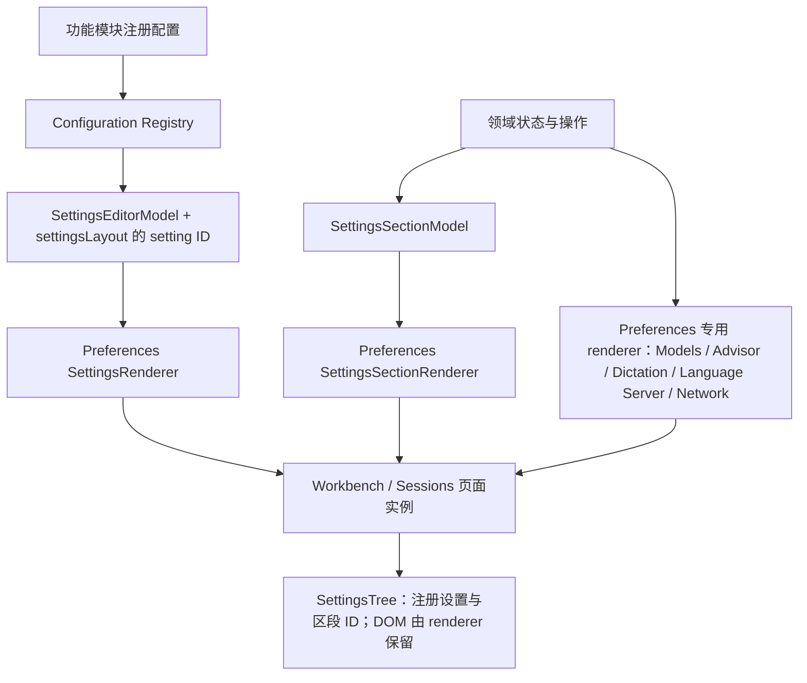
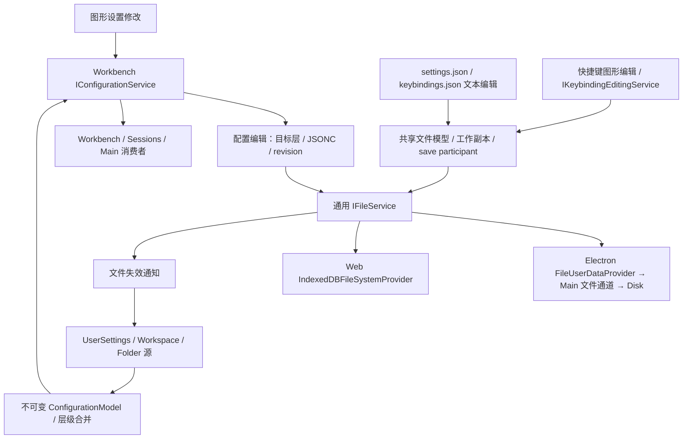

# Preferences、Settings 与 Configuration

> 适用范围：Ash TypeScript Workbench 与 Sessions 的偏好入口和编辑页面。配置存储背景见 [Browser foundation](browser-foundation.md#configuration-architecture)，设置接入规则见 [Preferences README](../src/ash/workbench/contrib/preferences/README.md)。

Preferences 负责打开偏好资源，Settings 是其中一种内容。配置读写、用户设置 JSONC 和快捷键独立资源的主链已接通；图形设置的目标与语言覆盖入口和部分真实环境验收仍未完成。具体动作统一维护在 [Configuration / Preferences TODO](../TODO.md#configuration--preferences--todo)。本文描述当前架构，不作为全部 VS Code 契约已对齐或当前 HEAD 验收通过的声明。

## 打开路径

[PreferencesService](../src/ash/workbench/services/preferences/browser/preferencesService.ts) 选择资源并交给 EditorService，不绘制控件或保存配置值；[preferencesActions.ts](../src/ash/workbench/contrib/preferences/browser/preferencesActions.ts) 注册打开命令。Sessions 的设置对话框提供自己的宿主，并复用打开选项校验、设置模型和 renderer；设置控件由 Preferences 创建。

| 调用                                         | 内容选择                                          |
| -------------------------------------------- | ------------------------------------------------- |
| `openSettings()` / `openUserSettings()`      | 按 `workbench.settings.editor` 选择图形页或 JSONC |
| `openSettings({ jsonEditor: false })`        | 本次明确打开图形页                                |
| `openUserSettings({ jsonEditor: true })`     | 本次明确打开用户设置 JSONC                        |
| `openGlobalKeybindingSettings(false / true)` | 分别打开快捷键图形编辑器 / JSONC                  |

`IOpenSettingsOptions` 支持 `query`、Ash 分类或区段 `section`、`jsonEditor`、`revealSetting` 和本地用户目标 `USER` / `USER_LOCAL`。[validateSettingsEditorOptions](../src/ash/workbench/services/preferences/common/preferences.ts) 在改变页面前拒绝错误类型、未知选项与未支持目标。`jsonEditor` 只覆盖本次打开，不修改默认编辑器。

`workbench.action.openSettings` 接受查询字符串或选项对象，例如 `"editor.fontFamily"`、`{ "query": "@modified" }`、`{ "section": "models" }`。图形页查询更新并聚焦当前搜索框；显式空查询清除筛选，未传查询保留原搜索，区段定位清除筛选。Workbench 服务持有固定 Settings 输入，pane 注册打开选项委托并在清空输入或销毁时释放。搜索值随页面释放，不写入配置。

## 设置内容与渲染

普通配置与服务区段共用设置树，复杂页面也由 Preferences 的专用 renderer 创建控件。领域模块只提供配置、数据与操作。

Preferences 负责搜索、分类、导航、控件、布局、主题、键盘与无障碍交互；功能模块拥有配置语义和领域业务状态。新接入只提供注册配置或数据与操作，不传 DOM、widget 或渲染回调。完整约束与迁移边界仅在 [Preferences README](../src/ash/workbench/contrib/preferences/README.md) 维护。

普通配置经配置服务读写；账号、密钥、模型发现、Hook 执行与权限继续归各自领域服务。GitHub、Trace、Sandbox、Search 使用数据模型和共享 section renderer，Hooks 使用同一 renderer 提供 Agent Customizations 管理入口。Models、Advisor、Dictation、Language Server 和 Network 的控件及 CSS 归 Preferences，模型发现与批量测试继续使用 Chat 领域 view model 和服务。

`SettingsTreeModel` 的区段和交互标题只保存 `SettingsSectionReference`，由当前打开实例的 `SettingsRenderer` 找到保留的控件；不再在可搜索元数据中传递 DOM。Sessions 的普通设置只声明 ID 和顺序，由 `DefaultSettings` 解析注册表中的类型、文案与选项。宿主专属条目使用 `setting.included: false` 退出自动目录，仍可按 ID 显式解析，不改变配置的存储、作用域或默认值。

### 搜索与设置操作

| 行为            | 当前契约                                                                                                                                                                                                        |
| --------------- | --------------------------------------------------------------------------------------------------------------------------------------------------------------------------------------------------------------- |
| 搜索            | 普通文本匹配 ID、标题、说明、关键词和标签；支持 `@id:`、`@modified`、多项 `@tag:` 和排除 experimental / preview 的 `@stable`，可组合使用。`@lang:` 尚未接通                                                     |
| 已修改与已配置  | 按配置服务已接受的本地用户覆盖判断，显式默认值、false、0、空字符串均算覆盖；语言覆盖块不标记基础设置，服务状态不进入已修改结果。成功保存、外部更新和重置同步刷新内容与目录，失败保留实际状态                    |
| 重置            | 删除对应覆盖并保留其他 JSONC；自有 binding 可提供 `isDefault()`                                                                                                                                                 |
| 复制设置为 JSON | 注册表驱动且无自有 binding 的行复制 `"键": 值`，不带外层花括号；执行时读本地用户值，无覆盖时读窗口默认值。标准 JSON 序列化、两空格缩进，本操作不保存配置                                                        |
| 在 JSON 中编辑  | 同类设置行的菜单及复杂值按钮调用 `openUserSettings({ jsonEditor: true, target: USER_LOCAL, revealSetting: { key, edit: true } })`；复用脏模型，缺失键以默认值插入未保存模型，保留注释和其他键，支持撤销并选中值 |
| UI / JSON 切换  | 精确注册 ID 查询可定位 JSON 已有键，不创建覆盖；显式 `revealSetting.edit` 才插入缺失键。查询不成为配置内容，切换不丢弃未保存 JSON 草稿                                                                          |
| 显示语言        | 常规页与配置显示语言命令共用语言服务，写入 `workbench.locale`；内置语言、已安装语言包及后续列表变化进入下拉框，重置清除偏好。搜索支持 language、locale 和“语言”                                                 |

Sessions 菜单使用对话框内的 ContextView，关闭时释放菜单与服务，执行或取消后焦点回到对应的更多操作按钮。已配置标记不进入 Tab 顺序，通过单一无障碍说明提供状态；悬停复用 Hover、当前 ContextView 和 `workbench.hover.delay`，移除覆盖或销毁页面时关闭。操作与失败反馈使用 NLS，剪贴板失败沿设置状态反馈。

产品和扩展 schema 由 `DefaultSettings` 收集；动态 registry 更新目录与已打开页面，扩展名来自本地化 manifest，撤回扩展不删除已保存值。样式归创建控件的代码：[settingsEditor.css](../src/ash/workbench/contrib/preferences/browser/media/settingsEditor.css) 负责页面，[settingsTree.css](../src/ash/workbench/contrib/preferences/browser/media/settingsTree.css) 负责分类树，[settingsWidgets.css](../src/ash/workbench/contrib/preferences/browser/media/settingsWidgets.css) 负责搜索与设置控件。

### 工具、沙箱与 GitHub

[ILanguageModelToolsService](../src/ash/workbench/contrib/chat/common/tools/languageModelToolsService.ts) 在 `chat.shared.contribution.ts` 注册，由 Workbench 与 Sessions 共享入口加载。browser 实现将 App Server DTO 转为整体替换的只读目录快照；消费者先 `refresh()`，再读取 `getAllToolsIncludingDisabled()`、可观察 `toolSets` 和引用查询。它不提供工具注册、启用或执行入口。

`EnvToolPorts.replace` 成功安装且目录内容变化后，沿 UpdateBroker 向同一 Environment 的连接发送空参数 `agent/tools/changed`。前端合并并发刷新及读取期间的变更通知，失效旧读取，替换快照后触发 `onDidChangeTools`；断线清空列表，重连后重读。已打开的引用与配置选择器订阅事件，保留搜索、仍存在的选项及未提交的禁用选择，关闭时释放订阅。

Skill 补全和引用通过 `getFullReferenceNames()`、`getFullReferenceName()`、`getToolByFullReferenceName()` 与 `IToolSet.getTools()` 消费同一快照。来源组名由来源类别与编码 ID 组成，空 ID 使用保留段 `@`，MCP 工具集使用 `/*`，外部引用带来源组前缀；后端 ID 保留为解析别名，选择和执行仍传后端 ID。Skill 的 `allowed-tools` 仅是目录提示，不授予权限。来源、权限和暴露方式是 Ash 元数据；当前接口无模型参数或目录版本，不提供模型筛选或完整 VS Code `ToolDataSource`。

设置与 MCP 详情消费同一工具契约；沙箱准备诊断由 [IAgentCapabilitiesService](../src/ash/platform/agentCapabilities/common/agentCapabilitiesService.ts) 提供，目录授权仍归 `IWorkspaceTrustApi`。GitHub 设置显示 Codex 登录与 Ash GitHub 账号、检查仓库访问并链接官方 Connector / 自动审查管理页；Ash 访问成功不代表官方 Connector 获授权。PR 页使用 GitHub 账号提交 `@codex review` 并分页读取评论与审查讨论；结果不确定时须先确认远端结果，不能重复提交。

## 快捷键资源与生命周期

快捷键使用独立的有序 `keybindings.json`，不经过 Settings 键值 API，也不增加 App Server 接口。图形编辑与 JSON 编辑共享当前 profile 的文件模型，经 `IKeybindingEditingService` 保存或移除绑定，保留注释、参数与其他绑定。

`KeybindingsEditorInput` 持有唯一 `KeybindingsEditorModel`，管理行和服务监听；各 pane 分别持有搜索与录制草稿。打开请求和 pane 分别取得输入引用，最后一个引用释放时销毁模型；重复打开、失败、取消和恢复输入均沿同一生命周期。Editor Part 释放 pane 而不自动释放传入输入，因此该引用规则留在 Preferences。

录制最多四段组合键，首个输入替换原值，第五段开始新序列并显示和朗读提示。裸 Enter 保存；裸 Escape 清空，再按一次取消；Tab / Shift+Tab 移动焦点。这些裸键绑定通过 JSON 编辑，带修饰键的 Enter / Escape 可录制；重复 keydown、IME 组合输入与纯修饰键不计入。

保存期间禁用草稿、行操作和取消按钮，失败保留草稿并允许重试。取消后返回原行按钮，行已被替换则返回搜索框；保存后仅在焦点仍属于当前页时聚焦搜索。清空输入或销毁后，异步结果不得更新退休草稿；隐藏页面或焦点转移后不恢复焦点。页面可以在保存未完成时关闭。

## Models 设置

以下行为由 Preferences 的 `ModelSettingsRenderer` 与 `ModelProviderSettingsRenderer` 呈现，模型目录、开关、发现和凭据仍通过所属服务操作。

Workbench 和 Sessions 共用 `ModelSettingsRenderer`。模型目录按供应商排列，同一供应商内按发布时间从新到旧排列；默认收起为每家供应商的首个模型，`viewall models` 展开或收起完整列表。当前显示的列表将已开启模型排在前面，两组内部保持目录原序；关闭后回到未开启组中的原有位置，与开启先后无关。列表顶部的模型搜索框按名称和 `provider/model` ID 搜索整个目录，搜索结果使用同一排序规则，清空搜索后恢复展开状态；API key 区域不参与这个局部搜索。键盘切换开关后，保存完成时焦点留在同一个模型上。

`ModelCatalogConfiguration` 拥有模型开关的界面默认值：只开启 GPT-6.1 Sol、GPT-6 Astra、GPT-6 Luna、Claude Opus 5.5、Claude Sonnet 5.5 和 Grok 4.7。其他内置、后续新增及自定义模型默认关闭。手动修改由配置服务写入同一份用户设置，模型选择器通过 `ILanguageModelsService` 使用这些开关。

`models.hidden` 保存偏离默认值的选择。已有 `{ provider, model }` 条目继续表示关闭，新增 `{ provider, model, visible: true }` 条目表示开启默认关闭的模型；`visible` 仅接受布尔值。恢复某个模型的默认值时移除对应条目，不保存另一份模型目录。

模型管理文件参考 VS Code 的职责分工：

| 文件                                                                     | 职责                                                                   |
| ------------------------------------------------------------------------ | ---------------------------------------------------------------------- |
| `workbench/contrib/chat/common/languageModels.ts`                        | 模型服务契约与实现；目录加载、供应商发现和测试操作，两个窗口各一个实例 |
| `workbench/contrib/chat/common/languageModelsConfiguration.ts`           | JSONC 设置声明、六个默认开启模型、模型开关数据格式                     |
| `workbench/contrib/chat/browser/languageModelsConfigurationService.ts`   | 模型开关、默认模型及上一次选择的保存与事件                             |
| `workbench/contrib/chat/browser/chatManagement/chatModelsViewModel.ts`   | 当前供应商的发现列表、手动声明、批量测试进度                           |
| `workbench/contrib/preferences/browser/modelProviderSettingsRenderer.ts` | 供应商表单、模型表格、键盘操作与行内编辑                               |
| `workbench/contrib/preferences/browser/modelSettingsRenderer.ts`         | 将模型管理接入两个窗口的设置树                                         |

API key 输入框失焦即保存，清空即移除；成功保存不弹通知，失败显示输入框错误并进入通知服务。密钥由后端 secret store 保存，界面只用掩码表示已配置状态。

`Test models` 测试当前表格全部模型，与启用开关无关；表格为空时先发现模型。`Refresh models` 重新发现，保留手动配置和启用选择。发现成功的空列表、尚未发现、发现失败是不同状态，失败保留之前成功的列表。批量测试逐行更新结果，最后只发一条汇总通知；橙点表示未通过，绿点表示通过，同时提供文字状态。探测通过不证明 1M 上下文可用。

`Add model` 添加 Model ID、上下文 token 数、可选上游 Model ID 与 1M 预设。上游 ID 映射只解析一次，由 Rust 在真正发送请求时使用；配置、开关和上下文绑定界面 ID。行内可编辑上下文和映射，也可删除手动声明；删除发现模型的手动上下文声明后，端点模型仍在表格中并关闭启用开关。Rust 的 models-manager 拥有发现与缓存，model-provider 拥有 HTTP 发现、分页和探测，成功发现的自定义模型进入聊天选择器。ChatService 只保留聊天、线程和 Advisor 配置操作。

## Configuration 的存储与配置层

图中配置重读分支解释设置文件；`keybindings.json` 由快捷键 owner 解释，Web 资源为 `ash-userdata:/user/keybindings.json`，Electron 使用当前 profile 文件。UI 的 `settings.json` 由 TypeScript 配置系统解释，Rust `config.toml` 归后端配置领域及其宿主入口。密钥归 secret store，页面搜索、选区与展开状态归 UI 状态。

Preferences 首次打开缺失的设置文件时以不覆盖方式创建普通 JSONC，竞争创建保留另一窗口内容。设置 JSON 值的 save validator 归 Preferences，文件 provider 不解释配置语义；非法保存保留脏草稿，外部非法 JSONC 保留最后有效配置。文件 revision、脏文件保护和冲突归通用文件服务与工作副本，配置层不保存第二份文件版本。

| 负责方                                                         | 职责                                                                         |
| -------------------------------------------------------------- | ---------------------------------------------------------------------------- |
| platform `configurationModels.ts` / `ConfigurationModelParser` | 值树、语言覆盖、合并与不可变快照；Workbench 复用 `parseRaw`                  |
| platform `configurationService.ts` / `UserSettings`            | 单资源读取、文件失效和父目录提示；Windows 按文件系统大小写规则比较           |
| Workbench `configurationService.ts`                            | 配置层组合、resource / folder 解析、inspection、keys、写入目标与资源定向事件 |
| Workbench `configuration.ts`                                   | Workspace / Folder 的 JSONC 源、watch、条件写入和切换生命周期                |
| Sessions `configurationService.ts`                             | 动态 registry 的窗口默认值与只读规则，不缓存第二套元数据                     |
| profile / 文件 provider / 工作副本                             | 资源身份、存储、revision、脏模型、save / revert 与冲突                       |

多根 Workspace 读取工作区文件的 `settings` 对象，Folder 读取所属根的 `.vscode/settings.json`；单目录窗口把后者解释为 Workspace 层。默认 → 用户 → Workspace → Folder 的普通值先组合，再应用语言覆盖，Policy 最后覆盖。单语言覆盖优先于组合语言覆盖；对象按成员合并，数组整体替换；旧事件与快照保持不可变。

Workspace 排除 application / machine 设置，Folder 进一步排除 window 设置；Sessions 固定值在用户、Workspace、Folder 和语言覆盖中均过滤。动态注册、撤回和重注册即时重建默认值与只读规则。写入只修改目标属性并保留注释；无显式目标时选已有最高层，删除时遍历已有层。脏模型先经原 owner save / revert，revision 拒绝并发冲突；工作区切换撤回旧 watcher 和写入信号，拒绝迟到读取。

配置专用 IPC、revision envelope、虚拟设置 provider 和浏览器旧持久化链已退出生产装配；旧 IndexedDB 配置仅一次性迁移。Web 备份仍归 `IndexedDbWorkingCopyBackupService`，不经过 Rust backup RPC。

## Policy 来源

Policy 的定义注册、值校验、最高优先级、写入限制和撤回均进入现有配置链。非法更新保留同一 setting／policy 身份的上次有效值；明确删除才撤回。系统来源和窗口组合来源分别归各自作用域的一个 policy service。

| 系统    | Desktop Main 的来源                                   |
| ------- | ----------------------------------------------------- |
| Windows | `HKLM\SOFTWARE\Policies\Ash`，DWORD 0／1 对应 boolean |
| macOS   | `/Library/Managed Preferences/com.ash.desktop.plist`  |
| Linux   | `/etc/ash/policies.json`                              |

Windows／macOS 的进程级 `SystemPolicyService` 每 2 秒检查变化，命令有 timeout、输出上限、退出取消及隐藏窗口；Linux 走文件 watcher。Workbench／Sessions 通过只读 `PolicyChannelClient` 消费 Main 的值，IPC 不开放任意路径或策略写入。策略定义不能在窗口间改变既有类型。`DesktopUpdateChannel` 映射 `update.policy` 的 `latest`／`stable`／`never`。

账户来源沿 primary grant → `IGitHubService.readManagedSettings(accountId)` → 可取消 App Server 请求 → `github/account/managedSettings` → 该账户的 GitHub client → `/copilot_internal/managed_settings`。协议只收账户及 operation ID，不收凭据或自定义 URL。HTTP 404／空对象撤回；权限、网络和非法输入保留同一账户的最后有效快照。登录切换取消旧请求，退出清空，迟到结果不能恢复旧账户策略；当前账户每分钟刷新。

`AccountPolicyService` 只解释 registry 声明的映射。`ChatDefaultModel` 将顶层 `model` 或旧 `permissions.model` 映射到 `chat.defaultModel`；顶层非空字符串优先，空白视为缺省。实际选择仍由模型目录和聊天偏好服务负责。`ChatAIDisabled` 仅为系统策略，不伪造 Copilot 字段。`MultiplexPolicyService` 组合系统优先、账户其次；映射函数留在 renderer，Main 只传类型声明和策略值。

## 页面与公开契约的边界

底层配置服务已有 Workspace / Folder 读写及语言覆盖，不表示图形 Preferences 已支持这些目标。当前图形打开目标仍仅为本地用户；Workspace / Folder 目标切换、`@lang:`、folder 定位、焦点模式和编辑器组选项须沿实际消费者闭合，不能只增加筛选 token 而继续写基础用户值。Ash 直接打开 SettingsEditor，尚未采用上游全部 Preferences 容器、pane registry 和公开 API。

已确认缺口、真实环境验收和待复核场景统一见 [TODO](../TODO.md#configuration--preferences--todo)；registry / schema、typed parse / serialize、`ashBinding` 等额外契约按真实消费者决定，见 TODO 的发展候选，不按上游成员表整体补齐。

## 已有验证与限制

存储迁移与跨平台验收的历史范围如下；设置渲染的检查范围另列于表后：

| 范围                        | 已有证据与适用限制                                                                                                                                                                                                                                  |
| --------------------------- | --------------------------------------------------------------------------------------------------------------------------------------------------------------------------------------------------------------------------------------------------- |
| 配置文件与迁移              | 模型、文件 IPC、Sessions、Settings JSONC、层级边界和真实 Chromium 旧 IndexedDB 迁移已有定向验证，包含冲突、非法输入、中断重试；历史类型检查、构建与中英文回归不代表当前 HEAD 全部通过                                                               |
| Workspace / Folder / Policy | 定向测试覆盖优先级、inspection、作用域、JSONC、切换、迟到读取、冲突与脏保护；系统 / 账户链和 Windows 固定注册表只读探测已有验证，macOS / Linux OS 来源及真实登录账户仍待验收                                                                        |
| 快捷键录制                  | 保存一致性基线 `2cc6ab4e` 上通过 13 项 recorder 单测、macOS Web 7 项及 Electron 6 项严格场景，覆盖两段 / 四段、JSONC / 参数保留、立即重载、失败重试、中文、焦点与 pending-close；Windows / Linux 未运行                                             |
| 验收未闭合                  | 配置迁移 smoke 曾出现辅助 live 选区文本滞后、Appearance `Unknown select option 'ash-dark'`，旧准备阶段的 App Server 文件访问 API 类型错误已通过重新生成协议解除；选区和 Appearance 场景仍须按 TODO 在当前 HEAD 复核，不能标作现存已复现故障或已通过 |

快捷键早期 Web 重载失败由 editor / backup owner 修复，原 recorder 场景与不打开 recorder 的对照随后通过；没有增加保存后等待备份删除或放宽文本断言。该批 Web / Electron 仍记录既有 Session catalog 与 syntax document 关闭期 console 错误，不能描述为所有 console 均无错误。

验证入口包括 [Settings 单测](../src/ash/workbench/contrib/preferences/test/browser/settings.test.ts)、[快捷键单测](../src/ash/workbench/contrib/preferences/test/browser/keybindingsEditor.test.ts)、[Settings smoke](../test/smoke/areas/windows/settings.spec.ts)、[Settings JSON smoke](../test/smoke/areas/windows/settings-json.spec.ts)、[快捷键 JSON smoke](../test/smoke/areas/windows/keybindings-json.spec.ts) 和 [Sessions Settings smoke](../test/smoke/areas/sessions/sessions-settings.spec.ts)。测试源码存在不等于当前运行通过。

设置渲染迁移已在 macOS 通过定向业务单测、Preferences 边界检查、中英文 Chromium 集成，以及 Browser / Electron 的 Workbench 和 Sessions 设置窗口场景。覆盖查询复用、配置保存与重开、菜单焦点、模型管理表单、听写设置和分类搜索；Web / Desktop 构建通过。上述结果不包含真实 App Server 模型发现、Windows / Linux 或真实系统 Policy 来源验收。
