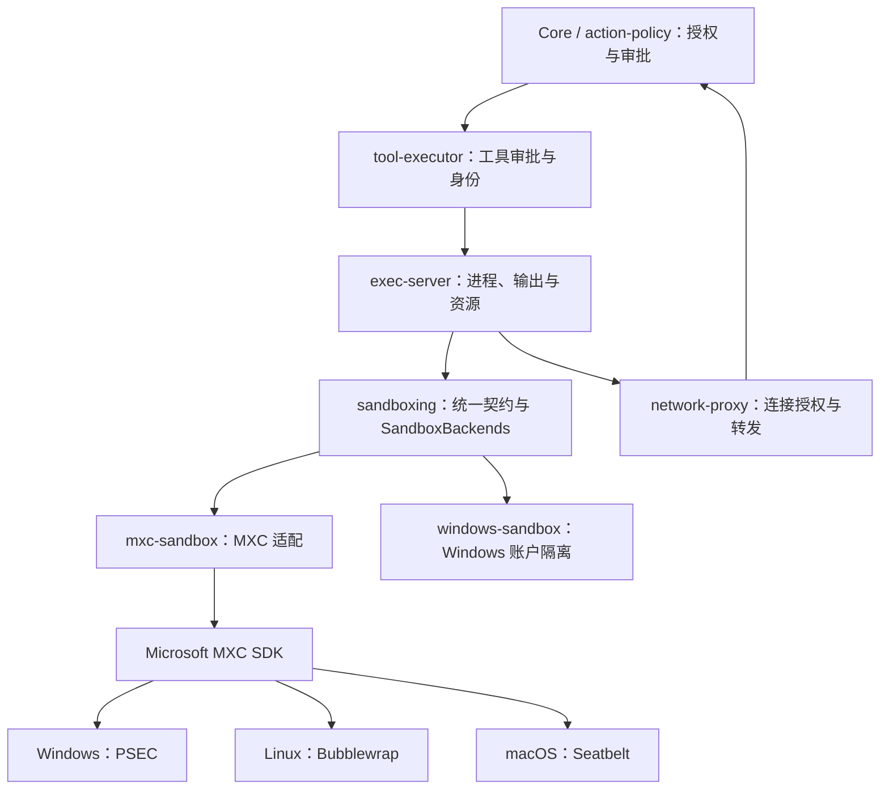

# 沙箱架构

Ash 的 `sandboxing` 拥有统一权限契约和执行前的后端选择。请求先确定最低隔离要求，再选择能实施该请求的后端；选择过程不得改变隔离模型。本文维护所有权、权限语义及平台边界；SDK 接入由 [MXC 适配器](../crates/mxc-sandbox/README.md) 维护。

## 调用与所有权

产品在 Windows 上按 `mxc`、`windows` 顺序注册两个候选；Linux/macOS 只注册 MXC。Windows 本地工具选择 `WindowsAccount` 作为最低隔离要求，能力足够时仍优先使用 PSEC。账户后端接入安装身份、授权、运行器和打包，产品采用 Codex 的 Windows 账户模型，`Strict` 的保证仍由支持它的独立后端承担。

| Owner                        | 职责                                                                                        |
| ---------------------------- | ------------------------------------------------------------------------------------------- |
| `action-policy` / Core       | 操作及网络授权、审查、持久审批、重试决定                                                    |
| `sandboxing`                 | 策略、目录范围、候选选择、准备与进程契约                                                    |
| `tool-executor`              | 工具审批检查与任务身份适配                                                                  |
| `exec-server`                | `LocalSandbox` 统一配置平台候选；进程及持续执行会话、输入输出、预算、超时、取消和代理作用域 |
| `utils/pty`                  | PTY、管道、尺寸、信号与已有进程驱动；不负责授权和后端选择                                   |
| `network-proxy`              | 检查真实连接目标，执行授权结果并转发                                                        |
| `mxc-sandbox`                | 请求、错误和进程句柄的机械转换                                                              |
| 具体后端                     | 系统能力检查、进程创建、隔离与清理                                                          |
| App Server / Hook / 独立服务 | 提供权限要求，通过 `LocalSandbox` 取得统一后端；不自行注册平台候选或判断系统版本            |

后端 crate 依赖统一契约，统一契约不依赖 MXC 或 Codex。平台 crate 用于能力和依赖隔离，不按转发层数拆 crate。`windows-sandbox` 当前还直接使用固定 MXC 版本的 `mxc-sdk` 的 `mxc_common` 策略类型与 ACL 日志；这项共享依赖保留在后端内部，其变更必须同时验证两个消费者，不能宣称两个后端在实现依赖上完全独立。
授权语义见 [permissions.md](permissions.md)，审查语义见 [guardian.md](guardian.md)。

## 选择与执行

以下是执行契约。

1. Executor 为已授权请求建立代理，Manager 验证并解析工作目录。
2. `SandboxBackends` 按注册顺序准备候选；每个候选收到完整且相同的策略和目录范围。
3. 只有明确的能力或策略不支持可以产生 `UnsupportedPolicy` 并考虑下一候选。此结果必须发生在命令启动和宿主配置变更之前；下一候选仍须满足同一最低隔离要求。
4. 无效请求、运行时损坏、读取错误和其他运行故障直接返回，不能用换后端掩盖。
5. 准备成功后固定后端。任何启动错误都不触发重新选择或自动重跑。
6. 被选中的后端随 `PreparedCommand` 移交给 `ProcessHandle`，由它解释该进程的拒绝证据；不保存全局“当前后端”。
7. 结束时终止并等待进程树，排空输出，再释放隔离资源和代理。

注册的候选必须完整实施请求。准备出普通进程不能满足受限请求；只有显式 `FullAccess + Allowed` 且单目录、无隐藏范围时使用普通进程。
能力检查可以创建并释放临时 PSEC 环境，但不能启动用户命令、配置账户或修改持久 ACL/WFP 规则。只有已确认的 API 或请求能力缺失映射为 `UnsupportedPolicy`；加载、访问、资源、查询及清理故障保留操作名和系统错误码，不能靠错误文本或布尔探测授权重选。支持清单必须同时满足运行时能力与对应平台的实际验收。

## 权限契约

以下规则描述权限契约；各节同时列出当前能力限制。

- `ReadOnly` 将授权目录设为只读；`DirectoryWrite` 开放授予的可写目录，并保护已存在的目录元数据。macOS 还按名称保护尚未创建的 `.git`、`.agents`、`.codex`、`.ash`。
- `FileSystemIsolation::Strict` 另要求授权目录外不可写，是构造策略的默认值；`WindowsAccount` 接受账户、ACL 和有预算限制的审计模型。两者表示请求接受的最低保证，不是指定后端的开关。
- 账户后端拒绝 `Strict`，也不提供 `FullAccess` 与受限网络的组合。缺少 PSEC 时不能把这些请求改成 `WindowsAccount` 或普通进程。
- Windows 本地工具在 `local_tools.rs::local_isolation()` 中明确选择 `WindowsAccount`；Linux/macOS 选择 `Strict`。这是产品在授权请求形成前确定的规则，不是在探测失败后修改策略，也不意味着三平台具有相同强度的宿主写隔离。
- `FullAccess` 扩大文件权限，但不清除明确的隐藏、只读或网络要求。
- 本地命令获得普通执行批准时，仍保留明确的路径拒绝要求，以 `FullAccess` 和获准的网络范围交给能实施它的沙箱后端；没有合格后端就拒绝执行。执行前快照只覆盖当时命中的路径，macOS 持续模式还覆盖执行期间的新匹配文件。
- `Denied` 禁止连接外部与宿主 IP 网络，包括宿主回环，并阻止来自这些网络的入站；`Managed` 只开放本次执行的代理端点，代理再检查真实目标；`Allowed` 允许网络。后端不能实施完整组合时拒绝准备。
- `SandboxScope` 隐藏共享存储并开放本次 Grant，拒绝重复、重叠或跨 Environment 的目录集合。
- `HostAclChanges::Scoped` 只授权 Grant 与隐藏目录内的 ACL 配置；`ScopedWithTraversal` 另允许必要祖先目录的非继承属性查询与遍历权限（0xa0），不允许枚举目录或读取其文件内容。Windows 本地工具显式使用后者。
- 祖先属性 ACL 的写入和恢复只作用于当前目录，保留原始继承标记；不使用会重算整个子树的写回接口。
- 授权目录的继承传播另记录原先没有 `AI` 的对象，每次传播及异常恢复后恢复其控制标记，保留其他执行的权限项。
- 账户、服务、持久网络规则与设备 ACL 的安装授权必须独立处理，不能隐含在普通命令准备中。
- 子进程输出只是可能已有副作用的诊断，不能据此声称用户代码没有执行。

### 文件权限目标

- `SandboxScope` 已支持归属于目录 Grant 的精确路径规则与执行前模式快照，本地工具目前固定拒绝 `**/.env`。macOS 另支持拒绝与只读的持续 glob，由 Seatbelt 覆盖新匹配路径和匹配目录的后代；其他后端仍拒绝持续模式。尚未完成用户可配置的任意路径规则、所有授权执行路径的一致性和跨平台实机验收。长期契约仍需保留 Grant 来源与 Environment 归属，并覆盖单文件/目录的读、写、拒绝、可读基线及路径例外。
- `HostReadScope::Host` 与 `Minimal` 分别表达宿主读取和最小工具链读取；宿主读取不能被描述成最小可读集合。最小模式只加入获准的工具链、运行库及数据路径。
- 策略统一解析路径、大小写、符号链接、文件对象身份和规则交叠。同一路径的明确拒绝优先；更具体路径例外必须保留授权来源，并检查后端是否能够实施，不由各后端自行解释冲突。
- 隐藏共享存储中重新开放已授权工作目录，是存储隔离范围的例外；不能机械转换为 MXC 的“拒绝整个父目录，再允许子目录”。明确 `deniedPaths` 在部分后端最终覆盖允许规则，必须保留现有例外补丁或生成等价策略并验证。
- 拒绝模式匹配需要区分执行前快照与执行期间新建的匹配文件。有限遍历不能被描述成持续匹配保证；后端不支持请求要求时明确拒绝，不能遗漏规则后启动。
- 快照命中的单文件若存在多个或无法确认的硬链接，准备阶段拒绝本次请求；路径规范化本身不能封住另一个硬链接名称。执行期间由外部进程改变链接关系仍需平台级验收，不能据此宣布对象级隔离完成。
- 文件读取、搜索和补丁工具也必须实施同一授权结果，通过现有 `file-access` 校验入口落地；不能只约束 shell。`file-access` 不反向依赖 `sandboxing` 或供应商类型。

前端搜索和过滤继续在本地使用 TypeScript glob；沙箱权限由 Rust 后端解析、校验和执行。统一的是路径语法约定和共同测试案例，不能把前端生成的正则或匹配结果作为授权依据。`*`、`**`、`?`、备选、ASCII 字符类和反斜杠分隔符已有两端用例；前端专用的相邻文件 `when` 条件不属于权限规则。macOS 支持 Unicode 字面量，拒绝不能等价转换到 Seatbelt 的非 ASCII 字节字符类及持续模式写授权。

macOS 策略固定可写根和受保护路径的祖先目录，防止移动目录绕过路径限制；受限文件权限还拒绝 `F_MAKECOMPRESSED`、`F_TRANSFEREXTENTS`，堵住只读描述符的修改路径。这些边界由 SDK 基础策略和 Ash 持续规则共同实施，管道与 PTY 使用同一策略。

### 网络与本地进程通信目标

- 保留 `Denied`、`Managed`、`Allowed` 作为产品的常用选择；完整请求分别表达外连、入站、宿主回环及本地进程通信。后端能力耦合不能成为修改授权的理由。
- `Managed` 的目标授权由 Ash 代理实施。MXC 负责使代理可达并限制其他出口，不会替外部代理安装域名规则，也不会把任意 TCP/UDP 客户端透明转换成 HTTP 代理客户端。
- Windows PSEC 的代理身份、私有网络双向能力与 Ash 默认禁止入站存在接入约束，见 [Windows 候选评估](#windows-候选评估)。
- Unix socket 是独立的 IPC 权限，不再用 IP 网络是否受限决定全部禁止。目标是在本次执行的私有临时目录中允许构建工具需要的 socket，并显式拒绝 Docker、SSH/GPG agent 及其他任务的 socket；不得通过授予整个共享临时目录来取得兼容性。
- macOS 没有私有 TCP 回环；Seatbelt 的宿主回环限制也会影响同一任务的 TCP 服务。后台开发服务器须带明确监听授权，或采用可实施的 IPC/转发方案；不支持的入站组合应拒绝。

### 桌面资源与工具环境目标

- Windows 命令兼容性包含 Win32k、桌面句柄、原子表及控制台需求，不能只看命令有没有可见界面。PowerShell 的启动策略必须明确指定并验证，同时保持剪贴板、输入注入和系统设置限制。
- 文件授权、桌面资源、令牌限制 SID 与网络分别实施；某一类拒绝不能靠扩大另一类权限解决。PSEC 的默认 UI 初始化失败与账户原型的 CLR 私有命名空间失败分别诊断。
- 环境由执行器明确构造，过滤凭据和宿主代理变量；PATH、HOME、TMP/TEMP 必须与授权的工具链及执行私有目录一致。只设置 PATH 不授予工具安装目录的读取/执行权限。

## 持续执行与终端

`tool-executor` 检查审批后调用 `exec-server`；`sandboxing::SandboxProcess` 提供管道、PTY、等待和关闭。Unix 的 MXC 受限 PTY 由 SDK 创建和持有。Windows MXC 保留宿主明确配置的内部启动器。WindowsAccount 的 ConPTY 由账户运行器创建并持有，通过私有管道传递输入、输出、尺寸及中断。

- `exec-server` 拥有持续执行的进程记录、输出游标、等待预算、硬超时、输入和终止；工具层和远程接口不复制这些状态。
- 后端在准备阶段检查管道或 PTY 能力，创建时一并施加隔离。`utils/pty` 适配已被沙箱创建的进程；不能另开一个普通 shell 来实现交互。
- 会话标识绑定调用方、Thread、Environment 和不可变授权快照；后续输入/读取不能跨任务或扩大权限。等待返回不关闭仍在运行的进程，硬超时、显式终止及所属任务销毁才回收资源。
- 输入关闭、前台中断和整个进程树终止分别表达。输出需要有界缓存及明确的截断/缺口信息；PTY 的 stdout/stderr 合并，管道保持分离。终态在回收进程树及排空尾部输出后确定。
- 复用执行进程的生命周期，不引入 MXC 命名容器来模拟会话。进程退出后本次隔离资源结束；不承诺 App Server 重启后仍可重新接入已退出或已回收的进程。

会话接口与保留期见 [执行服务](../crates/exec-server/README.md#进程所有权)，平台终端接入见 [MXC PTY](../crates/mxc-sandbox/README.md#pty-启动)。

## MXC 接入边界

- SDK 来源与兼容差异由 [MXC 依赖](../third_party/mxc/README.md) 维护。请求使用 typed V1 接口；文件身份快照、ACL 授权范围和 Windows PTY 交接格式由 Ash 持有，SDK 负责策略实施及进程清理。
- Windows 的 Ash 请求要求 MXC 只使用 PSEC；内部其他 ProcessContainer 实现不能代替它。准备阶段必须区分确定的能力不足与运行故障，不能把任意探测错误转换成 `UnsupportedPolicy`。
- 按运行时能力检查 PSEC，不能用“24H2 以上”代替检查。
- Linux 与 macOS 继续通过同一适配器接入 Bubblewrap 和 Seatbelt。Bubblewrap 在启动时安装禁止 `AF_VSOCK` 的 seccomp 过滤器，阻止 WSL 互操作创建不受 Linux 命名空间约束的 Windows 进程；过滤器由后代继承。

## Windows 候选评估

PSEC 按本次请求创建并关闭临时环境，检查启动属性、文件拒绝、网络、UI 和输入输出能力；拒绝捕获能力仅在请求启用时检查。系统版本、API 导出和缓存的布尔探测不能替代完整准备。启动前重新检查文件身份，变化或故障直接停止。

PSEC 的 `allowedProxyPeer` 可以绑定代理身份，但其私网代理模型要求允许双向的 `privateNetworkClientServer`，与 Ash 默认禁止未授权入站的 Managed 要求冲突。仅补齐代理身份或放宽宿主回环不能满足原请求；当前适配器在准备阶段拒绝此组合。WindowsAccount 请求再检查账户候选，Strict 请求没有合格候选时拒绝。

[`windows-sandbox`](../crates/windows-sandbox/README.md) 拥有独立账户、限制令牌、ACL、WFP 和进程树；它使用有预算的可写路径审计，不承诺整个宿主只读，也不满足 Strict。每次执行独占账户租约和 ACL 日志；先回收进程树，再恢复授权，未完成恢复阻止账户复用。

[`windows-sandbox-service`](../crates/windows-sandbox-service/README.md) 拥有 SCM、管理管道认证和安装操作。安装身份、程序路径和摘要由冻结的 InstallContext 提供，账户与程序状态由管理员持有。安装、更新、修复和卸载需要独立授权；`HostAclChanges::Scoped` 只覆盖 Grant 与隐藏目录，不能批准账户创建、持久网络对象或设备 ACL 修改。

普通 AppContainer／LPAC 令牌存在授权外写入反例；叠加独有写入限制 SID 的候选无法初始化 cmd／PowerShell，因此未作为 Shell 的 Strict 后端接入。

## 验证入口

文件、网络、终端和进程生命周期使用 [MXC 适配器测试](../crates/mxc-sandbox/README.md#验证)。Windows 的 PSEC、账户服务与虚拟机环境使用 [Windows 验收入口](windows-sandbox-acceptance-runbook.md)。验证结论限于实际运行的系统、策略和执行边界。
