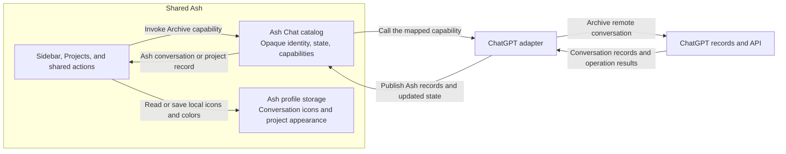

# Sessions list

> **Specification change gate:** Do not update this document for row rendering, styling, actions, picker flows, or bug fixes. Update it only when placement precedence, state ownership, or a cross-surface list contract changes.

## Scope

The Sessions list is the primary navigation surface in the Agents Window. It aggregates provider-neutral sessions into a grouped, filterable tree and owns user presentation state such as pins, custom groups, ordering, and collapsed sections.

This specification defines stable placement and state-ownership rules. Row styling, labels, icons, action placement, animation, picker workflows, and implementation algorithms belong in code and focused tests.

## Ownership

| Concern                                          | Owner                                                        |
| ------------------------------------------------ | ------------------------------------------------------------ |
| Session catalog and lifecycle                    | `ISessionsManagementService`                                 |
| Pins, manual row order, and automation filter    | `ISessionsListModelService`                                  |
| Attention classification and ignored occurrences | `IBlockedSessionsIndicatorService` shared with the title bar |
| Sidebar collapse state                           | `WorkbenchObjectTree` and the sidebar's profile preferences  |
| Custom groups and membership                     | `ISessionGroupsService`                                      |
| Top-level group/workspace order                  | `ISessionSectionOrderService`                                |
| Tree interaction and drop targets                | `SessionsListTree`                                           |
| Desktop contributed projects and paging          | Conversation catalog sources and their projection            |
| Row rendering, keyboard focus and scrolling      | Sidebar view and list controls                               |

Desktop Chat and Code each retain a Sessions tree with its own grouping, sorting, row order, and collapse state. Pins and custom-group membership remain attached to their conversation identities. Native Session rows retain their thread hierarchy. Workspace grouping uses the Agent's bound execution directory, which can be a worktree or container for the same Project.

### Conversation adapter boundary

Shared Ash code sees conversations through the Ash Chat catalog contract. The adapter translates ChatGPT conversations into that contract before the views and actions consume them.

Ash Chat owns the conversation experience across response backends. The shared catalog supplies Fork relationships and navigation to the sidebar. Native Chat uses the parent Thread recorded by App Server. For contributed conversations, Ash stores the relationship under the account-scoped catalog identity, using the backend's confirmed Fork result or verifiable history evidence. Response backends supply those facts and implement conversation operations through the catalog contract.

| Layer                   | Works with                                                                           | Responsibility                                                                                                                              |
| ----------------------- | ------------------------------------------------------------------------------------ | ------------------------------------------------------------------------------------------------------------------------------------------- |
| Ash views and actions   | Ash catalog conversations with an opaque identity, state, and supported capabilities | Render conversations and invoke Ash capabilities. For example, `agentSession.archive` calls the selected conversation's Archive capability. |
| ChatGPT adapter         | ChatGPT records, remote identifiers, and APIs                                        | Publish Ash catalog conversations, implement their capabilities, and publish the resulting Ash state after a remote operation.              |
| ChatGPT                 | Remote conversation and project data                                                 | Own the remote records and their lifecycle, including conversation archive and project creation.                                            |
| Ash profile preferences | Scoped catalog identity and Ash presentation settings                                | Read and save conversation icons and project appearance locally.                                                                            |

The shared New action invokes the contributed draft-opening capability. The adapter resolves its own default entry and opens a draft through the shared editor contract. Conversation sources publish scoped preference identities and identity changes. Ash retains or transfers the saved icon when a source replaces an identity.



### Project catalog scope

Chat and Code projects retain separate membership scopes. Each sidebar reads the project catalog for its mode and displays conversations of the corresponding kind. The Projects page, Chat Search and the Chat sidebar read local Chat projects. The Projects page and sidebar also show projects supplied by Chat providers. The Code project picker reads Code projects. Each scope has its own memberships even when both projects include the same Ash conversation. App Server persists the scope for newly created projects and recognizes legacy workspace-derived project IDs as Code. Other legacy local projects remain in Chat.

The Desktop Chat sidebar and Projects consume the conversation catalog contract owned by the Chat contribution. Sources supply opaque conversation and project identities, membership, paging state, and operations. The Desktop Chat sidebar shows pinned projects in Pinned and other active projects in Projects. Each project can expand to show its conversations. Project membership also keeps unpinned conversations out of Recent. A pinned conversation has a shortcut in Pinned and remains visible inside each of its projects. The Projects main page groups conversations by project identity regardless of their source, includes pinned conversations in their projects, and loads project history when a project opens. A conversation with a known project links back to that project from its header. The views keep only their presentation state.

### Catalog project ownership

Apply the same catalog contract to project operations. An adapter maps the provider's supported project operations to the capabilities of its Ash catalog records. For creation, the adapter creates the project in the target catalog and supplies the resulting record through that catalog.

Keep catalog project icons and colors in Ash profile preferences, keyed by account and project identity. Open and save appearance using the catalog record and local storage, independently of provider authentication and project-detail requests. Route each edit by data ownership, even when fields appear in the same form.

The table describes the current entry points and effects.

| User action                                                                                                                                                                                   | Owner and effect                                                                                                                                                                                                                                                                                          |
| --------------------------------------------------------------------------------------------------------------------------------------------------------------------------------------------- | --------------------------------------------------------------------------------------------------------------------------------------------------------------------------------------------------------------------------------------------------------------------------------------------------------- |
| Change or reset a project icon or color                                                                                                                                                       | Ash Projects reads and writes the same profile preferences for the sidebar and Projects page. The ChatGPT adapter supplies the scoped identity.                                                                                                                                                           |
| Pin or unpin a project, expand or collapse its sidebar row, or change the Projects sort order                                                                                                 | Ash stores the presentation preference. Expanding a row can separately load its conversation history through the provider.                                                                                                                                                                                |
| Open **Edit details** for a ChatGPT project, rename it, or save changes to its goals                                                                                                          | The ChatGPT adapter reads the provider details and writes changed names or goals to ChatGPT.                                                                                                                                                                                                              |
| Browse ChatGPT project history, move a ChatGPT conversation into or out of a ChatGPT project, create a ChatGPT project through **Move to project → New project**, or delete a ChatGPT project | The ChatGPT adapter reads history or changes the remote project and conversation membership.                                                                                                                                                                                                              |
| Use **New project** on the Ash Projects page                                                                                                                                                  | The shared project form creates the project through the selected owner. Ash App Server stores local projects and their materials. The ChatGPT adapter creates cloud projects in the current account. **Move to project → New project** uses the same form with the conversation’s project owner selected. |
| Archive or restore a ChatGPT project in Ash                                                                                                                                                   | Archive first archives its active conversations through ChatGPT, then records the project’s archived status in the account-scoped Ash profile. Restore clears that local marker. The conversations remain archived.                                                                                       |

The sidebar and Projects page invoke `projects.archive` to archive a project’s active conversations before marking the project archived. A partial failure leaves the project active so the command can retry the remaining conversations. The Archived view uses the project owner’s restore operation.

List-owned state is local presentation state. It is not synchronized back to a provider and must not mutate provider timestamps or metadata.

## Inputs

The list consumes sessions from `ISessionsManagementService`. Providers expose workspace, quick-chat, and archived state through provider-neutral fields. The Session catalog exposes durable automation creation provenance. The sidebar uses that metadata for its automation filter, including after the automation plan has been deleted.

Code and the regular IDE project saved Ash conversations from the same provider catalogs. An active conversation can be opened and continued in either surface with its existing execution context, including when it has no execution folder. Code's project and folder requirements apply to draft creation.

Sessions created by automation runs are hidden by default, with an exception for the active session. Chat and Code share the automation visibility preference and per-session overrides. The reply-based mode lists an automation session after the first accepted user submission. The profile remembers the Include Task Run Conversations filter independently of the default policy. The filter includes task runs unless the user explicitly hid the session. Runs that continue an existing conversation leave its classification intact. Automations retains its own run history. Surfaces that need session-row presentation without sectioning use `SessionsFlatList`.

## Placement precedence

A session appears in exactly one primary section. Higher-precedence states win:

```text
Archived
    > Pinned
    > Needs Attention (when shown)
    > Project (Code, when shown)
    > Custom group
    > External (when dedicated sectioning is enabled)
    > Quick chat
    > Workspace or date group
```

- Archived sessions appear only in the final archived section.
- Pinned sessions appear in the pinned section, retaining their project and custom-group membership. Unpinning derives placement from that membership again.
- Needs Attention uses the same background Session, host, and occurrence rules as the title bar. Eligible unpinned rows temporarily move into the section within the existing tree and open the Thread associated with the alert. The profile preference and section collapse are presentation state. Resolving or ignoring an alert restores ordinary placement without modifying its memberships or manual order.
- The Desktop Chat sidebar nests project members under their project when the sidebar shows projects. The Projects page provides access to project home pages. The standard Sessions list keeps Chat conversations flat within their custom group or the conversation section.
- A valid custom-group membership places an unpinned, unarchived session in that group, including a quick chat.
- When dedicated external sectioning is enabled, remaining external sessions appear together before the archived section. Pinning and custom-group membership retain their precedence; disabling sectioning returns external sessions to the ordinary grouping rules without changing that presentation state.
- Remaining unpinned quick chats appear in the dedicated chats section.
- Remaining sessions follow the grouping selected for their list.
- A regular session created by another regular session is initially placed
  immediately after its creator. While it has neither custom-group membership
  nor an explicit ungrouped preference, it inherits the creator's custom group
  when one becomes available. Subsequent user grouping, ungrouping, and
  reordering are ordinary persisted list state.

The active session remains visible even when a filter would otherwise exclude it.

A caller can acquire a disposable reveal of a session row or its archive action for onboarding. The list temporarily includes that session despite filters and presentation caps, expands its section, and exposes the requested spotlight target. An archive-action reveal also keeps the action visible without hover or focus. Releasing the reveal restores normal filtering and action visibility without changing the user's saved filters.

## Grouping

### Sidebar grouping

Chat and Code each remember a sidebar grouping choice. In Projects, project members appear under their project and unassigned conversations go directly into Recents. In Flat List, Recents also includes unpinned project conversations available in the catalog. The sidebar omits project headings in that layout. Switching layouts preserves project membership, pins, and custom group membership.

Repository, management status, and environment grouping apply to otherwise ungrouped conversations in Recents. Pins and explicit groups retain their placement. Hiding comparison groups displays their attempts as ordinary conversations and preserves the saved comparison membership. Repository grouping reads metadata through the session's authorized host. Environment grouping uses the saved session execution authority and runtime workspace.

### Legacy Code projects

The Projects section shows projects with a Project record. When the Code sidebar first loads the saved Session catalog for a profile, it creates or reuses Code projects for legacy local workspace groups and links their active, unassigned conversations. Existing project and custom-group memberships take precedence. The migration runs once so that deleting a project or removing a conversation from it stays effective.

### Date grouping

User-created groups remain a contiguous user-managed block. Ungrouped sessions follow in fixed date sections.

### Quick chats

Quick chats are identified through `ISession.isQuickChat`, not by checking for an absent workspace. They remain session rows; the list never exposes `IChat` objects as top-level rows.

### Archived sessions

Archiving removes custom-group membership. Restoring a session does not restore its former membership, except when undoing a bulk archive from the list: that operation restores the captured membership if the group still exists. User-facing archive terminology may vary, but the underlying archived state and placement rule do not.

## Durable user intent

Pin, group, and ordering state survives temporary provider-catalog removal. Providers may transiently publish incomplete catalogs while reconnecting or hydrating, so `onDidChangeSessions.removed` is not proof of deletion.

List-owned state is removed only when:

- the management service reports definitive deletion;
- archiving invalidates group membership;
- the user explicitly changes or removes the state.

Stale entries that match no current session are inert and may be compacted by their owning service.

## Sorting and filtering

Chat and Code remember the sort field and direction separately in the profile. Manual row order is scoped to the sidebar mode, section, and sort selection. It applies to durable session rows and leaves nested chats in provider order. Unordered rows follow their default list order. Custom section order is scoped to the sidebar mode and preserves fixed sections.

Filters compose across session type, status, archive/read state, and provider. The archived filter governs both archived sessions and archived nested chats; there is no per-session archive-visibility override. The agent host filter scopes to every provider the selected host entry covers, which is more than one when that entry groups several hosts and none while such a group is empty. The find widget matches session and section labels and bypasses presentation capping while a search is active.

## Drag and drop

Chat and Code supply row capabilities to the same list tree. The tree interprets the destination, and the row's source owns the mutation. A drop from the Pinned shortcut into Recents unpins the conversation and retains its memberships. A drop from a project row into Recents removes that project membership.

- sessions may reorder within valid sections;
- sessions may move into user-created groups;
- non-archived sessions may move into the pinned section;
- user groups and workspace sections may reorder where the grouping mode allows;
- dropping sessions on the Sessions grid opens them through `ISessionsService`.
- dropping a conversation on another composer on the same host attaches a transcript snapshot through that composer's context acquisition.

Archived and fixed sections are not reorder targets. Multi-selection preserves relative order.

## Reactive presentation

Rows derive title, status, workspace, changes, capabilities, and quick-chat identity from session observables. Renderers must support tree virtualization: reusing a row template for another session must not retain stale state, animations, hovers, or disposables.

Row renderers use tree-supported row classes and APIs rather than traversing tree-owned DOM structure.

Session facades may expose catalog-backed peer-chat identities, titles, and interactivity before detailed chat state is loaded. Rendering a virtualized peer-chat row requests provider-neutral chat hydration through `ISessionsManagementService`; collapsed and offscreen sessions therefore do not require eager per-session state loading.

## Persistence

List presentation state is profile-scoped user state. This includes grouping, sorting, filtering, section and nested-session collapse, pins, custom groups, manual sort keys, and section order. A nested session starts expanded, and the user's later collapse or expansion choice persists across list and window recreation. Storage keys are private implementation details; other components change list state through the owning service API.

## Change policy

Update this specification only when placement precedence, state ownership, or a cross-surface list invariant changes. Express concrete row behavior, menu enablement, picker flows, and regressions in focused tests instead.

## Related specifications

- [Sessions architecture](SESSIONS.md)
- [Layout](LAYOUT.md)
- [Mobile](MOBILE.md)
