<!-- auto-generated by CI — do not edit manually -->
<!-- environment: {"platform":"win32","browserVersion":"149.0.7827.55","channel":"chromium"} -->

#### shared/ButtonsAndMenu/ash-dark

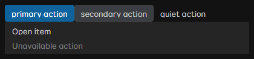

#### shared/ButtonsAndMenu/ash-high-contrast-dark

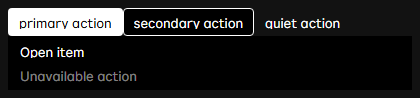

#### shared/ButtonsAndMenu/ash-high-contrast-light

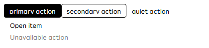

#### shared/ButtonsAndMenu/ash-light

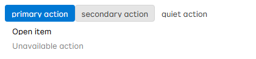

#### shared/SelectAndList/ash-dark

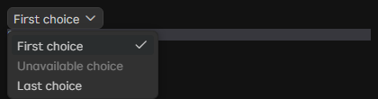

#### shared/SelectAndList/ash-high-contrast-dark

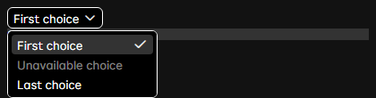

#### shared/SelectAndList/ash-high-contrast-light

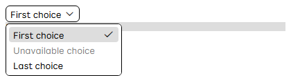

#### shared/SelectAndList/ash-light

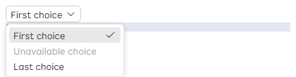

#### shared/TreeAndInput/ash-dark

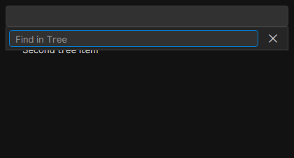

#### shared/TreeAndInput/ash-high-contrast-dark

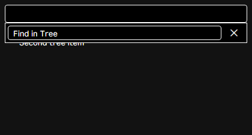

#### shared/TreeAndInput/ash-high-contrast-light

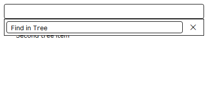

#### shared/TreeAndInput/ash-light

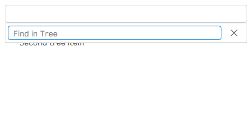
